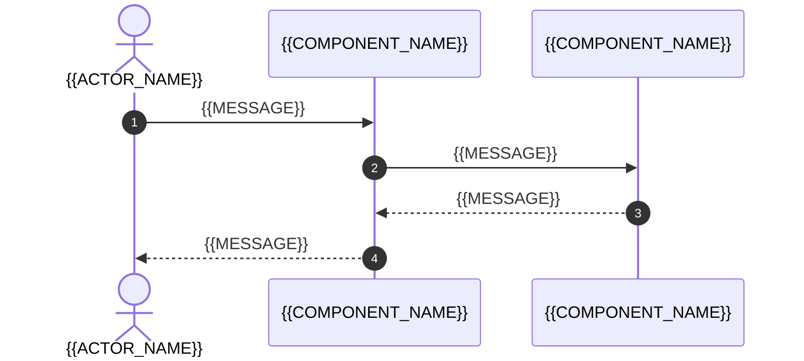

# Codebase Summary: {{PROJECT_NAME}}

<!-- fill: Copy to docs/brownfield/CODEBASE_SUMMARY.md at step 0a (brownfield/PLAYBOOK_BROWNFIELD.md). The document is a snapshot of the current state at the commit in §1, frozen after Gate 0R. Every claim about the source code carries evidence: a file:line path in inline code, or a command that was run with its exit code. Do not record the value of any secret, token or personal data that can be read in the repo. Fill §1 to §6, §8 and §9 by reading files and by read-only commands (git, listing files, counting lines), without running project commands yet; run the commands in §7 only when §2 is met (brownfield/PLAYBOOK_BROWNFIELD.md §5.1). The frontmatter assembled_from records "brownfield/00_Codebase_Summary_Template.md@<template_version>". -->

## 1. Scan Scope

| Item | Value |
| --- | --- |
| Code repository | <!-- fill: repo name or path --> |
| Measured branch and commit | <!-- fill: branch name, full commit hash of HEAD right after the commit of Prompt B0 (brownfield/PLAYBOOK_BROWNFIELD.md §5.1); this is the BASE of the leftover-check command from this step on --> |
| Measured commit does not change product code | <!-- fill: the git diff --name-status command between the commit in Intake §4 and the measured commit, with its result; every file belongs to a group that brownfield/PLAYBOOK_BROWNFIELD.md §5.1 allows (documents, agent configuration, specflow/, an approved .gitignore, a file already listed in §9) --> |
| Scan date | {{DATE}} |
| Scanner | {{AUTHOR}} |
| Scope read | <!-- fill: directories and files actually read; for a large repo, read the manifest, configuration, CI, entry points and the code of the main flows first, and the rest module by module when needed. Make no claim about what was not read --> |
| Skipped directories | <!-- fill: generated directories, vendored libraries, build files; give the reason --> |
| Total lines of code (excluding tests) | <!-- fill: number, with the measuring command --> |
| Total lines of tests | <!-- fill: number, with the measuring command --> |

## 2. Safety Preconditions

<!-- fill: One row for each data store, queue, cache and external service that the code or the tests connect to, taken from §6 and §8. The "Target during the scan" column records where the commands in §7 really connect: a local or disposable database, a container, a simulated service. The default credential chain of a cloud tool is also a row; the Claude Code hook that runs a project command has been disabled per brownfield/PLAYBOOK_BROWNFIELD.md §5.1 rule 6. An enabled Git hook (Intake §4) gets one row: the git commands were run with core.hooksPath=/dev/null and the commits up to Prompt B1 skipped the hook; for the secret-scanning tool of the hook, record the command that was run separately on the changed files and its result (brownfield/PLAYBOOK_BROWNFIELD.md §5.1 rule 8). A row that points to a shared environment (staging, production) or cannot be determined means no command is run; record a BLOCKING question in §11. The commands in §7 run in a clean worktree of the measured commit, with the variables that point to the target in the "Target during the scan" column set explicitly. -->

| Data store or service | Where configured | Target during the scan | Met |
| --- | --- | --- | :---: |
| {{EXTERNAL_SYSTEM}} | <!-- fill: file:line or environment variable name --> | <!-- fill: local or disposable target --> | [ ] |
| Git hook | <!-- fill: hook configuration file, or None --> | <!-- fill: hook disabled with core.hooksPath=/dev/null at which commit and worktree; secret-scanning tool: command run separately and result --> | [ ] |

## 3. Module Inventory

<!-- fill: One row for each unit of code with its own responsibility: a directory, package or service. Split into modules per PLAYBOOK §5: cross-cutting parts (authentication, rate limiting, logging) and shared libraries are not modules unless they have their own data or their own API; they still get a row, with None in the Module code column. If the number of modules here changes docs_mode compared with Intake §5, record a question in §11 (PLAYBOOK §5, reconsidered at Gate 0R). The Module code column is set at this step per CONVENTIONS §4 and reused by the to-be SRS for modules that survive; the REG tests in the Regression Baseline use this code. The "Depends on" column lists the other modules that this module imports or calls. -->

| Module code | Module | Path | Responsibility | Lines of code | Has tests | Depends on |
| --- | --- | --- | --- | --- | :---: | --- |
| `{{MODULE_CODE}}` | {{MODULE_NAME}} | <!-- fill: path in inline code --> | <!-- fill --> | <!-- fill --> | <!-- fill: choose one: Yes \| No --> | <!-- fill: other modules, or None --> |

## 4. Entry Points

| Entry point | Type | Location | Notes |
| --- | --- | --- | --- |
| <!-- fill --> | <!-- fill: choose one: HTTP \| command line \| scheduled job \| queue consumer \| screen \| other --> | <!-- fill: file:line --> | <!-- fill --> |

## 5. Main Flows

<!-- fill: One subsection 5.N for each important business flow, with a sequence diagram built from the real code; a participant is a module in §3, and each step records file:line in the description under the diagram. The flows here are the source for the list of behaviors to preserve in the Regression Baseline. -->

### 5.1. Flow {{FEATURE_NAME}}

## 6. Actual Configuration

| Variable or configuration key | Read at | Required | Has a default value in the code | Secret |
| --- | --- | :---: | :---: | :---: |
| <!-- fill: name, do not record the value --> | <!-- fill: file:line --> | <!-- fill: choose one: Yes \| No --> | <!-- fill: choose one: Yes \| No --> | <!-- fill: choose one: Yes \| No --> |

## 7. Working Commands

<!-- fill: Record only the commands that were really run in the scan session, in a clean worktree of the measured commit, after every row in §2 is met; a failing command is still recorded, with the error shortened. Do not run a command that writes to shared data or infrastructure, and do not run a migration against a database that is not the target in §2. Install dependencies exactly per the lockfile, without updating the lockfile; stop every process started for the Run locally row; after the run, the git status of the worktree shows no tracked file changed. If the repo has no test tool, the Test row says None and is raised in §11. For the Lint, Format, Typecheck and Migration rows: if the repo has no such tool, record None in the Command column and the basis in the Notes column (the manifest, configuration and CI that were read); a format command runs in check-only mode and writes no file; a migration runs only against the disposable database in §2. A command in this table that runs successfully is the verify command that Prompt B1 fills into CLAUDE.md, and it wins over the command of the stack profile (brownfield/PLAYBOOK_BROWNFIELD.md §5.5). -->

| Purpose | Command | Exit code | Run time | Notes |
| --- | --- | :---: | --- | --- |
| Install dependencies | <!-- fill --> | <!-- fill --> | <!-- fill --> | <!-- fill --> |
| Build | <!-- fill --> | <!-- fill --> | <!-- fill --> | <!-- fill --> |
| Test | <!-- fill --> | <!-- fill --> | <!-- fill --> | <!-- fill: number of tests passed, failed, skipped --> |
| Run locally | <!-- fill --> | <!-- fill --> | <!-- fill --> | <!-- fill --> |
| Lint | <!-- fill: command, or None --> | <!-- fill --> | <!-- fill --> | <!-- fill --> |
| Format | <!-- fill: command in check-only mode, or None --> | <!-- fill --> | <!-- fill --> | <!-- fill --> |
| Typecheck | <!-- fill: command, or None --> | <!-- fill --> | <!-- fill --> | <!-- fill --> |
| Migration | <!-- fill: command that applies migrations to the disposable database in §2, or None --> | <!-- fill --> | <!-- fill --> | <!-- fill --> |

## 8. External Dependencies

| System | How it is called | Location in the code | Has a test environment |
| --- | --- | --- | :---: |
| {{EXTERNAL_SYSTEM}} | <!-- fill: protocol, client library --> | <!-- fill: file:line --> | <!-- fill: choose one: Yes \| No --> |

## 9. Existing Docs & Agent Files

<!-- fill: Every file already in the repo whose name or directory the specflow layout also uses: CLAUDE.md, AGENTS.md, .claude/, .mcp.json, docs/. The Handling column records the decision approved at Gate 0 (Intake §4) and applied in the repo preparation step. Add a row for .gitignore when the repo preparation step edited it per Gate 0, and a row for each gitignored file not created by specflow that was excluded from the third command of the leftover-check command (brownfield/PLAYBOOK_BROWNFIELD.md §5.5 rule 3). A line already present in this file is not counted when the leftover-check command runs. -->

| File or directory | Main content | Handling |
| --- | --- | --- |
| <!-- fill --> | <!-- fill --> | <!-- fill: choose one: keep as is \| merge into the specflow CLAUDE.md \| move to docs/legacy/ \| move the content into a specflow document (record the target document; done at the prompt that creates that document). How to handle it and when, per brownfield/PLAYBOOK_BROWNFIELD.md §5.5 rule 2 --> |

## 10. Minimal Scope

<!-- fill: A repo under 5,000 lines of code (per §1) is allowed: §3 grouped by first-level directory, §5 with only the longest flow and the flow that writes data, §8 with a single line. §1, §2, §6 and §7 are always complete. Record the decision in the table; a larger repo records No. -->

| Minimal scope applies | Basis |
| --- | --- |
| <!-- fill: choose one: Yes \| No --> | <!-- fill: line count of code in §1 --> |

## 11. Assumptions & Open Questions

| ID | Type | Content | Reason or impact | BLOCKING | Respondent |
| --- | --- | --- | --- | :---: | --- |
| AQ-01 | <!-- fill: choose one: Assumption \| Question --> | <!-- fill --> | <!-- fill --> | <!-- fill: choose one: Yes \| No --> | <!-- fill --> |

## 12. Version History

| Version | Date | Author | Change | Reason and requester | Approver |
| --- | --- | --- | --- | --- | --- |
| 0.1.0 | {{DATE}} | {{AUTHOR}} | Initial version | Created by the brownfield pipeline | Not approved |
