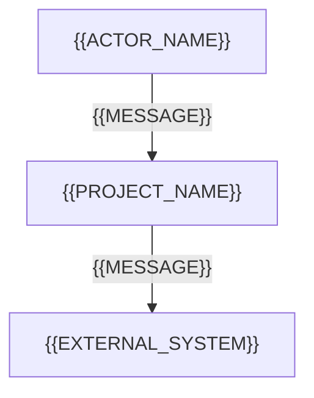
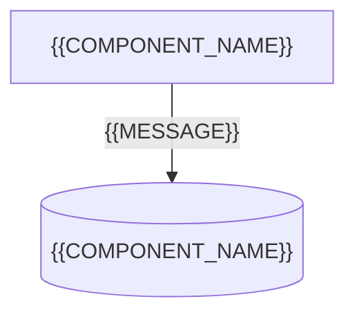
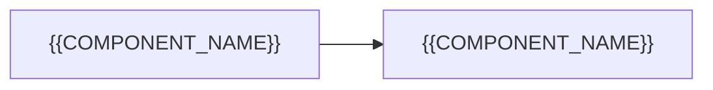

# As-Is Architecture: {{PROJECT_NAME}}

<!-- fill: Copy to docs/brownfield/AS_IS_ARCHITECTURE.md at step 0b (brownfield/PLAYBOOK_BROWNFIELD.md). The document describes the system that is running, not the desired system: every row records the current state with evidence (file:line in inline code, a manifest file, command output). Without evidence, record "Undetermined" and add a question in §13. The document is a snapshot at the commit of Codebase Summary §1, frozen after Gate 0R. The desired architecture is written later, in docs/ARCHITECTURE.md per core/02. The frontmatter assembled_from records "brownfield/01_As_Is_Architecture_Recovery_Template.md@<template_version>". -->

## 1. As-Is Summary

<!-- fill: 3 to 5 sentences: what the system does, where it runs, the actual architecture style, the biggest weakness. -->

| Item | Current state | Evidence |
| --- | --- | --- |
| Actual architecture style | <!-- fill: for example a single application, several services, an application and separate jobs --> | <!-- fill --> |
| Number of surfaces | <!-- fill: which overlay each surface matches in PLAYBOOK §3 --> | <!-- fill --> |

## 2. Actual Tech Stack

<!-- fill: Taken from the manifest files and lockfiles (for example package.json with its lockfile, pyproject.toml, go.mod, pom.xml), not from old documents. Record versions exactly as in the lockfile. -->

| Layer | Technology | Version in the lockfile | Source | Still supported |
| --- | --- | --- | --- | :---: |
| <!-- fill --> | <!-- fill --> | <!-- fill --> | <!-- fill: manifest file --> | <!-- fill: choose one: Yes \| No \| Undetermined --> |

## 3. Recovered C4 Views

### 3.1. System Context



### 3.2. Container

<!-- fill: Every deployment unit and data store that is really running; an edge records the protocol that can be observed in the code or configuration. -->



### 3.3. Component

<!-- fill: The components of the most complex module. -->



## 4. Actual Repository Layout

<!-- fill: The directory tree down to the level where module boundaries are visible; note the deviations from the split into communication, business and data-access layers (rule 1 in core/02 §1.2), for example a controller that queries the database directly. -->

```text
.
```

| Module (Codebase Summary §3) | Layers it actually has | Layer-separation violations observed | Evidence |
| --- | --- | --- | --- |
| `{{MODULE_CODE}}` {{MODULE_NAME}} | <!-- fill --> | <!-- fill: or None --> | <!-- fill --> |

## 5. Current Data

<!-- fill: The schema is extracted from the migration files or ORM schema files in the repo. The structure or record counts of the running database are taken only when the project owner runs the queries personally and sends the result, or grants read-only access to a copy that is not production; do not read personal data. A surface with no storage records N/A with a reason. -->

```mermaid
erDiagram
    {{ENTITY_NAME}} {
        string id PK "Primary key"
    }
```

| Table or collection | Approximate record count | Schema source | Integrity problems observed |
| --- | --- | --- | --- |
| <!-- fill --> | <!-- fill: number supplied by the project owner, or Undetermined --> | <!-- fill: migration file or schema file --> | <!-- fill: for example a missing foreign key, a missing unique constraint; or None --> |

## 6. As-Is Cross-cutting Concerns

| Item | Current state | Evidence | Risk |
| --- | --- | --- | --- |
| Authentication and authorization | <!-- fill --> | <!-- fill --> | <!-- fill --> |
| Error handling and error response format | <!-- fill --> | <!-- fill --> | <!-- fill --> |
| Logging | <!-- fill --> | <!-- fill --> | <!-- fill --> |
| Configuration and secrets | <!-- fill: refer to Codebase Summary §6; whether secrets are in the code (record only the location, not the value) --> | <!-- fill --> | <!-- fill --> |
| Observability (metrics, traces, health checks) | <!-- fill --> | <!-- fill --> | <!-- fill --> |
| Internationalization | <!-- fill --> | <!-- fill --> | <!-- fill --> |
| Background jobs | <!-- fill --> | <!-- fill --> | <!-- fill --> |
| Cache | <!-- fill --> | <!-- fill --> | <!-- fill --> |

## 7. Current Interface Conventions

<!-- fill: The API style, response format, pagination and idempotency in use; the error codes and error messages found in the code. The current contract is captured again in Regression Baseline §5. -->

| Item | Current state | Evidence |
| --- | --- | --- |
| Interface style | <!-- fill --> | <!-- fill --> |
| Success and error response format | <!-- fill --> | <!-- fill --> |
| Error codes in use | <!-- fill: list them, or "no codes, messages only" --> | <!-- fill --> |

## 8. Current Deployment

| Item | Current state | Evidence |
| --- | --- | --- |
| Where it runs and how it is deployed | <!-- fill --> | <!-- fill: CI file, deployment script, infrastructure configuration --> |
| Migration at deployment | <!-- fill --> | <!-- fill --> |
| Backup and restore | <!-- fill --> | <!-- fill --> |
| Rollback | <!-- fill --> | <!-- fill --> |

## 9. As-Is Security

| Control | Current state | Evidence | Risk level |
| --- | --- | --- | --- |
| <!-- fill: one row for each control: CORS, CSRF, security headers, secret management, encryption in transit, password storage, injection protection, output encoding, personal data at rest, audit log, rate limiting, dependency scanning --> | <!-- fill --> | <!-- fill --> | <!-- fill: choose one: High \| Medium \| Low --> |

## 10. Current Tests

| Test type | Count | Tool | Run command | Result of the latest run |
| --- | --- | --- | --- | --- |
| <!-- fill --> | <!-- fill --> | <!-- fill --> | <!-- fill: taken from Codebase Summary §7 --> | <!-- fill: passed, failed, skipped --> |

## 11. Technical Debt

| Problem | Evidence | Severity | Impact on the to-be |
| --- | --- | --- | --- |
| <!-- fill --> | <!-- fill: file:line or command output --> | <!-- fill: choose one: High \| Medium \| Low --> | <!-- fill: which requirement or NFR is blocked --> |

## 12. Minimal Scope

<!-- fill: A repo under 5,000 lines of code (Codebase Summary §1) is allowed to record N/A with a reason in §3.3 and §7, and to merge the rows with no mechanism in §6 into one row "None". §2, §4, §5 and §11 are always complete. Record the decision in the table; a larger repo records No. -->

| Minimal scope applies | Basis |
| --- | --- |
| <!-- fill: choose one: Yes \| No --> | <!-- fill: line count of code in Codebase Summary §1 --> |

## 13. Assumptions & Open Questions

| ID | Type | Content | Reason or impact | BLOCKING | Respondent |
| --- | --- | --- | --- | :---: | --- |
| AQ-01 | <!-- fill: choose one: Assumption \| Question --> | <!-- fill --> | <!-- fill --> | <!-- fill: choose one: Yes \| No --> | <!-- fill --> |

## 14. Version History

| Version | Date | Author | Change | Reason and requester | Approver |
| --- | --- | --- | --- | --- | --- |
| 0.1.0 | {{DATE}} | {{AUTHOR}} | Initial version | Created by the brownfield pipeline | Not approved |
