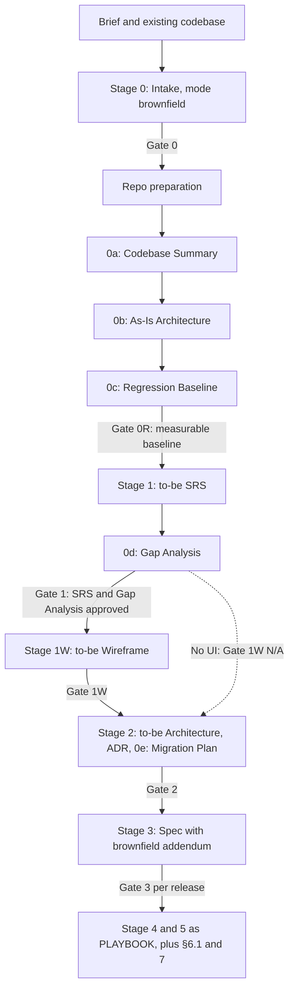

# Brownfield Playbook

## 1. Scope

Use when Intake fixes `mode: brownfield`: the project already has running source code and its behavior has to be preserved. This playbook supplements [PLAYBOOK.md](../PLAYBOOK.md): every stage, core template, overlay, stack profile, starter, prompt, and rule in PLAYBOOK still applies, except the exception stated in §5.1 (`REG` tests at Stage 0R). When the repo's existing `CLAUDE.md` or rules conflict with §5, §5 wins. What it adds:

- A repo preparation step after Gate 0: apply the decisions about `CLAUDE.md`, `.claude/`, and existing documents.
- Stage 0R (recover the current state) before the SRS: 0a Codebase Summary, 0b As-Is Architecture, 0c Regression Baseline.
- 0d Gap Analysis after the to-be SRS is written; Stage 1W draws the to-be wireframes after the Gap Analysis when there is a UI; 0e Migration Plan together with the to-be Architecture.
- The brownfield SPEC addendum at Stage 3, and additions to each PLAYBOOK prompt (§6.1).

The templates of this set are in `brownfield/`; generated documents are in `docs/brownfield/` according to the layout in CONVENTIONS §6. Choose the overlay by the surface of the running system (PLAYBOOK §3); the stack profile by §5.5.

## 2. Brownfield Pipeline

The brownfield steps sit inside the 3 steps of PLAYBOOK §2: repo preparation, Stage 0R (0a, 0b, 0c), and 0d Gap Analysis belong to step 1 Requirements; 0e Migration Plan and the SPEC addendum belong to step 2 Design; step 3 Plan and execution is as in PLAYBOOK, plus §6.1 and 7.



| Stage | Answers the question | Template | Output in the project | Gate |
| --- | --- | --- | --- | --- |
| Repo preparation | How are the existing `CLAUDE.md` and documents handled | None | specflow `CLAUDE.md`, documents with a colliding path moved to `docs/legacy/` | No gate of its own |
| 0a. Codebase Summary | What the code contains, how it runs, which commands are safe to run | [00_Codebase_Summary_Template.md](00_Codebase_Summary_Template.md) | `docs/brownfield/CODEBASE_SUMMARY.md` | Gate 0R |
| 0b. As-Is Architecture | The real running architecture and technical debt, with evidence | [01_As_Is_Architecture_Recovery_Template.md](01_As_Is_Architecture_Recovery_Template.md) | `docs/brownfield/AS_IS_ARCHITECTURE.md` | Gate 0R |
| 0c. Regression Baseline | Which behavior has to be preserved, which tests protect it, what the current coverage is | [02_Regression_Baseline_Template.md](02_Regression_Baseline_Template.md) | `docs/brownfield/REGRESSION_BASELINE.md` | Gate 0R |
| 1. to-be SRS | What the whole target system does, including the parts left unchanged | The stage's SRS (PLAYBOOK §4) | `docs/srs/` | Gate 1 |
| 0d. Gap Analysis | Where the to-be differs from the current state, which RBs change | [03_Gap_Analysis_Template.md](03_Gap_Analysis_Template.md) | `docs/brownfield/GAP_ANALYSIS.md` | Gate 1 |
| 1W. to-be Wireframe | How the new or changed screens (per the Gap Analysis) look and navigate; which screens stay unchanged | `core/07_Wireframe_Template/` (PLAYBOOK §2.2.1) | `docs/wireframes/` | Gate 1W |
| 2. to-be Architecture and ADR | How the system will be built | The stage's Architecture, `core/03_ADR_Template.md` | `docs/ARCHITECTURE.md`, `docs/adr/` | Gate 2 |
| 0e. Migration Plan | Which steps lead from the current state to the to-be, and how to roll back | [04_Migration_Plan_Template.md](04_Migration_Plan_Template.md) | `docs/brownfield/MIGRATION_PLAN.md` | Gate 2 |
| 3. Spec | The execution contract of one step | The stage's Spec and [Spec_Brownfield_Addendum.md](Spec_Brownfield_Addendum.md) | `docs/specs/` | Gate 3 |

### 2.1. Document Lifecycle

| Document | After its gate | Updated when |
| --- | --- | --- |
| Codebase Summary, As-Is Architecture | Frozen: a snapshot at the measured commit | Only for recording errors (PLAYBOOK §8, PATCH level). The architecture after changes lives in `docs/ARCHITECTURE.md` |
| Regression Baseline | Living | At the start of Stage 2, after Gate 1 approves: the RB status per Gap Analysis §5. In the Sync Docs of each SPEC: the row of an RB that is changed or removed, and the §6.1 row for a new `REG` test that the SPEC adds (the Protected by column of the RB points to that test) |
| to-be SRS | Living, like the greenfield SRS | Per PLAYBOOK §8; the to-be SRS describes the whole target system and becomes the project's SRS |
| Gap Analysis | Frozen after Gate 1 | Only when the to-be SRS changes, per PLAYBOOK §8, including when Stage 1W finds a mismatch and the to-be SRS is fixed; the Gap Analysis is re-approved together with the SRS before Gate 1W |
| to-be Wireframe | Living, like the to-be SRS | Per PLAYBOOK §8 |
| Migration Plan | Living | In the Sync Docs of each SPEC: the Status column in §2. A strategy change needs a new ADR and PLAYBOOK §8 |

## 3. Brownfield Gates

### 3.1. Gate 0R: Regression Gate

Do not write the to-be SRS before Gate 0R passes. The gate passes when every criterion in the two tables below passes.

| Criterion | Verified by |
| --- | --- |
| Every row of the safety conditions section passes before the first project command runs | Codebase Summary §2 |
| The existing build and test commands have actually run in a clean worktree of the measured commit, with the exit code recorded | Codebase Summary §1, §7 |
| The measured commit differs from the commit in Intake §4 only in files that §5.1 allows | Codebase Summary §1 |
| Every module has a module code per CONVENTIONS §4 | Codebase Summary §3 |
| `docs_mode` in Intake matches the criteria in PLAYBOOK §5 when recomputed with the module codes in Codebase Summary §3, or Intake and the `docs_mode` line of `CLAUDE.md` are updated so that the Gate 0 approver re-approves together with Gate 0R | Intake §5, §14 and Version History; `CLAUDE.md` |
| The verify commands section of `CLAUDE.md` is filled from Codebase Summary §7 | `CLAUDE.md` |
| Every main flow has a diagram built from the code, each step with `file:line` | Codebase Summary §5 |
| Every claim in the As-Is Architecture has evidence, or is marked "Undetermined" with a question | As-Is Architecture |
| The project owner approves the three documents, no `BLOCKING` question remains | `status: approved` and Version History of the three documents; Assumptions & Open Questions section |

The criteria that belong to the Regression Baseline; section numbers follow that document, and Regression Baseline §8 states the same wording:

| Criterion | Met? |
| --- | :---: |
| §1 and §2 have figures from commands that were run; §2 per module, or one line for the whole repo when §9 says Yes | [ ] |
| Every main flow in Codebase Summary §5 has at least one RB | [ ] |
| Every Must-level RB has a protecting test that passes on the product code of the measured commit, or the manual procedure in §6.2 is accepted by the project owner | [ ] |
| The external contract is captured in §5 on the data in §4 | [ ] |
| Pre-existing failing tests are listed in §7 | [ ] |
| No BLOCKING question remains in §11 | [ ] |

### 3.2. Gate 1, Gate 1W & Gate 2 Additions

| Gate | Added criteria |
| --- | --- |
| Gate 1 | The Gap Analysis is `approved`; every RB that is changed or removed has a row in Gap Analysis §5 and is approved by the project owner; to-be SRS §1.2 and Gap Analysis §1.2 match |
| Gate 1W | Stage 1W exists: a new or changed screen per the Gap Analysis has a wireframe page; an FR whose screen does not change records `Unchanged` in the mapping table with a reference to Regression Baseline §5; if the to-be SRS changes at Stage 1W then the Gap Analysis is fixed and re-approved; the heuristic evaluation table and the deceptive pattern checklist (CONVENTIONS §10.3, 10.4) cover only screens that have a page, an `Unchanged` screen has no evaluation of its own |
| Gate 2 | Regression Baseline §3 records the status per the approved Gap Analysis §5; the Migration Plan is `approved`; the migration strategy ADR is `accepted`; each step in Migration Plan §2 has a list of RBs that have to pass |

## 4. Context Loading Manifest

This table supplements PLAYBOOK §6; a stage not in the table uses the PLAYBOOK row as is. The rule "MUST NOT read `examples/` or the old template set" still applies at every stage.

| Stage | MUST read | MUST NOT read |
| --- | --- | --- |
| 0. Intake | As PLAYBOOK §6, plus this file §1 and §5, the directory tree and manifests of the repo, `CLAUDE.md`, `AGENTS.md`, `.claude/`, `.mcp.json`, and the repo's existing `docs/`, `.gitignore`, git hook configuration (`.pre-commit-config.yaml`, `.husky/`, `.git/hooks`, `core.hooksPath`), test runner configuration and fixtures | As PLAYBOOK §6, plus env files that are not sample files |
| Repo preparation | The existing `CLAUDE.md`, this file §5.1 and 5.5, Intake §4 and §13, the stage's Agent Context, `.gitignore`, and git hook configuration | Source code |
| 0a, 0b | `CLAUDE.md`, this file, `specflow/CONVENTIONS.md`, Intake, the step's template, `specflow/core/02_Architecture_Core_Template.md` §1.2; in the repo: in the reading order of §5.2 | Env files that are not sample files; the repo's old documents as evidence (use them only as hints to find code) |
| 0c | `CLAUDE.md`, this file §3 to §5, `specflow/CONVENTIONS.md` §4, Intake §4, Codebase Summary, As-Is Architecture, the Regression Baseline template, existing tests, the code of the main flows | As 0a, plus code outside the main flows once the evidence is sufficient |
| 1. to-be SRS | As PLAYBOOK §6, plus this file §5.3, Codebase Summary, As-Is Architecture, Regression Baseline | As PLAYBOOK §6 |
| 0d | `CLAUDE.md`, this file §3 to §5, `specflow/CONVENTIONS.md` §4, the to-be SRS, Codebase Summary §3, As-Is Architecture, Regression Baseline, the Gap Analysis template | Source code, unless needed to confirm a "Partial" row |
| 1W. to-be Wireframe | As PLAYBOOK §6, plus this file §2.1 and §5.3, Gap Analysis, Regression Baseline §5 | As PLAYBOOK §6 |
| 2. to-be Architecture, 0e | As PLAYBOOK §6, plus this file §3 to §5, As-Is Architecture, Gap Analysis, Regression Baseline, the Migration Plan template | As PLAYBOOK §6 |
| 3. Spec | As PLAYBOOK §6, plus the Migration Plan (the current step), Regression Baseline, Gap Analysis §1.2 and §5, the SPEC addendum | As PLAYBOOK §6, plus the code of modules outside the current step |
| 4a. Plan | As PLAYBOOK §6, plus Migration Plan §6 | As PLAYBOOK §6 |
| 4b. Coding | As PLAYBOOK §6; the tests in SPEC §9.2 are run even when they are outside the File Diff, only edit tests that are inside the File Diff | As PLAYBOOK §6 |
| 5. Verify and Sync | As PLAYBOOK §6, plus this file §2.1 and 7, Regression Baseline, Migration Plan | As PLAYBOOK §6 |
| Resume | As PLAYBOOK §6, plus this file §2, §4, §5 and the prompt of the unfinished step in §6 | As PLAYBOOK §6 |

## 5. Agent Rules

The rules below supplement PLAYBOOK §7.

### 5.1. Stage 0R Safety

"Project command" is a command that runs the repo's code or scripts: install dependencies, build, test, run locally, migrations. Read-only commands (git, listing files, counting lines) are not in this group.

"Measured commit" is the HEAD of the working branch when Prompt B0 is done: the commit of Prompt B0, or the HEAD at that time if B0 has nothing to commit. Compared with the commit recorded in Intake §4, it may differ only in documents and agent configuration (`docs/`, `plans/`, `CLAUDE.md`, `AGENTS.md`, `.claude/`, `.mcp.json`), the `specflow/` directory, the `.gitignore` approved at Gate 0, and existing files handled under §5.5 rule 2. Prompt B1 checks this with `git diff --name-status <commit in Intake §4> <measured commit>` and records the command and its result in Codebase Summary §1; each line of the result belongs to one of the groups above, with no product code file.

1. Before the first project command, fill Codebase Summary §2, §6, §8 by reading files only. Every variable or configuration key that points to a data store, queue, cache, or external service MUST point to a local or disposable target (container, empty database, simulated service). If the target cannot be determined, do not run the command, and record a `BLOCKING` question.
2. Project commands run only in a clean worktree created from the measured commit (`git worktree add` into a directory outside the repo, or a fresh clone), so that env files and local configuration files that git ignores in the working directory are not loaded automatically. Each command explicitly sets every variable in Codebase Summary §6 that points to a data store or service, with the target in §2 as the value; authentication variables inherited from the shell (cloud keys, kube configuration, tool tokens) are removed from the command's environment; the default authentication chain of a cloud tool counts as an external service in §2.
3. MUST NOT open env files that are not sample files. Variable names are read from the code and sample env files; if you need to know where a variable points, ask the project owner.
4. The structure or record counts of the running database are obtained only when the project owner runs the query and sends the result, or grants read-only access to a non-production copy. Do not write connection strings into documents.
5. Do not write secret values, tokens, or personal data into any document. Recorded requests, responses, and screenshots mask personal data and credentials (`Authorization` header, cookies, tokens, API keys, session IDs) before saving (Regression Baseline §4, §5).
6. Claude Code configuration already in the repo: before Prompt 0, the project owner reviews the hooks in `.claude/settings.json`, `.claude/settings.local.json` and the servers in `.mcp.json`. Hooks that run project commands are disabled from before Prompt 0 until Gate 0R passes; afterwards they are re-enabled only when the hook explicitly sets the environment variables per §5.4 rule 6. If the existing `CLAUDE.md` conflicts with this §5, §5 wins.
7. Stage 0R does not modify product code. The only exception, which overrides PLAYBOOK §1.2 principle 1 and §7 rules 4, 5 and 7 for this part only: at step 0c the agent adds `REG` tests for Must-level RBs that have no test. What may be added is test files, synthetic test data, and the test configuration and dependencies that Gate 0 has approved (Intake §4); the tests are written in the working directory following the loop in rule 9, sit in one separate commit on the working branch that does not touch product code, are a descendant of the measured commit (not necessarily a direct child; commits in between change only documents and agent configuration), and pass when run in a clean worktree created from that commit; Regression Baseline §1 records that commit; a new test dependency is recorded in an ADR at Stage 2. The exception is allowed by default; the project owner may refuse it at Gate 0. When it is refused, or when the repo has no test tool and Gate 0 does not approve adding one, the manual procedure in Regression Baseline §6.2 with a risk accepted by the project owner replaces the test, and the first SPEC that touches that RB adds a `REG` test per the SPEC addendum.
8. Active git hooks (Intake §4; `.pre-commit-config.yaml`, `.husky/`, hooks in `.git/hooks`, `core.hooksPath`) run not only at commit but also at `git worktree add` and `git checkout` (the `post-checkout` hook), before Codebase Summary §2 passes. Therefore every git command that may call hooks during Stage 0R (commit, `worktree add`, checkout) runs with `git -c core.hooksPath=/dev/null`, even for hooks that only format or lint, because they may modify checked files. The commit message records the hooks that were skipped; Codebase Summary §2 summarizes this for commits up to Prompt B1, and Regression Baseline §1 records it for the `REG` test commit. A secret-scanning hook is not replaced by skipping it: before each commit, run the hook's scanning tool directly (not through the hook manager, because it may run the repo's local scripts) only on the files changed by that commit, without loading env files, and record the command and result in the same place. If the tool reports a secret, do not commit (rule 5). If the scanning tool cannot be run on its own (missing tool, missing configuration file such as its baseline), ask the project owner before committing.
9. The loop for writing and running `REG` tests at step 0c: write and fix tests in the working directory, do not run tests there. To run, copy the uncommitted test files, test data, and test configuration, together with the manifest and lockfile when Gate 0 approved a test dependency, into a clean worktree of the measured commit, keeping relative paths, then run per rule 2; on failure, fix in the working directory and copy again. This worktree is only for running, never commit from it. When all tests pass, make one single `REG` test commit on the working branch per rule 7, then create a new clean worktree from that commit, rerun the whole test suite, and re-measure coverage for Regression Baseline §1 and §2. If this rerun fails, or Gate 0R demands more tests, fix by the same loop and fold the fix into that `REG` test commit (`git commit --amend` while it is still HEAD, otherwise a fix commit and then squash before Gate 0R), so that Regression Baseline §1 still records one commit.

### 5.2. Evidence & Reading Scope

1. Every claim about the current state comes with evidence: `file:line`, a manifest file, or a command that was run with its exit code. Do not guess; with no evidence, write "Undetermined" and ask a question.
2. Order of reading the repo: the directory tree and line counts per directory; manifests and lockfiles; configuration and CI; entry points; then close reading of the code of each main flow. Read the rest by module as needed. Codebase Summary §1 records the scope actually read; make no claim about what was not read.
3. A repo of 5,000 lines of code or more: Prompt B1 runs in two passes, the first only the Codebase Summary, the second the As-Is Architecture.
4. The repo's old documents are only hints for finding code, not evidence.

### 5.3. Module Codes & IDs

1. Codebase Summary §3 sets the module codes per CONVENTIONS §4 at step 0a, and divides modules per PLAYBOOK §5: cross-cutting parts (authentication, rate limiting, logging) and shared libraries are not modules, unless they have their own data or their own API; they still have a row in §3, with `None` in the Module code column. The Regression Baseline uses these module codes for the TC IDs of `REG` tests.
2. to-be SRS §1.2 reuses the as-is code for a module that still exists; a new module has a new code; a module that is split or merged records the mapping in Gap Analysis §1.2.
3. Regression Baseline §6.1 follows CONVENTIONS §4: every test that protects an RB carries the type `REG`, including tests that existed before Stage 0R; a parameterized test is one TC; the TC uses the module code of the behavior being protected, not the module code containing the test file (cross-cutting behavior uses the module code of the flow that exhibits the behavior); NN is unique per pair of module code and type across the whole project. A TC ID keeps the as-is code and is not renumbered; a `REG` test that a SPEC adds later is numbered after the largest number of that pair in SRS §8, Regression Baseline §6.1 and the SPECs. An RB ID is not reused; a removed RB is marked `deprecated` (PLAYBOOK §7 rule 8).
4. A test name does not contain a TC ID or an RB ID (CONVENTIONS §4).
5. Screens and wireframes (a project that has Stage 1W). The wireframe describes the to-be UI; an existing screen is not redrawn as as-is, because the screenshot already exists in Regression Baseline §5. A new or changed screen per the Gap Analysis has an `SCR ID` in to-be SRS §3 and has a wireframe page. A screen that does not change records `Unchanged` in the `SCR ID` column of to-be SRS §3 and has no page; an FR that uses only unchanged screens records `Unchanged` in the mapping table of the wireframe index, with a reference to the screenshot row in Regression Baseline §5. An existing screen that has to implement an additional new FR is a changed screen.
6. Roadmap (CONVENTIONS §11): the roadmap tracks only work to be done. An FR whose Work needed is `Unchanged` in Gap Analysis §2 has no line, because that behavior is protected by the Regression Baseline and the `REG` tests; an FR marked `Modify` or `Write new` has a line as in a greenfield project. Work needed `Remove` in the Gap Analysis (removing old behavior) is work to be done: that FR has a line when the to-be SRS keeps it with a priority other than `Won't`; the roadmap status `Dropped` is a different matter, only for requirements that the SRS has dropped (CONVENTIONS §11). When a re-approved Gap Analysis moves an FR between `Unchanged` and other work, the roadmap adds a line or sets the line to `Dropped` per PLAYBOOK §8.

### 5.4. Preserving Behavior

1. Preserve every behavior in the Regression Baseline, except RBs approved for change or removal in Gap Analysis §5.
2. Do not refactor outside the File Diff of the current SPEC, even if the code looks like it needs improvement; record suggestions in the Assumptions & Open Questions section or the technical debt table.
3. A `REG` test describes the current behavior, including behavior that looks wrong; fixing that behavior is a to-be change and goes through the Gap Analysis.
4. The tests in SPEC §9.2 run green on the current code before the code changes, not following the red step; new tests in SPEC §9.1 still go red first, then green (SPEC addendum §4).
5. A Should-level RB with no test is not in the mandatory checkpoint in Migration Plan §6; the risk is recorded in Regression Baseline §11.
6. From Stage 1 onward, project commands run in the working directory (a clean worktree is not required), but every variable pointing to a data store, queue, cache, or external service is explicitly set to a local or disposable target per ARCHITECTURE §10.2; commands do not rely on the machine's env files and drop authentication variables inherited from the shell as in §5.1 rule 2. The verify commands in `CLAUDE.md` already include these variables.

### 5.5. Stack Profile & Existing Files

1. Choose the stack profile that matches the existing stack per the definition in PLAYBOOK §3. When a profile matches:
   - ARCHITECTURE to-be §2.1 records the version, directory tree, and practices that are running (As-Is Architecture §2), not the profile's values. Every point where the current state deviates from the profile (minor version, directory tree, authentication method, error envelope, verify commands) is gathered into one ADR at Stage 2.
   - The PROFILE-CONTENT block and the `Profile` source placeholders that conflict with the current state are not copied verbatim: the document records the running value and refers to that ADR.
   - Raising the current state to the profile's value is a to-be change, and goes through the Gap Analysis and the Migration Plan.

   When no profile matches, record `none`, per PLAYBOOK §3 rule 5 and CONVENTIONS §2; do not pick a profile with a different base component and then record each deviation. In that case ARCHITECTURE to-be §2.1 is built from As-Is Architecture §2 plus changes that have an ADR. In both cases, the verify commands come from the commands that ran successfully in Codebase Summary §7, because commands that ran successfully on the repo win over the profile's commands (PLAYBOOK §2.1; Prompt B1 fills them into `CLAUDE.md`).
2. `CLAUDE.md`, `AGENTS.md`, `.claude/`, or documents in `docs/` that already exist in the repo: do not overwrite. At Prompt 0, list them in Intake §4 and in the Assumptions & Open Questions section of the Intake, one proposed handling for each. The project owner decides at Gate 0; Codebase Summary §9 records it. The four ways of handling them and when to do them:
   - Keep as is.
   - Merge into the specflow `CLAUDE.md`, at Prompt B0: the specflow `## Documentation Layout` section comes first, the project's existing rules stay in the later sections.
   - Move into `docs/legacy/`, at Prompt B0: keep the sub-path (for example `docs/architecture.md` becomes `docs/legacy/architecture.md`). Use when the file collides with the specflow layout: the same path that CONVENTIONS §6 uses (compared case-insensitively, because `docs/architecture.md` and `docs/ARCHITECTURE.md` are the same file on a case-insensitive file system), or the same name as a document that the Documentation Layout block replaces. Documents written for outside parties (for example an API contract for callers) are usually kept as is. Files in `docs/legacy/` are old documents, used only as hints (§5.2 rule 4); the leftover check command in rule 3 skips this directory.
   - Move the content into a specflow document: Prompt B0 leaves the file as is. The prompt that creates the target document (for example Prompt 2 for `docs/ARCHITECTURE.md`) moves the evidenced content into that document, deletes the old file, and records this in the target document's Version History. A file whose path collides with a specflow document that must be created earlier is moved into `docs/legacy/` by Prompt B0 first.

   A directory or file that specflow needs to commit (`CLAUDE.md`, `.claude/rules/`, `docs/`, `plans/`) that `.gitignore` ignores: Prompt 0 records a proposed `.gitignore` line in Intake §13. Git cannot re-include a file inside an ignored directory, so for example `.claude/` is changed to `.claude/*` together with `!.claude/rules/`. Gate 0 approves; Prompt B0 edits `.gitignore` exactly as approved.
3. The leftover check command in PLAYBOOK §4 runs only on what specflow created or modified: newly added lines in files that already existed, whole new uncommitted files, and files ignored by `.gitignore`, including `CLAUDE.md`, Markdown files in `docs/` and `plans/`, and every file in `.claude/rules/` (the third command; this pass catches rules or documents that git does not track and so cannot be committed). The `docs/legacy/` directory is not scanned. Run at the project root (a subdirectory if the repo is a monorepo), with the `BASE` variable set to the commit in Codebase Summary §1; before the Codebase Summary exists, `BASE` is the commit recorded in Intake §4. The result MUST be empty. If a line comes from an ignored file that specflow did not create (for example build output in `docs/`), record that file or directory in Codebase Summary §9 and add `':(exclude)<path>'` to the third command; exclude a directory once for its whole subtree.

```bash
: "${BASE:?BASE is not set}"
pattern='<!-- (SLOT|PROFILE-SLOT|slot-hint|fill)[ :-]|[{][{][A-Z][A-Z0-9_]*[}][}]|"[$]description": *"fill:'
paths=(docs plans CLAUDE.md .claude ':(exclude)docs/legacy')
git diff -z --name-only --relative --no-ext-diff --diff-filter=d "$BASE" -- "${paths[@]}" |
  while IFS= read -r -d '' f; do
    git diff -U0 --no-color --no-ext-diff --no-textconv --relative "$BASE" -- ":(literal)$f" | grep -vE '^\+\+\+ ' | grep -E '^\+' | grep -E "$pattern" |
      while IFS= read -r line; do printf '%s: %s\n' "$f" "${line#+}"; done
  done
git ls-files -z --others --exclude-standard -- "${paths[@]}" |
  while IFS= read -r -d '' f; do grep -HnE "$pattern" "$f"; done
git ls-files -z --others --ignored --exclude-standard -- ':(glob)docs/**/*.md' ':(glob)plans/**/*.md' ':(glob).claude/rules/**' CLAUDE.md ':(exclude)docs/legacy' |
  while IFS= read -r -d '' f; do grep -HnE "$pattern" "$f"; done
```

## 6. Prompts

Run in a Claude Code session at the root of the existing repo. Prompt 0 to 6, Prompt 1W, and Prompt Resume are used as in PROMPTS.md, plus the additions in §6.1. Prompts B0 to B4 run at the brownfield-specific steps per the pipeline in §2.

### 6.1. Additions to PROMPTS.md Prompts

Each PLAYBOOK prompt adds to its Read part and its Task part as in the table below. Every prompt: the leftover check command runs per §5.5 in place of the command in PLAYBOOK §4.

| Prompt | Add to the Read part | Add to the Task |
| --- | --- | --- |
| Prompt 0 | `specflow/brownfield/PLAYBOOK_BROWNFIELD.md` §1 and §5; the directory tree, manifests, `CLAUDE.md`, `AGENTS.md`, `.claude/`, `.mcp.json`, the existing `docs/` | Intake §4 records the code repository and the `HEAD` commit at the start, the size, the existing test tools, the decision on `REG` tests, the test coverage tool, the active git hooks (§5.1 rule 8), the existing files with a proposed handling each (§5.5 rule 2); a specflow directory that must be committed but is ignored by `.gitignore` gets a proposed `.gitignore` line in Intake §13; do not overwrite existing files. Proposals that need the project owner's approval before the repo preparation step or before the first project command (handling of existing files, the `.gitignore` line, git hook handling, the environment for running `REG` tests, the coverage tool) are recorded in Intake §13 as Assumptions, `BLOCKING: No`, with "approved at Gate 0": approving Gate 0 approves those proposals, and the project owner edits any proposal before approving. Repo already has a `CLAUDE.md`: do not create `CLAUDE.md` yet, record the proposed specflow version in the Assumptions & Open Questions section of the Intake; the stop condition becomes "Intake created". Repo has no `CLAUDE.md`: create it as in PLAYBOOK, keeping the Brownfield lines of the Agent Context |
| Prompt 1 | This file §5.3; `docs/brownfield/CODEBASE_SUMMARY.md`, `docs/brownfield/AS_IS_ARCHITECTURE.md`, `docs/brownfield/REGRESSION_BASELINE.md` | The to-be SRS describes the whole target system; §1.2 reuses the module codes in Codebase Summary §3; behavior of an RB with `Keep` has a corresponding FR; with a UI: a screen that does not change from the current state records `Unchanged` in the `SCR ID` column of SRS §3 per §5.3 rule 5, which the Gap Analysis confirms at Prompt B3; an existing file whose handling is "move the content into a specflow document" with the SRS as the target document is moved at this step (§5.5 rule 2). After stopping, run Prompt B3 |
| Prompt 1W | This file §2.1 and §5.3; `docs/brownfield/GAP_ANALYSIS.md`, `docs/brownfield/REGRESSION_BASELINE.md` §5 | Runs after Gate 1 approves the to-be SRS and the Gap Analysis. The to-be wireframe per §5.3 rule 5: pages for new or changed screens, `Unchanged` with a reference to Regression Baseline §5 for FRs of screens that do not change. A mismatch that changes the to-be SRS means the Gap Analysis is fixed as well per PLAYBOOK §8 (rerun the corresponding part of Prompt B3) to be re-approved together with the SRS before Gate 1W |
| Prompt 2 | This file §3 to §5; `docs/brownfield/AS_IS_ARCHITECTURE.md`, `docs/brownfield/GAP_ANALYSIS.md`, `docs/brownfield/REGRESSION_BASELINE.md` | Before writing ARCHITECTURE, record the status Change approved or Removal approved in Regression Baseline §3 for every RB in the approved Gap Analysis §5, with the version of the Gap Analysis. ARCHITECTURE §2.1 follows §5.5 rule 1, the deviations from the matching profile gathered into one ADR; an ADR for every change from As-Is Architecture §2 and for test dependencies added at Stage 0R. The verify gate in PLAYBOOK §11 needs commands that Codebase Summary §7 does not have yet (test coverage when Stage 0R only installed it temporarily or measured another way, dependency audit, contract checks): choose the tool in ARCHITECTURE with an ADR and add the commands to the verify commands section of `CLAUDE.md`, after the commands B1 already filled. An existing file whose handling is "move the content into a specflow document" with ARCHITECTURE as the target document is moved at this step (§5.5 rule 2). After stopping, run Prompt B4 |
| Prompt 3 | `specflow/brownfield/Spec_Brownfield_Addendum.md`; `docs/brownfield/MIGRATION_PLAN.md` (the current step), `docs/brownfield/REGRESSION_BASELINE.md`, `docs/brownfield/GAP_ANALYSIS.md` §1.2 and §5 | Apply all three parts and the rules of the addendum |
| Prompt 4 | `docs/brownfield/MIGRATION_PLAN.md` §6 | The first phase of each SPEC runs the tests in that SPEC's §9.2 on the current code (after the SPECs before it in the plan) and records the Pass column before that SPEC changes code; each phase reruns the regression checkpoint |
| Prompt 5 | This file §7; `docs/brownfield/MIGRATION_PLAN.md` §6, `docs/brownfield/REGRESSION_BASELINE.md` §5 | Run the tests in SPEC §9.2 and the step's regression checkpoint; compare the external contract with the snapshot |
| Prompt 6 | This file §2.1; `docs/brownfield/REGRESSION_BASELINE.md`, `docs/brownfield/MIGRATION_PLAN.md` | Update Regression Baseline §3 and §6.1, and the Status column in Migration Plan §2 per §2.1 |
| Prompt Resume | This file §2, §4 and §5 | The unfinished stage includes the repo preparation step, steps 0a to 0e, and Stage 1W after the Gap Analysis; continue with Prompt B0 to B4, or the prompt of PROMPTS.md plus this table |

### Prompt B0: Repo preparation

```text
Intake approved with mode brownfield. Apply the Gate 0 decisions about the files already in the repo.

Read: CLAUDE.md if it exists, specflow/brownfield/PLAYBOOK_BROWNFIELD.md §1, §5.1 and §5.5, docs/intake/PROJECT_INTAKE.md §4 and §13, the stage's Agent Context, .gitignore, git hook configuration.

Task:
1. For each existing file in Intake §4, do exactly the approved handling, per §5.5 rule 2: keep as is; merge into the specflow CLAUDE.md; move into docs/legacy/ keeping the sub-path; or, for "move the content into a specflow document", leave the file as is until the prompt that creates the target document.
2. CLAUDE.md: if Prompt 0 already created it, only check that the Documentation Layout section comes first and the Brownfield lines are complete. If the repo had a CLAUDE.md before, merge per the stage's Agent Context: the Documentation Layout section first, keep the Brownfield lines, the project's existing rules in the later sections.
3. If Gate 0 approved editing .gitignore (Intake §13), edit exactly the approved lines, so that CLAUDE.md, .claude/rules/, docs/ and plans/ can be committed.
4. Change only documents, agent configuration, and the approved .gitignore; do not change code, do not run project commands. Commit these changes separately, handling git hooks per §5.1 rule 8. The HEAD after this commit is the measured commit (§5.1).

Stop when: every existing file is handled per the decision, the leftover check command in §5.5 of PLAYBOOK_BROWNFIELD returns empty, git status is clean. Open a new session for Prompt B1 so that Claude Code loads the new CLAUDE.md.
```

### Prompt B1: Codebase Summary and As-Is Architecture

```text
The repo has been prepared per Prompt B0. Start steps 0a and 0b.

Read: CLAUDE.md, specflow/brownfield/PLAYBOOK_BROWNFIELD.md, specflow/CONVENTIONS.md, docs/intake/PROJECT_INTAKE.md, specflow/core/02_Architecture_Core_Template.md §1.2; in the repo read in the order of §5.2 of PLAYBOOK_BROWNFIELD.
Template: specflow/brownfield/00_Codebase_Summary_Template.md, specflow/brownfield/01_As_Is_Architecture_Recovery_Template.md.

Task:
1. Create docs/brownfield/CODEBASE_SUMMARY.md. Fill §1, §2, §3, §4, §6, §8, §9 by reading files and read-only commands (git, listing files, counting lines); do not run project commands yet. The measured commit in §1 is the HEAD after the commit of Prompt B0; run git diff --name-status between the commit in Intake §4 and the measured commit, record the command and result in §1, and stop if there is a product code file (§5.1). The module codes in §3 follow CONVENTIONS §4 and the module division rules in PLAYBOOK §5; if the number of modules changes docs_mode compared with Intake §5, record a question in §11 (BLOCKING: No, decided at Gate 0R) with a proposal to update the Intake and the docs_mode line of CLAUDE.md.
2. When every row in §2 passes: create a clean worktree from the measured commit outside the repo, then run in it the commands for installing dependencies, build, test, run locally, and every lint, format, typecheck, and migration command the repo has, each command explicitly setting the variables that point to the targets in §2 and removing inherited authentication variables; record them in §7 with the exit code. Migrations run only against the disposable database in §2. If any row in §2 does not pass: do not run commands, record a BLOCKING question and stop.
3. Fill the verify commands section of CLAUDE.md: replace exactly the line "Complete at Stage 0R (Prompt B1)." with a lead-in sentence and a table of the commands that ran successfully in §7, each with its environment variables already set per §5.4 rule 6. The commands in §7 win over the stack profile's commands (§5.5 rule 1).
4. Draw the main flows in §5 from the real code, each step with file:line.
5. Create docs/brownfield/AS_IS_ARCHITECTURE.md: tech stack from lockfiles, reconstructed C4, the actual directory tree, schema from migration files or the ORM schema, cross-cutting concerns, deployment, security, tests, technical debt; every row has evidence.
6. Do not change code; do not open env files that are not sample files; do not write secrets or personal data; do not create the Regression Baseline. Commit per §5.1 rule 8.

A repo of 5,000 lines of code or more: this pass does only tasks 1 to 4 and then stops; task 5 is done in a later pass after I confirm.

Stop when: the documents of this pass are in status in-review, the verify commands section of CLAUDE.md no longer has the line "Complete at Stage", the leftover check command in §5.5 of PLAYBOOK_BROWNFIELD returns empty.
```

### Prompt B2: Regression Baseline

```text
The Codebase Summary and As-Is Architecture are approved. Start step 0c.

Read: CLAUDE.md, specflow/brownfield/PLAYBOOK_BROWNFIELD.md §3 to §5, specflow/CONVENTIONS.md §4, docs/intake/PROJECT_INTAKE.md §4, docs/brownfield/CODEBASE_SUMMARY.md, docs/brownfield/AS_IS_ARCHITECTURE.md, the existing tests, the code of the main flows.
Template: specflow/brownfield/02_Regression_Baseline_Template.md.

Task:
1. Create docs/brownfield/REGRESSION_BASELINE.md. Measure coverage by the module codes of Codebase Summary §3 in a clean worktree of the measured commit, following the choice in the "Test coverage tool" row of Intake §4: already available; installed temporarily in the measurement worktree, without changing the manifest or lockfile; added as a dev-dependency in the REG test commit, while the figures at the measured commit are still measured with the temporary install; or measured another way with its limits. If Intake has no such row, ask me before measuring. Record the tool, command, and figures in §1, §2; if branch coverage cannot be measured, record N/A with the reason.
2. List the RBs in §3: each main flow at least one RB, each RB has evidence; a Must-level RB has a protecting test or a manual procedure.
3. Prepare the synthetic data in §4; capture the external contract in §5 on the local environment, masking personal data and credentials.
4. Per the decision in Intake §4: if allowed, write REG tests for Must-level RBs that have no test (only test files, synthetic test data, configuration and approved test dependencies) following the loop in §5.1 rule 9: write in the working directory, run in a clean worktree of the measured commit until they pass on the current code, then one single REG test commit that does not touch product code, handling git hooks per §5.1 rule 8, and re-measure coverage; if not, write the manual procedure in §6.2 for me to approve the risk. Assign the TC IDs in §6.1 to every protecting test per §5.3 rule 3: every test carries the type REG, including existing tests; a parameterized test is one TC; the module code of the behavior being protected.
5. List the pre-existing failing tests in §7; self-check §8 and §3.1 of PLAYBOOK_BROWNFIELD.

Stop when: the Regression Baseline is in status in-review, the leftover check command in §5.5 of PLAYBOOK_BROWNFIELD returns empty. Do not write the SRS.
```

### Prompt B3: Gap Analysis

```text
The to-be SRS was written per Prompt 1 of specflow/PROMPTS.md plus the additions in §6.1 of PLAYBOOK_BROWNFIELD. Start step 0d.

Read: CLAUDE.md, specflow/brownfield/PLAYBOOK_BROWNFIELD.md §3 to §5, specflow/CONVENTIONS.md §4, the to-be SRS, docs/brownfield/CODEBASE_SUMMARY.md §3, docs/brownfield/AS_IS_ARCHITECTURE.md, docs/brownfield/REGRESSION_BASELINE.md.
Template: specflow/brownfield/03_Gap_Analysis_Template.md.

Task:
1. Create docs/brownfield/GAP_ANALYSIS.md. Build the mapping from as-is to to-be module codes in §1.2, matching to-be SRS §1.2.
2. Each FR and NFR of the to-be SRS gets one row in §2 or §3, compared with the current state with evidence; data differences in §4.
3. Every RB that the to-be SRS changes or removes is recorded in §5; an RB that is changed with no reason stated in the to-be SRS gets a BLOCKING question. Do not edit the Regression Baseline yet; the RB status is recorded after Gate 1 approves.
4. Summarize the work to do by priority in §6.

Stop when: the Gap Analysis is in status in-review, the leftover check command in §5.5 of PLAYBOOK_BROWNFIELD returns empty. Do not write ARCHITECTURE.
```

### Prompt B4: Migration Plan

```text
The to-be ARCHITECTURE was written per Prompt 2 of specflow/PROMPTS.md plus the additions in §6.1 of PLAYBOOK_BROWNFIELD. Start step 0e.

Read: CLAUDE.md, specflow/brownfield/PLAYBOOK_BROWNFIELD.md §3 to 5, specflow/CONVENTIONS.md §4, docs/ARCHITECTURE.md, the related ADRs, docs/brownfield/GAP_ANALYSIS.md, docs/brownfield/REGRESSION_BASELINE.md.
Template: specflow/brownfield/04_Migration_Plan_Template.md, specflow/core/03_ADR_Template.md.

Task:
1. Create docs/brownfield/MIGRATION_PLAN.md. Choose the migration strategy and create a proposed ADR for that choice.
2. Split the work in Gap Analysis §6 into small ordered steps; each step has an entry condition, an exit condition, the RBs that must pass, how to cut over, how to roll back, and the expected SPEC.
3. Make a data migration plan with reconciliation if Gap Analysis §4 has entities that must be migrated.
4. Record the regression check commands for each step in §6.

Stop when: the Migration Plan is in status in-review together with ARCHITECTURE, the strategy ADR is in status proposed, the leftover check command in §5.5 of PLAYBOOK_BROWNFIELD returns empty. Do not write SPEC.
```

## 7. DoR & DoD Additions

| Item | Criterion | Passed? |
| --- | --- | :---: |
| DoR | Gate 0R passed; the Gap Analysis and Migration Plan are `approved`; the strategy ADR is `accepted`; the current step in Migration Plan §2 has a SPEC | [ ] |
| DoR | The SPEC applies the full brownfield addendum: the extended §2.1 table, the §9.2 table covering every RB of the step, the additional DoD, `parent` including the Migration Plan and Regression Baseline | [ ] |
| DoD | Every test in SPEC §9.2 passes on the current code before the change; after the change, the tests of RBs with `Keep` and the updated tests of RBs with `Change approved` pass, the tests of RBs with `Removal approved` are deleted; the external contract matches the snapshot, except approved differences | [ ] |
| DoD | The step's regression checkpoint in Migration Plan §6 passes | [ ] |
| DoD | Regression Baseline §3 and §6.1, and the Status column in Migration Plan §2, are updated per §2.1 | [ ] |
