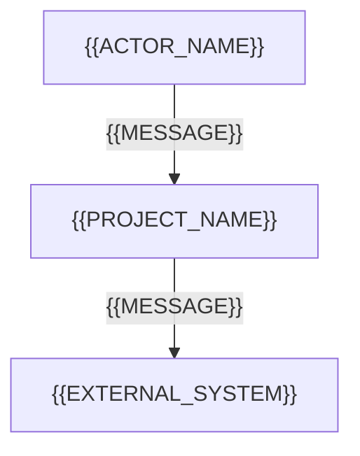

# System Architecture Document: {{PROJECT_NAME}}

<!-- fill: Copy to docs/ARCHITECTURE.md. Add the approved SRS to parent (docs/srs/SRS.md or docs/srs/00_SRS_MASTER.md). Refer to ISO/IEC/IEEE 42010:2022 (the view concept, rationale recorded as ADRs; no conformance claim) and use the C4 model. The document answers WHERE and HOW; every choice in the document is a single value, never "A or B". Key decisions have an ADR per PLAYBOOK §2.3 and are listed in §12; a choice marked "has ADR" MUST be covered by an ADR. The frontmatter assembled_from records the sources per CONVENTIONS §3. -->

## 1. Architectural Goals & Principles

### 1.1. Quality Attributes

| Attribute | Related NFR | How it is achieved (summary, details in §8.1) |
| --- | --- | --- |
| <!-- fill: for example scalability, reliability, security, maintainability --> | <!-- fill: NFR ID in SRS §7 --> | <!-- fill --> |

### 1.2. Golden Rules

1. Layer Isolation. The communication layer (route handler, controller, screen, command handler) only receives input, validates it and maps output; it MUST NOT contain business logic or access storage directly. The business layer (service, use case) handles the business and coordinates transactions. The data access layer (repository, gateway, adapter) encapsulates queries and calls to external systems.
2. No Circular Dependencies. If module A depends on module B, then B MUST NOT depend back on A; they communicate through a public interface or events.
3. Strict Typing. Every payload, entity and function signature has an explicit type; MUST NOT use the language's mechanism for escaping type checking. The language-specific rules are in the rule of the surface in `.claude/rules/`.
4. No hardcoded secrets. Secrets only pass through the mechanism in §6.4 and §9.1.
5. Write logs through the structured logger (§6.3); MUST NOT print directly to stdout or stderr outside the logger.
6. Only the config module reads environment variables; elsewhere, config is received through parameters or dependency injection.
7. Currency uses one single exact representation across the whole system: <!-- fill: choose one: exact decimal type \| integer in the smallest currency unit; write N/A if the system does not handle money -->; MUST NOT use floating-point numbers.
8. Time is stored and transmitted in UTC, in ISO 8601 format; time zone conversion happens only in the display layer.
9. Validate at the boundary (user input, external systems, files, queues); data that has passed the boundary is trusted inside. Values computed by the client (price, amount, permission, status) MUST NOT be trusted: the server recomputes or rechecks them from the source of truth.
10. A migration only changes structure and data and MUST NOT contain business logic; migrations are forward-only and have a rollback plan in the SPEC.
11. <!-- fill: project-specific rules, or delete this line if there are none -->

### 1.3. Architectural Style

| Item | Decision |
| --- | --- |
| Architectural style | <!-- fill: choose one, has ADR: modular monolith \| microservices \| serverless \| another style, named explicitly --> |
| Module boundaries | <!-- fill: how the modules in §4.1 communicate with each other: in-process interface calls, events, network calls --> |
| ADR | <!-- fill: ADR ID --> |

## 2. Fixed Tech Stack

### 2.1. Technology Table

<!-- fill: One group of rows per surface, copied from the section whose heading contains (Tech Stack) in the stack profile chosen in Intake §14. Write exact versions (no ranges or ^). Every deviation from the profile has an ADR. The coding agent MUST only use libraries that are in this table. -->

| Surface | Layer | Technology | Exact version | Role | ADR |
| --- | --- | --- | --- | --- | --- |
| <!-- fill --> | <!-- fill: for example language, runtime, framework, storage, cache, validation, test --> | <!-- fill --> | <!-- fill --> | <!-- fill --> | <!-- fill: ADR ID or "per profile" --> |

### 2.2. Dependency Policy

| Rule | Content |
| --- | --- |
| Adding a new library | An `accepted` ADR is needed before installing; the ADR states the reason, the alternative of not using a library, and the license |
| Allowed licenses | <!-- fill: list of accepted licenses; any other license needs an ADR --> |
| Package source | <!-- fill: official registry or internal registry --> |
| Version upgrades | <!-- fill: patch level may be upgraded after passing the verify gate; minor and major levels need an ADR --> |
| Lockfile | The lockfile is committed; the build uses exactly the versions in the lockfile |
| Vulnerability check | Runs in CI (§11); a high or critical vulnerability blocks the merge unless an ADR accepts the risk |

## 3. C4 Architecture Views

### 3.1. C4 Level 1: System Context

<!-- fill: The actors and external systems match SRS §2.1 and §2.2. Each edge states the purpose and the protocol. -->



<!-- SLOT: arch.views -->
<!-- slot-hint: The overlay provides C4 Level 2 (container), Level 3 (component) and the deployment view of the surface. -->

## 4. Repository Layout

The coding agent MUST put new files in the directory tree below and MUST NOT create directories outside the standard.

### 4.1. Module Mapping

| Module ID | Code | Component (container, component) | Directory | Surface |
| --- | --- | --- | --- | --- |
| {{MODULE_ID}} | `{{MODULE_CODE}}` | {{COMPONENT_NAME}} | <!-- fill: path in inline code --> | <!-- fill --> |

<!-- SLOT: arch.layout -->
<!-- slot-hint: The overlay provides the layered directory tree of the surface, the locations of test files and the concrete file names per the stack profile. -->

## 5. Physical Data Schema

The source of truth for the physical data structure. Table names, columns, types and value domains MUST match SRS §4 and SRS §10.1; if they differ, fix them per PLAYBOOK §8.

<!-- SLOT: arch.schema -->
<!-- slot-hint: The overlay provides the physical schema or the data schema in the DSL of the stack profile, with the mandatory checklist. -->

## 6. Cross-cutting Concerns

<!-- fill: A section that does not apply to the project is written as N/A with a reason, not deleted. -->

### 6.1. Authentication & Authorization

Write N/A with a reason if the system has no authentication. If the authentication model does not use tokens (for example a session stored on the server), write N/A in the rows about tokens and describe the actual model in the last row. The ADR column is required for a row marked `has ADR`; other rows write `Not needed`.

| Item | Decision | ADR |
| --- | --- | --- |
| Access token format (has ADR) | {{TOKEN_FORMAT}} | <!-- fill --> |
| Signing algorithm (has ADR) | {{SIGNING_ALG}} | <!-- fill --> |
| Access token lifetime | {{ACCESS_TTL}} | <!-- fill --> |
| Refresh token lifetime | {{REFRESH_TTL}} | <!-- fill --> |
| Refresh token storage (has ADR) | {{REFRESH_STORE}} | <!-- fill --> |
| Refresh token rotation | <!-- fill: choose one: Yes, the old token is revoked as soon as the new token is issued \| No, with a reason --> | <!-- fill --> |
| Revocation on logout | <!-- fill --> | <!-- fill --> |
| Token content (claims) | <!-- fill: identity and role only; MUST NOT contain sensitive personal data --> | <!-- fill --> |
| Authorization model (has ADR) | <!-- fill: choose one: RBAC \| ABAC \| ACL; state where permissions are checked --> | <!-- fill --> |
| Other authentication model | <!-- fill: only when tokens are not used; otherwise write N/A --> | <!-- fill --> |

### 6.2. Error Handling & Response Envelope

- Every error is mapped to a code in the Error Code Registry (§7.1) before it leaves the system; MUST NOT return a stack trace or an internal message to the client.
- Every request/response style response (API, IPC) is wrapped in the envelope below. A surface with no request/response writes N/A.
- The content of `meta` follows the pagination convention in §7; `correlationId` comes from §6.3.

Success response:

```json
{
  "success": true,
  "data": {},
  "meta": {},
  "timestamp": "2026-01-01T00:00:00.000Z"
}
```

Error response:

```json
{
  "success": false,
  "error": {
    "code": "VALIDATION_ERROR",
    "message": "A message for the user that does not reveal internal details.",
    "details": [{ "field": "fieldName", "issue": "Description of the violation" }],
    "correlationId": "request-id",
    "timestamp": "2026-01-01T00:00:00.000Z"
  }
}
```

### 6.3. Logging

| Item | Decision |
| --- | --- |
| Format | <!-- fill: choose one: JSON, one line per record \| key-value --> |
| Log level | <!-- fill: the level used in each environment --> |
| Correlation ID | Generated at the boundary if the request has none, passed through every internal and external call, and written in every log record |
| Data forbidden in logs | Secrets, tokens, passwords, card data, sensitive personal data that is not masked |
| Collection point | <!-- fill --> |
| Retention period | <!-- fill: matches NFR-OBS and NFR-DATA --> |

### 6.4. Config & Environment Variables

<!-- fill: List every variable. The project's environment variable template file holds only variable names and fake values, no real secrets. -->

| Variable name | Type | Required | Default | Description | Secret |
| --- | --- | --- | --- | --- | :---: |
| <!-- fill: UPPER_SNAKE --> | <!-- fill --> | <!-- fill: choose one: Yes \| No --> | <!-- fill: or "None" --> | <!-- fill --> | <!-- fill: choose one: Yes \| No --> |

### 6.5. Observability

| Item | Decision |
| --- | --- |
| Metrics | <!-- fill: the main business and technical metrics, where they are collected --> |
| Trace | <!-- fill: trace scope, sampling rate --> |
| Health check | <!-- fill: liveness and readiness checks, what each one checks --> |
| Alerts | <!-- fill: alert conditions tied to NFR-RELI and NFR-PERF, recipients --> |

### 6.6. Internationalization

<!-- fill: default language, supported languages, where display strings are stored, number, currency and date formats by locale; matches NFR-I18N. -->

### 6.7. Feature Flags

<!-- fill: mechanism (choose one: static configuration per environment | flag service), naming convention, who may switch flags, deadline to remove a flag after it is stable. -->

### 6.8. Background Jobs

<!-- fill: queue or scheduling mechanism, retry and backoff policy, job idempotency, handling of a job that finally fails (dead letter), monitoring. -->

### 6.9. Caching Policy

| Data | Cache location | TTL | How to invalidate | Acceptable staleness |
| --- | --- | --- | --- | --- |
| <!-- fill --> | <!-- fill --> | <!-- fill --> | <!-- fill --> | <!-- fill --> |

## 7. Conventions

### 7.1. Error Code Registry

The only source of error codes. Stage 2 moves every code in SRS §6.3 (including SRS modules) into this table. A SPEC only uses codes that are in the table; a new code is added here before a SPEC uses it. The column "Mapping per surface" records how the error code appears on each surface under the convention of that surface below; a project with many surfaces writes one part per surface in the same cell, starting with the display name of the surface (CONVENTIONS §2) and a colon, the parts separated by semicolons, for example `Backend API: HTTP 409; Frontend Web: string key and display behavior`.

| Error code | Meaning | Owning module | Type | Mapping per surface |
| --- | --- | --- | --- | --- |
| `VALIDATION_ERROR` | Input violates the schema or the validation rule at the boundary | Shared | Client error | <!-- fill: per the convention of each surface below --> |
| `UNAUTHENTICATED` | Authentication information is missing, expired or wrong | Shared | Client error | <!-- fill --> |
| `FORBIDDEN` | Authenticated but without permission | Shared | Client error | <!-- fill --> |
| `RATE_LIMITED` | Rate limit exceeded | Shared | Client error | <!-- fill --> |
| `INTERNAL_ERROR` | Unexpected error; details only in the log | Shared | Server error | <!-- fill --> |
| <!-- fill: business error code in UPPER_SNAKE --> | <!-- fill --> | {{MODULE_ID}} | <!-- fill: choose one: Client error \| Server error --> | <!-- fill --> |

<!-- SLOT: arch.conventions -->
<!-- slot-hint: The overlay provides the communication conventions of the surface and how the error codes in §7.1 map to the surface. -->

## 8. Deployment & Operations

### 8.1. NFR to Tactic

| NFR ID | Tactic | Component applied | ADR | Verification method |
| --- | --- | --- | --- | --- |
| NFR-PERF-01 | <!-- fill --> | {{COMPONENT_NAME}} | <!-- fill --> | <!-- fill: load test, monitoring --> |
| NFR-RELI-01 | <!-- fill --> | {{COMPONENT_NAME}} | <!-- fill --> | <!-- fill --> |
| NFR-SEC-01 | <!-- fill --> | {{COMPONENT_NAME}} | <!-- fill --> | <!-- fill --> |

### 8.2. Backup & Disaster Recovery

| Item | Decision |
| --- | --- |
| RPO, RTO | <!-- fill: taken from NFR-RELI --> |
| Data that is backed up | <!-- fill --> |
| Frequency and retention of backups | <!-- fill: enough to meet the RPO --> |
| Recovery testing | <!-- fill: frequency, who performs it, pass criteria --> |
| Recovery procedure | <!-- fill: the main steps, the expected time compared with the RTO --> |

<!-- SLOT: arch.deployment -->
<!-- slot-hint: The overlay provides the topology, build, release, migration at deploy time and rollback of the surface. -->

## 9. Security Architecture

### 9.1. Security Controls

| Control | Applies | Design | NFR |
| --- | --- | --- | --- |
| CORS | <!-- fill: choose one: Yes \| N/A: reason --> | <!-- fill: list of allowed origins, no wildcard in a real environment --> | <!-- fill --> |
| CSRF | <!-- fill: choose one: Yes \| N/A: reason --> | <!-- fill --> | <!-- fill --> |
| Security headers | <!-- fill: choose one: Yes \| N/A: reason --> | <!-- fill: list of headers and values, including HSTS when there is HTTPS --> | <!-- fill --> |
| Secret management | Yes | <!-- fill: where stored, who may read, rotation period --> | <!-- fill --> |
| Encryption in transit | Yes | <!-- fill: minimum TLS version --> | <!-- fill --> |
| Password storage | <!-- fill: choose one: Yes \| N/A: reason --> | <!-- fill: salted one-way hash with a slowing parameter (for example Argon2id with parameters); MUST NOT store in a recoverable form --> | <!-- fill --> |
| Injection prevention | Yes | Parameterized queries, no string concatenation to build a query or command | <!-- fill --> |
| Output encoding | <!-- fill: choose one: Yes \| N/A: reason --> | <!-- fill: context-aware encoding when displaying user data to prevent XSS --> | <!-- fill --> |
| Personal data at rest | <!-- fill: choose one: Yes \| N/A: reason --> | <!-- fill: encryption, masking, table separation, access rights --> | <!-- fill --> |
| Audit log | <!-- fill: choose one: Yes \| N/A: reason --> | <!-- fill: events recorded, immutability, retention period --> | <!-- fill --> |
| Rate limiting | <!-- fill: choose one: Yes \| N/A: reason --> | <!-- fill: limit per function group --> | <!-- fill --> |
| Dependency scanning | Yes | Per §2.2 and §11 | <!-- fill --> |

### 9.2. Threat Model (STRIDE)

| Category | Specific threat | Mitigation | Verification method |
| --- | --- | --- | --- |
| Spoofing | <!-- fill --> | <!-- fill --> | <!-- fill --> |
| Tampering | <!-- fill --> | <!-- fill --> | <!-- fill --> |
| Repudiation | <!-- fill --> | <!-- fill --> | <!-- fill --> |
| Information disclosure | <!-- fill --> | <!-- fill --> | <!-- fill --> |
| Denial of service | <!-- fill --> | <!-- fill --> | <!-- fill --> |
| Elevation of privilege | <!-- fill --> | <!-- fill --> | <!-- fill --> |

## 10. Test Strategy

### 10.1. Test Pyramid

| Test type | Scope | Target ratio | Tool | Runs on |
| --- | --- | --- | --- | --- |
| Unit | <!-- fill --> | <!-- fill --> | <!-- fill: from the stack profile --> | <!-- fill: choose one: local and CI \| CI only --> |
| Integration | <!-- fill --> | <!-- fill --> | <!-- fill --> | <!-- fill --> |
| E2E | <!-- fill --> | <!-- fill --> | <!-- fill --> | <!-- fill --> |
| Concurrency (`CONC`) | The core invariants of each SPEC | At least one test for each invariant in SPEC §1.2 | <!-- fill --> | <!-- fill --> |

### 10.2. Test Data

| Item | Decision |
| --- | --- |
| Storage during tests | <!-- fill: choose one: a real instance run in isolation for each run \| a disposable instance created at test time \| an in-memory fake; state the reason --> |
| Fixtures and factories | <!-- fill: where they live, naming convention --> |
| Data cleanup | <!-- fill: the isolation mechanism between tests --> |
| Personal data | Tests MUST NOT use real personal data |

### 10.3. Coverage & Naming

- The coverage threshold follows NFR-MAINT, measured over <!-- fill: the scope of code measured and what is excluded -->.
- A test name describes the behavior in English and contains no TC ID; SPEC §9 records the file and the test name of each TC (CONVENTIONS §4). The location of test files follows §4.

## 11. CI/CD

| Stage | Content | Pass condition | Blocks merge |
| --- | --- | --- | :---: |
| Lint | Per the verify command in `CLAUDE.md` | 0 errors, 0 warnings | Yes |
| Typecheck | Per the verify command in `CLAUDE.md` | 0 errors | Yes |
| Test | Unit, integration, e2e | 100% pass, coverage meets NFR-MAINT | Yes |
| Build | Produce the deployment artifact | Exit code 0 | Yes |
| Scan | Check dependency vulnerabilities and secrets in the code | No high or critical level without an ADR | Yes |
| Deploy | <!-- fill: environment, trigger condition, approver for the real environment --> | <!-- fill --> | <!-- fill: choose one: Yes \| No --> |

Branch and merge strategy: <!-- fill: main branch, review rules, commits in Conventional Commits in English -->

## 12. ADR Index

| ADR ID | Title | Status | File |
| --- | --- | --- | --- |
| ADR-{{ADR_NUMBER}} | {{ADR_TITLE}} | <!-- fill: choose one: proposed \| accepted \| deprecated \| superseded --> | <!-- fill: path of the ADR file in inline code, in the form docs/adr/NNNN-<slug>.md --> |

## 13. Assumptions & Open Questions

| ID | Type | Content | Reason or impact | BLOCKING | Respondent |
| --- | --- | --- | --- | :---: | --- |
| AQ-01 | <!-- fill: choose one: Assumption \| Question --> | <!-- fill --> | <!-- fill --> | <!-- fill: choose one: Yes \| No --> | <!-- fill --> |

## 14. Agent Execution Directive

When reading this document to execute a task, the agent MUST:

1. Use the exact table names, column names and data types in §5.
2. Put files in the directory tree in §4; MUST NOT create directories outside the standard.
3. Follow the Golden Rules in §1.2, especially layer isolation.
4. Map every error to the envelope in §6.2 with a code in §7.1.
5. Only use libraries in §2.1; if a new library is needed, propose an ADR and stop.
6. When this document conflicts with the SPEC or the existing code: stop and report per PLAYBOOK §7.

## 15. Version History

| Version | Date | Author | Change | Reason and requester | Approver |
| --- | --- | --- | --- | --- | --- |
| 0.1.0 | {{DATE}} | {{AUTHOR}} | Initial version | Created by the pipeline | Not approved |
