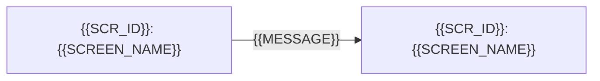

# Wireframe Index: {{PROJECT_NAME}}

<!-- fill: Copy to docs/wireframes/00_WIREFRAME_INDEX.md at Stage 1W (PLAYBOOK §2.2.1), only when Intake §14 records Stage 1W: Yes, with full HTML, or Yes, Markdown only. parent names the SRS that holds the User Interfaces table and the FRs of the screens: docs/srs/SRS.md when docs_mode is monolithic; docs/srs/00_SRS_MASTER.md and the SRS_MODULE_<NAME>.md files that have UI FRs when modular. parent also adds docs/design-system/DESIGN_SYSTEM.md, the design system document written together with Stage 1W (CONVENTIONS §10.7). overlays lists the surfaces of the project that have a UI, in the order of the Intake. assembled_from records "core/07_Wireframe_Template/00_Wireframe_Index_Template.md@<template_version>". This template is shared by every surface that has a UI and has no slots: the differences between web and mobile are written in the fill comments below and in the Stage 1W section of the overlay's OVERLAY.md. Status, version and changes after approval follow the SRS (CONVENTIONS §3, PLAYBOOK §8). The index does not define screens, FRs or ACs: the list of screens has one source, SRS §3, the FRs are in SRS §6.1, the ACs in SRS §8. UI/UX standards (the help entry in §3, §5, §6) follow CONVENTIONS §10; the fill comments point there and do not restate the rules. -->

## 1. Scope & Surfaces

- Source of the screen list: the User Interfaces table in SRS §3, column `SCR ID`. The index repeats exactly that set of `SCR ID`s; do not add, remove or change screens here.
- Releases with screens: <!-- fill: the release labels in the Release column of SRS §6.1 that the FRs of the screens belong to, for example R1, R2 -->
- Design system: `docs/design-system/DESIGN_SYSTEM.md` <!-- fill: path of the project's design system document; the source tokens are in docs/design-system/tokens.json (CONVENTIONS §10.7) -->
- Project type: <!-- fill: choose one: greenfield \| brownfield. Brownfield: the wireframes draw the to-be UI after the Gap Analysis; a screen that does not change is marked Unchanged in the SCR ID cell of SRS §3, has no page and no row in the catalog; screenshots of the current UI are in Regression Baseline §5 -->

| Surface | Entry point type | Number of screens | Notes |
| --- | --- | --- | --- |
| <!-- fill: name of an overlay that has a UI, for example frontend-web or mobile-app, or another surface that has screens --> | <!-- fill: web: the route of the page; mobile: deep link or the screen name in the navigator (stack, tab, modal) --> | <!-- fill --> | <!-- fill: for example the smallest breakpoint (web), screen orientation and offline work (mobile) --> |

## 2. Screen Catalog

<!-- fill: One row for each SCR ID in SRS §3, with exactly the same set of IDs and screen names as the SRS; the first column MUST be SCR ID. Entry point: web writes the route /path as in the Route column of SRS §3; mobile writes the deep link, or the screen name in the navigator when the screen cannot be opened by deep link. FR is copied from the FR column of SRS §3. Release is the earliest release label among the FRs of the screen. HTML file holds the path docs/wireframes/html/SCR-<MOD>-NN.html when the screen has a low-fi HTML (optional, CONVENTIONS §7), and None when it has none. A project with several UI surfaces: the web screen and the mobile screen are two different SCR IDs. -->

| SCR ID | Name | Entry point | Actor | FR | Release | HTML file |
| --- | --- | --- | --- | --- | --- | --- |
| {{SCR_ID}} | {{SCREEN_NAME}} | `{{ENTRY_POINT}}` | `ACT_{{ROLE_CODE}}` | FR-{{MODULE_CODE}}-001 | {{RELEASE}} | <!-- fill: choose one: `docs/wireframes/html/{{SCR_ID}}.html` \| None \| In flow (a screen with no page of its own, drawn in the mockup of the flow in §3) --> |

## 3. Navigation Map

<!-- fill: Each screen of the catalog is a node, labelled with the SCR ID and the name; an edge is a main navigation, labelled with the action or the condition (for example not signed in, saved successfully). Web: record the routes that need sign-in and the navigation by the browser's back button when it differs from the normal flow. Mobile: record the screens that can be opened by deep link or push notification, the tab group or stack of the navigator, and where the system back gesture takes the user. The map matches the entry and exit navigation of each page. -->

<!-- fill: Flow mockup. For each flow that has a screen marked In flow in the catalog: a heading "### Flow: <name>" and a low-fi `text` block that draws those screens one after another, each screen starting with its SCR ID, with the empty and error states when the screen has them. When no screen is marked In flow, delete this comment. -->

Help entry: <!-- fill: criterion 3.2.6 in CONVENTIONS §10.2: the help entry repeated on several screens (contact, FAQ, contextual help) and its shared relative position on those screens; N/A with a reason when the product has no help entry -->

## 4. FR ↔ SCR Traceability

<!-- fill: Exactly one row for each FR in SRS §6.1 whose priority is not Won't; a Won't FR has no row. Modular mode: merge the FRs of the master and of every module. The first column MUST be FR ID, with an SCR ID column. The SCR ID cell holds one of: the SCR-* that implement the FR, separated by commas; "No UI: <reason>" for an FR with no screen (for example a background job, an API for other systems); or, in a brownfield project only, "Unchanged" with a reference to the screenshot in Regression Baseline §5. Every SCR ID of the catalog appears in at least one row. An FR that is in the SRS but implemented by no screen, or a screen that needs an FR the SRS does not have, is a mismatch with the SRS: record a BLOCKING question in §7 with a proposed SRS fix per PLAYBOOK §8, and do not edit this table to match. -->

| FR ID | SCR ID | Notes |
| --- | --- | --- |
| FR-{{MODULE_CODE}}-001 | {{SCR_ID}} | <!-- fill: the part of the FR that each screen implements when the FR spans several screens --> |

## 5. Heuristic Evaluation

<!-- fill: Per CONVENTIONS §10.3: evaluate the whole index and the pages against each heuristic; exactly one row for each key, with the key and the name kept as in the template (copied from the heuristic table of CONVENTIONS §10.3). The problem level and how to handle it follow §10.3. Gate 1W fails while a Critical row remains (PLAYBOOK §2.2.1). -->

| Heuristic key | Heuristic | Evaluation | Problem level | Handling |
| --- | --- | --- | --- | --- |
| `H1` | Visibility of System Status | <!-- fill: the pages, states or edges of the navigation map that were examined, and what is visible --> | <!-- fill: choose one: Critical \| Minor \| None --> | <!-- fill: what was fixed; for a problem that stays Minor: the AQ-NN in §7 or the reason it is accepted; the surface name when the problem belongs to one surface only; None when no problem was found --> |
| `H2` | Match Between the System and the Real World | <!-- fill --> | <!-- fill: choose one: Critical \| Minor \| None --> | <!-- fill --> |
| `H3` | User Control and Freedom | <!-- fill --> | <!-- fill: choose one: Critical \| Minor \| None --> | <!-- fill --> |
| `H4` | Consistency and Standards | <!-- fill: compare the pages with the Component, Pattern, Template catalogs of DESIGN_SYSTEM.md: the same task uses the same Component ID --> | <!-- fill: choose one: Critical \| Minor \| None --> | <!-- fill --> |
| `H5` | Error Prevention | <!-- fill --> | <!-- fill: choose one: Critical \| Minor \| None --> | <!-- fill --> |
| `H6` | Recognition Rather than Recall | <!-- fill --> | <!-- fill: choose one: Critical \| Minor \| None --> | <!-- fill --> |
| `H7` | Flexibility and Efficiency of Use | <!-- fill --> | <!-- fill: choose one: Critical \| Minor \| None --> | <!-- fill --> |
| `H8` | Aesthetic and Minimalist Design | <!-- fill --> | <!-- fill: choose one: Critical \| Minor \| None --> | <!-- fill --> |
| `H9` | Help Users Recognize, Diagnose, and Recover from Errors | <!-- fill --> | <!-- fill: choose one: Critical \| Minor \| None --> | <!-- fill --> |
| `H10` | Help and Documentation | <!-- fill --> | <!-- fill: choose one: Critical \| Minor \| None --> | <!-- fill --> |

## 6. Deceptive Pattern Check

<!-- fill: Per CONVENTIONS §10.4: check the whole index, the pages and the navigation map against the signs of each pattern; exactly one row for each key, with the key and the name kept as in the template (copied from the deceptive pattern table of CONVENTIONS §10.4). Gate 1W fails while a Found row remains (PLAYBOOK §2.2.1); if dropping a pattern needs a business rule to change, fix the SRS per PLAYBOOK §8 first. -->

| Deceptive pattern key | Pattern | Result | Evidence |
| --- | --- | --- | --- |
| `DP1` | Preselection | <!-- fill: choose one: None \| Found --> | <!-- fill: None: the pages, components or edges of the navigation map that were examined; Found: the location of the pattern --> |
| `DP2` | Obstruction | <!-- fill: choose one: None \| Found --> | <!-- fill --> |
| `DP3` | Hidden costs | <!-- fill: choose one: None \| Found --> | <!-- fill --> |
| `DP4` | Hard to cancel | <!-- fill: choose one: None \| Found --> | <!-- fill --> |
| `DP5` | Confirmshaming | <!-- fill: choose one: None \| Found --> | <!-- fill --> |

## 7. Assumptions & Open Questions

<!-- fill: A mismatch between the wireframes and the SRS is of two kinds (PLAYBOOK §2.2.1). If a wireframe is drawn wrongly or misses something compared with the SRS, fix the wireframe. If drawing the wireframes exposes something missing or wrong in the SRS (a screen to add, remove or change; a missing FR; an AC that does not match the states of the screen), record a BLOCKING question with a proposed SRS fix (brownfield: and the Gap Analysis). Gate 1W fails while a BLOCKING question remains in the index or in any page. -->

| ID | Type | Content | Reason or impact | BLOCKING | Respondent |
| --- | --- | --- | --- | :---: | --- |
| AQ-01 | <!-- fill: choose one: Assumption \| Question --> | <!-- fill --> | <!-- fill --> | <!-- fill: choose one: Yes \| No --> | <!-- fill --> |

## 8. Version History

| Version | Date | Author | Change | Reason and requester | Approver |
| --- | --- | --- | --- | --- | --- |
| 0.1.0 | {{DATE}} | {{AUTHOR}} | Initial version | Created by the pipeline | Not approved |
