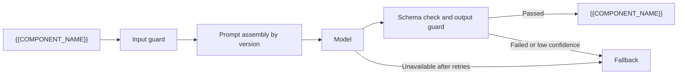
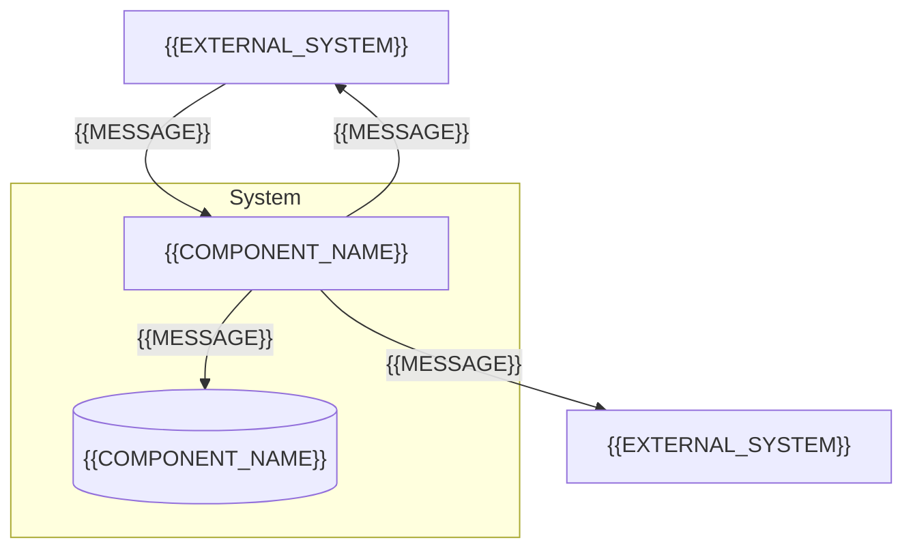
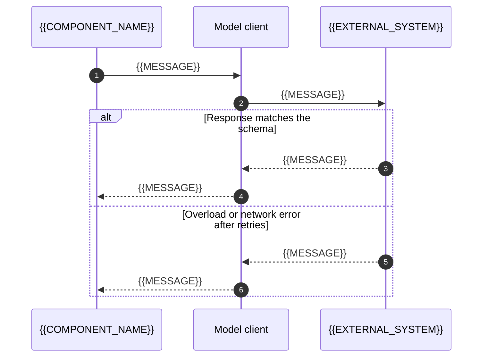

# Overlay ai-llm-app: blocks for the ARCHITECTURE

<!-- SLOT-CONTENT: arch.views -->
### Processing Pipeline

<!-- fill: Every task that calls the model goes through the steps below; remove a step that does not apply and write the reason in §13. -->

### C4 Level 2: Container

<!-- fill: The component that calls the model, the model provider, where the log is stored, the source and target systems of the data. Write the protocol on each edge. -->

### Model Call Flow

### Deployment View

| Environment | Where it runs | Model and API key | Data | Spending limit |
| --- | --- | --- | --- | --- |
| dev | <!-- fill --> | <!-- fill: same model ID as production; separate key --> | Synthetic data | <!-- fill --> |
| staging | <!-- fill --> | <!-- fill --> | <!-- fill: synthetic or anonymized data; MUST NOT use real personal data --> | <!-- fill --> |
| production | <!-- fill --> | <!-- fill --> | Real data | <!-- fill --> |
<!-- /SLOT-CONTENT -->

<!-- SLOT-CONTENT: arch.layout -->
### Layering Rules

- Prompts live in their own directory, one module per prompt with a version constant equal to the `version` of the Prompt Spec; MUST NOT scatter prompts through business code.
- The model client is the only module that calls the provider's SDK: it sets the model parameters, structured output, timeout and retry count, and returns a result classified as success or error.
- The input guard and output guard are pure functions, testable without a network.
- Business logic receives the checked result and decides to use it or switch to the fallback; MUST NOT trust model output that has not passed the schema.
- Eval datasets live in their own directory of the repo, in JSON Lines format; the `EVAL`, `INJ`, `COST` tests live in a separate test project, not run with the unit tests.
- Only the config module reads environment variables; the API key does not pass through logs or error messages.

<!-- PROFILE-SLOT: arch.layout -->
<!-- /SLOT-CONTENT -->

<!-- SLOT-CONTENT: arch.schema -->
### Output & Log Schemas

- Each task has an output schema; the schema in code is the source of the structured output format sent to the provider, and Prompt Spec §5 describes the same fields.
- Enumerated value domains (labels, types) are written out in full in the schema; output outside the domain is invalid.
- The call log record follows SRS §4.1; the input in the log is the version with personal data masked, or only a hash. The tokens of every call that got a response are recorded, even when the output is unusable, because that call is still billed.
- The eval dataset is one JSON object per line, with the sample ID, the input and the expected output.

| Task | Output schema | Fields | Prompt Spec |
| --- | --- | --- | --- |
| {{FEATURE_NAME}} | <!-- fill: schema name in code --> | <!-- fill: fields and value domains --> | `PROMPT-{{MODULE_CODE}}-001` |

<!-- PROFILE-SLOT: arch.schema -->
<!-- /SLOT-CONTENT -->

<!-- SLOT-CONTENT: arch.conventions -->
### Prompt & Model Conventions

| Item | Convention |
| --- | --- |
| Prompt version | The Prompt Spec and the code use the same SemVer version. Changing the prompt text, few-shot examples, output schema or parameters is a Prompt Spec change per PLAYBOOK §8: raise the version, re-approve, re-run the eval gate. Recording eval results in the Prompt Spec does not change the prompt, so it does not raise the version |
| Model | One exact model ID per task, recorded in §2.1; no alias that points to "the latest version" |
| Parameters | `temperature` 0 for classification and extraction tasks; another value needs a reason in the Prompt Spec; `max_tokens` is set by the maximum output length |
| Structured output | Every task uses structured output per the schema; do not extract JSON from free text. The provider may enforce only the shape of the output; limits on values (enumerated domains, number ranges, lengths) are always re-checked by the schema on the system side |
| Untrusted content | User or external-system input goes inside the pair of delimiter tags that the system prompt declares to be data; do not merge untrusted content into the instruction part |
| Personal data | Mask before sending, except fields that SRS §2.5 allows; do not put secrets in the prompt |

### Guardrails, Errors & Fallback

- Input guard: coarse truncation with a limit (Unicode normalization can make a string many times longer), normalize, remove control characters and every non-visible character (invisible formatting characters and default-ignorable characters such as variation selectors), replace curly braces so content cannot open or close a delimiter tag, mask personal data over the whole normalized text with a pattern that runs in linear time in the length, and only then cut at a character (code point) boundary so no half surrogate pair remains. Apart from the coarse truncation, do not truncate before masking: such a cut splits an email or phone number in two and lets the remainder through. The coarse truncation can also split an address that sits on its boundary; that fragment reaches the sent part only when most of the coarse segment before it is dropped (a ticket padded with invisible characters), and Prompt Spec §7 records this residual risk.
- Output guard: check the schema, then the business rules (value domains, confidence threshold); on failure use the fallback in SRS §2.5, and do not retry the same input to "guess" a different result.
- Provider errors: retry overload, rate-limit and network errors with a maximum count and one deadline for the whole call, because the provider may ask for a long wait through `retry-after`; a bad request, a wrong API key, an exhausted billing quota or a nonexistent model is not retried and is reported as a configuration error.
- Processing many records in one run: filter records at the source system and read by page up to a ceiling per run, so skipped records do not hide new ones; an error specific to one record (source data that fails the schema, a permanent rejection by the target system) is logged and skipped; the model's decision is remembered per record and version, so a failed write or a rejected record does not cause another model call; the model call is logged before the run stops on an error. Only a transient error of an external system stops the run; an external system that rejects the service account's authentication or authorization is a configuration error.
- Writing results: do not delete other data of the target record (add a tag, do not replace the tag list) and do not overwrite a result set by a person; a record that already has a result from a person is not processed again.
- Budget: `max_tokens` limits each call; total tokens per day, including the tokens of calls whose output is unusable, are tracked and alerted per §8.
- Tools with side effects: the model only proposes; the server checks permissions and, for an irreversible operation, requires user confirmation.

### Error Code Mapping

The AI/LLM App part of the "Mapping by surface" column in §7.1 records the system's behavior on a code; internal error codes of this surface are not returned directly to the end user.

<!-- fill: Record the codes the project uses; the names below are suggestions, change them to follow the project's convention. -->

| Code | When | Behavior |
| --- | --- | --- |
| `OUTPUT_INVALID` | The output does not match the schema or business rules | Fallback; log with the prompt version |
| `MODEL_UNAVAILABLE` | The provider is overloaded, has a network error or times out after retries | Fallback; alert when the rate exceeds the threshold in §8 |
| `LOW_CONFIDENCE` | Confidence is below the Prompt Spec threshold | Send to a reviewer |

### Evaluation Gate

- Run the `EVAL`, `INJ`, `COST` tests when the prompt, few-shot examples, schema, input guard, model client, model or parameters change, and on a schedule to catch changes on the provider's side. Eval tests run in a separate CI job that has the API key of the eval environment, not in the coding agent's commit loop.
- Each eval run repeats the dataset several times per the Prompt Spec; every run has to meet the threshold, the best run is not taken. 20 samples is the minimum: with a threshold near the true accuracy the gate passes sometimes and fails sometimes, so when it fails look at the wrong samples before changing the prompt, and expand the dataset when real anonymized samples are available.
- The eval results (prompt version, model, metric, cost) are recorded in the Prompt Spec before the new prompt version is released.

<!-- PROFILE-SLOT: arch.conventions -->
<!-- /SLOT-CONTENT -->

<!-- SLOT-CONTENT: arch.deployment -->
### Keys, Limits & Monitoring

| Item | Decision |
| --- | --- |
| API key | One key per environment, in the secret store; rotated <!-- fill: cycle -->; MUST NOT be committed or written to logs |
| Spending limit | Set in the provider's console for each key: <!-- fill: monthly limit of each environment --> |
| Monitoring | Input tokens, output tokens, cost, p95 latency, error rate by code in §7, rate of sends to a reviewer |
| Alerts | <!-- fill: daily cost threshold, rate of `MODEL_UNAVAILABLE`, rate of `OUTPUT_INVALID`, unusual increase in the rate of sends to a reviewer --> |

### Release & Rollback

| Item | Decision |
| --- | --- |
| Releasing a new prompt | After the eval gate passes; <!-- fill: choose one: enable for everyone \| run in parallel without using the result (shadow) then enable \| enable by percentage; give the reason --> |
| Upgrading the model | A new ADR, re-run the eval gate with the new model, update §2.1 and the Prompt Spec |
| AI kill switch | <!-- fill: a flag or config that switches every request to the fallback without a redeploy --> |
| Rollback | Redeploy the previous prompt version or model; AI results already written are kept, and the prompt version in the log allows tracing |
<!-- /SLOT-CONTENT -->
