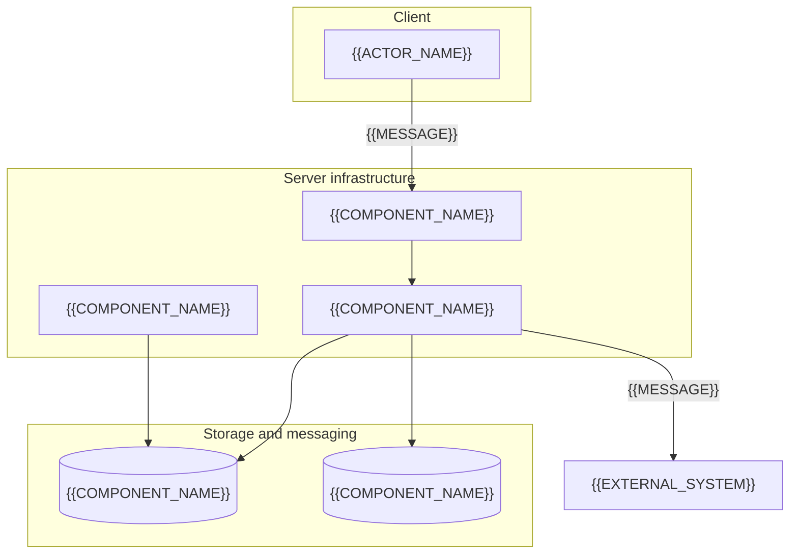
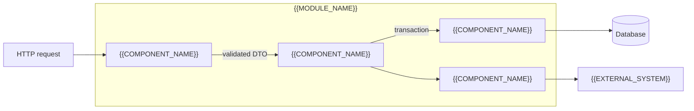

# Overlay backend-api: blocks for the ARCHITECTURE

<!-- SLOT-CONTENT: arch.views -->
### C4 Level 2: Container

<!-- fill: Each container is an independently running or storage unit. Delete containers that are not used (worker, cache, broker) and record the reason in §13 if you delete one. Edges state the protocol. -->

### C4 Level 3: Component

<!-- fill: Draw it for the module with the most complex flow; the other modules follow the same layering pattern in §4. -->

### Deployment View

| Environment | Where it runs | API instances | Database | Data | Who has access |
| --- | --- | --- | --- | --- | --- |
| dev | <!-- fill --> | <!-- fill --> | <!-- fill --> | Fake data | <!-- fill --> |
| staging | <!-- fill --> | <!-- fill --> | <!-- fill --> | <!-- fill: fake or anonymized data; MUST NOT use real personal data --> | <!-- fill --> |
| production | <!-- fill --> | <!-- fill: at least 2 if NFR-RELI requires high availability --> | <!-- fill --> | Real data | <!-- fill --> |
<!-- /SLOT-CONTENT -->

<!-- SLOT-CONTENT: arch.layout -->
### Layering Rules

- Each module in §4.1 is a module directory that holds everything: the interface layer (controller or route handler), the business layer (service), the data access layer (repository), DTOs and validation schemas, domain types (entity), the module's tests.
- Shared code that is not business logic lives in the shared directory: constants, errors, error filters, guards, interceptors, pure utilities.
- Infrastructure connections (database, cache, email, storage, clients of external APIs) live in the infrastructure directory and are injected into a repository or adapter.
- A module imports another module only through that module's public interface; MUST NOT import another module's repository or internal files.
- Only the configuration module reads environment variables.

<!-- PROFILE-SLOT: arch.layout -->
<!-- /SLOT-CONTENT -->

<!-- SLOT-CONTENT: arch.schema -->
### Physical Schema Rules

- Concrete types for every column: UUID, string with a maximum length, decimal with precision and scale, timestamp with time zone; no generic types.
- The primary key is of type `{{ID_FORMAT}}`, generated by the server or the database, not accepted from the client.
- Every foreign key has an explicit delete rule; data with financial or legal constraints uses `Restrict`.
- An index for every foreign key and every column used to filter or sort in common queries; unique constraints (including composite unique) match SRS §4.2.
- Enums match SRS §4.2 and SRS §10.1; adding an enum value is a schema change and needs a migration.
- Every table has `created_at`, a table that allows edits has `updated_at`; a soft-delete table has `deleted_at`.
- Table and column names are `snake_case`, table names plural.
- Check constraints for simple arithmetic rules, for example quantity greater than 0.
- Migrations are generated with the stack's tool, go one way, and contain no business logic.

<!-- PROFILE-SLOT: arch.schema -->

### Project Schema

<!-- fill: The whole physical schema of the project in one code block in the DSL of the stack profile: every table, column, key, index, enum, relationship. The schema MUST be migratable as is and match SRS §4. -->
<!-- /SLOT-CONTENT -->

<!-- SLOT-CONTENT: arch.conventions -->
### HTTP API Conventions

| Item | Convention |
| --- | --- |
| Version | Major version in the path: `/api/v1/...`; a breaking change increases the major |
| Resource naming | Plural `kebab-case` nouns, nested at most one level, for example `/api/v1/{{RESOURCE_PATH}}/{id}` |
| Methods | `GET` reads, `POST` creates or performs an action, `PATCH` edits partially, `PUT` replaces entirely, `DELETE` deletes |
| Envelope | Per §6.2 for every response |
| Date-time format | ISO 8601 UTC, for example `2026-01-01T00:00:00.000Z` |
| Resource ID | `{{ID_FORMAT}}` |
| Pagination | `{{PAGINATION_STYLE}}`. Offset: parameters `page`, `limit`; `meta` has `page`, `limit`, `totalItems`, `totalPages`. Cursor: parameters `cursor`, `limit`; `meta` has `nextCursor`, `limit`, `hasMore`. <!-- fill: keep the sentence of the chosen style, delete the other --> |
| Filtering and sorting | Filter with queries by field name, for example `?status=ACTIVE`; sort with `?sort=-createdAt,name` (a minus sign means descending); accept only fields in the endpoint's allowlist |
| Rate limit | Count per user on an authenticated route, per real client IP (through a trusted proxy, including the servers of another surface that call the API on behalf of users) on a public route; headers `RateLimit-Limit`, `RateLimit-Remaining`, `RateLimit-Reset`; a `429` response has `Retry-After`; the way to configure it per stack is at the end of this section |
| Idempotency | A write operation that is not naturally idempotent accepts the `Idempotency-Key` header (a client-generated string, scoped per user); the storage mechanism and the key retention time are recorded in an ADR |
| Request size | <!-- fill: maximum body limit --> |
| OpenAPI document | One complete OpenAPI 3.1 document at `openapi/openapi.yaml`: it has `info` (title, version, license) and the `servers` of each environment, plus the fragment in SPEC §3 of every implemented SPEC; it is the source for generating clients of other surfaces and for contract tests |
| CORS for browser clients | Only the origins in §9.1; allow the headers `Authorization`, `Content-Type`, `Idempotency-Key`; declare `Access-Control-Expose-Headers` for `Retry-After` and the rate-limit headers so a browser on another origin can read them |

### Error Code to HTTP Mapping

The Backend API part of the "Mapping by surface" column in §7.1 records the HTTP status per this table.

| Error group | HTTP status | Error code |
| --- | --- | --- |
| Input violating the schema or the validation rules | `400` | `VALIDATION_ERROR` |
| Missing, expired or wrong token | `401` | `UNAUTHENTICATED` |
| Insufficient permission | `403` | `FORBIDDEN` |
| Resource does not exist | `404` | Codes of the form `*_NOT_FOUND` by resource name, present in §7.1 |
| State conflict or business rule violation | `409` | Business codes in §7.1 |
| Rate limit exceeded | `429` | `RATE_LIMITED` |
| Unforeseen error | `500` | `INTERNAL_ERROR` |

### Transaction

- The transaction boundary sits at the service layer; the controller and the repository do not open a transaction themselves.
- Default isolation level: `{{ISOLATION_LEVEL}}`. The SPEC states it explicitly when a higher level or a row lock is used.
- Invariants under concurrent operations are kept in the database: a conditional atomic update, a unique constraint, or a lock (row lock, advisory lock) taken inside the transaction before the check step. No check-then-write at the application layer without holding that lock.
- Events and calls to external systems are emitted after the transaction commits.

<!-- PROFILE-SLOT: arch.conventions -->
<!-- /SLOT-CONTENT -->

<!-- SLOT-CONTENT: arch.deployment -->
### Packaging & Runtime

| Item | Decision |
| --- | --- |
| Deployment unit | Container image; the process runs as a non-root user |
| Configuration | Environment variables per §6.4; secrets come from a secret manager at startup |
| Health check | `GET /health/live` (process alive) and `GET /health/ready` (can connect to the database and required dependencies) |
| Graceful shutdown | Receive the stop signal, stop accepting new requests, finish in-flight requests within <!-- fill: number of seconds --> |

### Migrations on Deploy

- The release step runs `{{MIGRATION_DEPLOY_CMD}}` before the new version receives traffic.
- Migrations follow the expand and contract style: the old and new versions can both run on the new schema; dropping a column or table happens in a later release.

### Release & Rollback

| Item | Decision |
| --- | --- |
| Release strategy | <!-- fill: choose one: rolling update \| blue-green; give the reason per NFR-RELI --> |
| Rollback | Redeploy the image of the previous version; the schema does not need to be reversed thanks to expand and contract |
| Database replica | <!-- fill: read replica or standby, or No with the reason --> |
| Backup | Per §8.2 |
<!-- /SLOT-CONTENT -->
