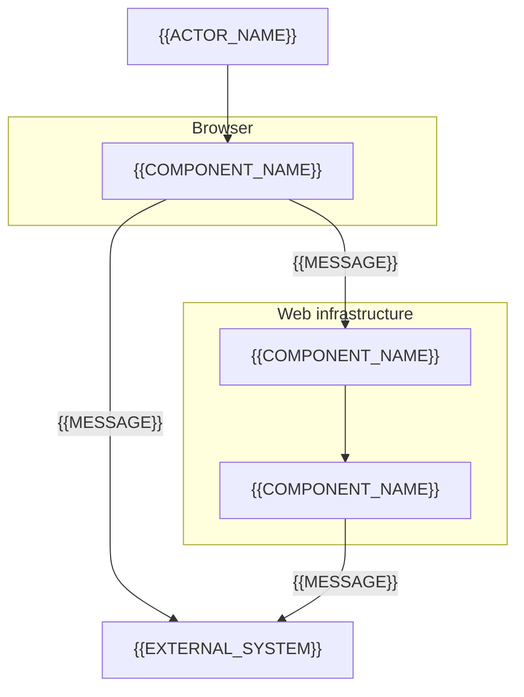
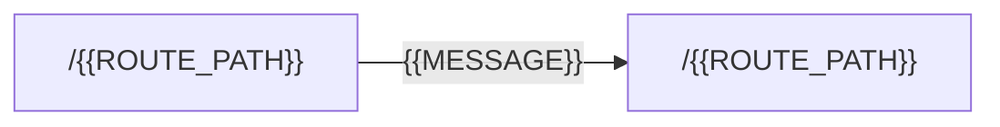
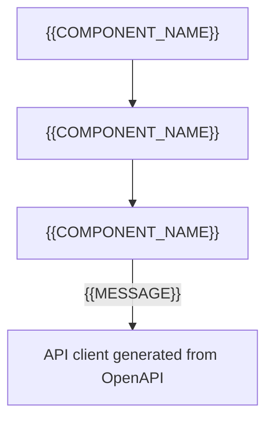

# Overlay frontend-web: blocks for the ARCHITECTURE

<!-- SLOT-CONTENT: arch.views -->
### C4 Level 2: Container

<!-- fill: The browser, the web app (server rendering if any), the backend API and the external services that the browser calls directly. Delete unused containers and record the reason in §13. Edges record the protocol. -->

### Route Map

<!-- fill: Every route of the app, with the main navigation as edges; routes that need login are marked explicitly. -->

<!-- fill: Route table: one row for each route. With Stage 1W: the SCR ID column records the screen that the route displays; each SCR-* of the wireframe index has at least one row (Gate 2); a route that displays no screen of the index (for example a redirect route, a shared error page) records N/A with a reason. Without Stage 1W: remove the SCR ID column. -->

| Route | SCR ID | Requires login | Notes |
| --- | --- | :---: | --- |
| `/{{ROUTE_PATH}}` | {{SCR_ID}} | <!-- fill: choose one: Yes \| No --> | <!-- fill --> |

### Component Tree

<!-- fill: Draw it for the most complex screen; record which components render on the server, which run on the client, and where the API is called. -->

### Deployment View

| Environment | Where it runs | API called | Data | Who has access |
| --- | --- | --- | --- | --- |
| dev | <!-- fill --> | <!-- fill: dev API or a mock API --> | Fake data | <!-- fill --> |
| staging | <!-- fill --> | <!-- fill --> | <!-- fill: fake or anonymized data; MUST NOT use real personal data --> | <!-- fill --> |
| production | <!-- fill --> | <!-- fill --> | Real data | <!-- fill --> |
<!-- /SLOT-CONTENT -->

<!-- SLOT-CONTENT: arch.layout -->
### Layering Rules

- The route layer (pages, layouts, loading screens, error screens of each route) only fetches initial data and composes the feature's components; MUST NOT contain display business logic or call the API directly by URL.
- Each module in §4.1 is a feature directory containing: the feature's components, hooks, form schemas, API calls through the shared client, display strings by key, and the feature's tests.
- Shared UI components (button, input field, dialog) live in the design system directory; they contain no business logic and do not call the API.
- The API client generated from the OpenAPI document and the shared utilities live in the lib directory; every API call goes through this client.
- A feature imports another feature only through that feature's public export file; MUST NOT import the internal files of another feature.
- Only the configuration module reads environment variables; variables sent to the browser are public and MUST NOT contain secrets.

<!-- PROFILE-SLOT: arch.layout -->
<!-- /SLOT-CONTENT -->

<!-- SLOT-CONTENT: arch.schema -->
### Client Data Types

This surface has no physical storage schema; business data belongs to the API. This section fixes the source of every client-side data type.

- API request and response types are generated automatically from the API's OpenAPI document; MUST NOT hand-write response types. The OpenAPI document used for generation has its source and version recorded in the table below.
- The form validation schema copies the constraints (required, length, value range, format) from the request DTO in the API's SPEC; each constraint has a boundary test. A form adds no field that the API does not accept.
- Server data is held in exactly one place per the stack's convention (server-rendered data or the query cache in the browser); it is not copied into local state.
- Browser storage is used only for the non-sensitive data in the table below; tokens and personal data follow ARCHITECTURE §6.1 and §9.1.

| Item | Decision |
| --- | --- |
| Source OpenAPI document | <!-- fill: path of the copy in the repo or the URL, with the API version --> |
| How to update when the API changes its contract | <!-- fill: who updates the copy, which generation command runs, which SPEC records the change --> |
| Browser storage used | <!-- fill: key, content, lifetime; write No if not used --> |

<!-- PROFILE-SLOT: arch.schema -->
<!-- /SLOT-CONTENT -->

<!-- SLOT-CONTENT: arch.conventions -->
### UI Conventions

| Item | Convention |
| --- | --- |
| Design token | Color, spacing, font size, corner radius come from tokens; no loose values in components. Token source: `docs/design-system/tokens.json`; the mapping file in the source code (CSS variables or the UI library theme) per the stack profile is a mapping from `tokens.json`, hand-written per the profile's mapping table or generated by a tool the project chooses, edited at the same time as `tokens.json`, and is the only place allowed to hold raw color, spacing, radius and font size values; the UI library theme changes only through tokens |
| Component naming | Component names in `PascalCase`, file names in `kebab-case`; one exported component per file |
| Accessibility | WCAG level of NFR-USAB; semantic tags before ARIA; every action can be done with the keyboard; visible focus; full criteria in `specflow/CONVENTIONS.md` §10.2 |
| Display strings | The key is the feature name and the element name joined by a dot, in `camelCase`, for example `{{MODULE_SLUG}}.submit`; do not build display strings by string concatenation |
| Number, currency, time format | Use the platform's locale formatting API; currency is received as a string from the API and not converted to floating point for computation |
| Loading screen and error screen | Each route has a `Loading` state as a skeleton and an error boundary that shows the `Error` state with a way to retry |

### Five UI States

| State | When | Display requirement |
| --- | --- | --- |
| `Initial` | Before the user acts or before loading | Default content, no error message |
| `Loading` | Loading or submitting | Skeleton or progress indicator; lock the write action in progress |
| `Empty` | Loaded but no data | An explanation and the next action |
| `Success` | Has data or the action succeeded | The result, a message that screen readers announce |
| `Error` | Network error or error from the API | A message per the mapping table below, keep the data the user entered, a way to recover |

### Error Code to UI Mapping

The Frontend Web part of the "Mapping by surface" column in §7.1 records the display string key and behavior per this table; §7.1 has every code the UI handles.

<!-- fill: An API that belongs to another project: copy the API's codes exactly by name from the API's registry, and the Owning module column starts with API followed by the API's name. An API in the same project: the code is owned by the backend module like every other row. A code that exists only on the web side (network error) records the Owning module as the web module or Shared. The code names and the error structure (error.details, correlationId) in the table below follow the convention of the backend-api overlay; for another API, replace them with that API's names and structure. -->

| Error group | Display behavior |
| --- | --- |
| `VALIDATION_ERROR` | Show errors under each field per `error.details`, focus the first error field |
| `UNAUTHENTICATED` | Go to the login screen, return to the previous screen after login |
| `FORBIDDEN` | A no-permission message, no retry |
| Business code of the API | A dedicated message by the code's string key, keep the entered data |
| `RATE_LIMITED` | A wait message, allow retry after the time in the `Retry-After` header |
| Network error, timeout | Client-side code `NETWORK_ERROR`; a lost-connection message, allow retry with the same `Idempotency-Key` |
| `INTERNAL_ERROR` and unknown codes | A generic message with the `correlationId` for reporting to support |

### API Calls

- Every call goes through the client generated from OpenAPI; the base URL comes from configuration and is not hard-coded.
- A write action that is not naturally idempotent generates an `Idempotency-Key` once for each content the user submits; one key never goes with different content.
- After a network error, a timeout or `5xx`, the result is unknown: the form locks editing, and the user may only resend exactly that content with the same key until a definitive response arrives. A definitive response is a success, or an error that the API returns only after it has looked up the idempotency key (listed per the API's SPEC). After a definitive response, the form reopens and the next submission uses a new key.
- An error returned when there is no submission with an unknown result (for example a validation error on the first submission) allows immediate editing; the next submission uses a new key.
- Lock the write action while submitting; a second trigger during that time does not create a new request.
- Each call has a maximum timeout of <!-- fill: number of seconds -->; automatic retry only for read requests.
- An API call made on the web's server on behalf of the user (page rendering, route handler) carries an `X-Forwarded-For` of a single address: the client address written by the web's load balancer (the last element of the received header), and does not forward the header the client sent itself. The web server accepts only requests that pass through that load balancer. This way the API rate-limits per real user and the client cannot spoof the address.
- An API on a different origin: the API allows the web's origin and the request headers that the UI sends (`Authorization`, `Content-Type`, `Idempotency-Key`), and declares `Access-Control-Expose-Headers` for the headers the UI reads (for example `Retry-After`); record this dependency in §9.1.

<!-- PROFILE-SLOT: arch.conventions -->
<!-- /SLOT-CONTENT -->

<!-- SLOT-CONTENT: arch.deployment -->
### Packaging & Runtime

| Item | Decision |
| --- | --- |
| Deployment unit | <!-- fill: choose one: container running server rendering \| static files on a CDN; give the reason --> |
| Configuration | Environment variables per §6.4; public variables are embedded at build time, changing a value needs a rebuild; secrets are used only on the server |
| Static assets | Served through a CDN with hashed file names and long-term caching; HTML pages are not cached long-term |
| Security headers | Content-Security-Policy, HSTS, `X-Content-Type-Options: nosniff`, `Referrer-Policy` per §9.1 |
| Health check | <!-- fill: the check path when running a server-rendering server; N/A for static files --> |

### Release & Rollback

| Item | Decision |
| --- | --- |
| Release order with the API | A UI that uses a new contract is released only after the API supports that contract in the target environment |
| Release strategy | <!-- fill: choose one: rolling update \| blue-green \| version switch on the CDN; give the reason --> |
| Rollback | Redeploy the previous build; the previous build's static assets are kept until old user sessions end |
<!-- /SLOT-CONTENT -->
