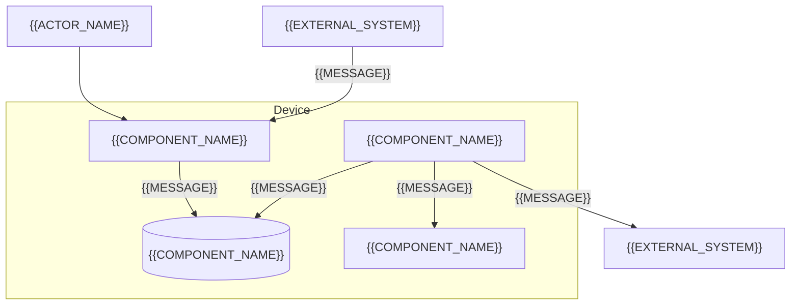
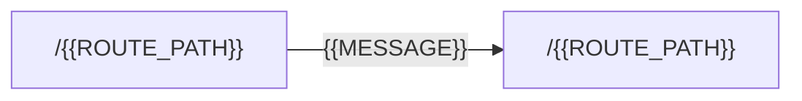
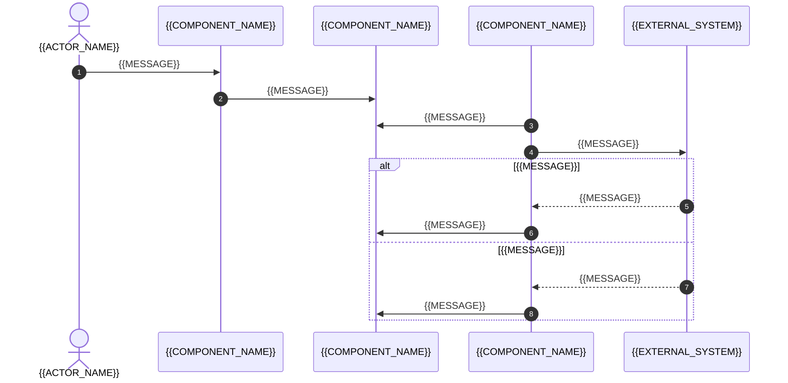

# Overlay mobile-app: blocks for ARCHITECTURE

<!-- SLOT-CONTENT: arch.views -->
### C4 Level 2: Container

<!-- fill: The on-device app has the UI, the local database, the sync engine and the OS keystore; outside it are the API, the push notification service and the over-the-air update service if used. Delete an unused container and record the reason at §13. Label each edge with its protocol. -->

### Navigation Map

<!-- fill: Every screen of the app, with the main navigation as edges; mark the screens that need sign-in and the screens that can be opened by deep link. -->

<!-- fill: Navigation table: one row for each screen in the navigator. With Stage 1W: the SCR ID column records the matching screen in the wireframe index; every SCR-* of the index has at least one row (Gate 2); a technical screen that is not in the index (for example the splash screen) records N/A with the reason. Without Stage 1W: drop the SCR ID column. -->

| Route | SCR ID | Navigator group | Deep link | Requires sign-in |
| --- | --- | --- | --- | :---: |
| `/{{ROUTE_PATH}}` | {{SCR_ID}} | <!-- fill: choose one: stack \| tab \| modal --> | <!-- fill: deep link path, or None --> | <!-- fill: choose one: Yes \| No --> |

### Sync Flow

<!-- fill: The flow of a change from the moment the user saves on the device to the moment the API confirms it, including the conflict branch; consistent with the sync conventions at §7. -->

### Build & Distribution View

| Channel | Build | API called | Data | Who can install |
| --- | --- | --- | --- | --- |
| Development | <!-- fill: development build on the developer's emulator or device --> | <!-- fill: dev API or mock API --> | Fake data | Developers |
| Internal testing | <!-- fill: TestFlight, Google Play internal testing --> | <!-- fill: staging API --> | <!-- fill: fake or anonymized data; MUST NOT use real personal data --> | <!-- fill --> |
| Production | <!-- fill: App Store, Google Play --> | <!-- fill --> | Real data | Users |
<!-- /SLOT-CONTENT -->

<!-- SLOT-CONTENT: arch.layout -->
### Layering Rules

- The screen layer (route files and navigation layouts) only composes feature components and reads navigation parameters; it MUST NOT query the local database or call the API directly.
- Each module at §4.1 is a feature folder that holds: components, hooks that read data from the local database, local write operations, form schemas, display strings by key, and the feature tests.
- The local database is accessed only through a shared query gateway (a small interface for statements, queries and transactions) so that tests run on the SQL engine of the test machine; migrations live in the same folder as this gateway.
- The sync engine is the only code that calls the write endpoints of the API for synced data; screens write to the local database and the change queue and do not wait for the API.
- The API client generated from the OpenAPI document and the shared utilities live in the lib folder; every API call goes through this client.
- A feature imports another feature only through its public export file; platform-specific code goes in a file with a platform suffix, with no scattered platform branching in the code.
- Only the config module reads environment variables; every value embedded in the build is public and MUST NOT contain a secret.

<!-- PROFILE-SLOT: arch.layout -->
<!-- /SLOT-CONTENT -->

<!-- SLOT-CONTENT: arch.schema -->
### On-device Schema

The source of truth for business data is the API; the local schema holds a copy plus data that exists only on the device so that the app works offline.

- The migrations of the local database run when the app opens, before the first query; a released migration is not edited, merged or deleted, only new migrations are added. The app opens the database created by every released version, including a version below the minimum: a blocked user can still update while changes are pending on the device.
- Each synced table has a primary key column equal to the API ID, a version column issued by the API on which the on-device value depends, and a record sync status column (`SYNCED`, `QUEUED`, `CONFLICT`, `REJECTED`).
- The change queue table (outbox) holds each change waiting to be sent: the change ID (also the idempotency key), the target record, the content, the base version, the send count, the time it is to be resent, and the last error code. A change that has never been sent is merged with a new change of the same record. Before the request leaves the device, the change is read and marked as sent (the send count increases) in the same transaction; from then on it keeps its content and key, and a new edit of the same record, including one made while the request is in flight, becomes a new change queued behind it.
- The conflict table holds the API's version when the API reports a conflict, so the user can compare and choose.
- A column that holds an enumerated value owned by the API (status, result) gets a `CHECK` constraint on the value domain only when the API contract commits to adding a new value at the same time as it raises the minimum app version; otherwise the column has no `CHECK` and the UI shows an unknown value with a fallback label. A column owned by the app (sync status, queue status) always has a `CHECK`.
- The request and response data types are generated automatically from the API's OpenAPI document; the table below maps local tables to DTOs.
- Personal data on the device consists only of the fields in SRS §4 whose "Data classification" is personal data or sensitive personal data; delete it per SRS §4.3.

| Local table | API DTO | Device-only fields | Notes |
| --- | --- | --- | --- |
| <!-- fill --> | <!-- fill: schema name in OpenAPI --> | <!-- fill: for example server_version, sync_status --> | <!-- fill --> |

| Item | Decision |
| --- | --- |
| Source OpenAPI document | <!-- fill: path of the copy in the repo or URL, with the API version --> |
| How to update when the API changes its contract | <!-- fill: who updates the copy, which code generation command runs, which SPEC records the change, which local migration goes with it --> |
| Encryption of on-device data | <!-- fill: rely on OS encryption, or database encryption with the key in the keystore; give the reason --> |

<!-- PROFILE-SLOT: arch.schema -->
<!-- /SLOT-CONTENT -->

<!-- SLOT-CONTENT: arch.conventions -->
### Offline-first Rules

| Item | Rule |
| --- | --- |
| Read | Screens read from the local database; a sync result updates the local database and then the screen re-renders by itself |
| Write | A write operation updates the local record and adds the change to the queue in the same transaction; the UI shows "saved on device" at once and does not wait for the API |
| Data loss | No change is dropped without the user knowing: sign-out, data deletion, a conflict or a rejection is always shown to the user first |
| Time | The time on the device is for display only; ordering and arbitration use the version issued by the API |

### Sync Conventions

- Triggers: when the app opens, when the network returns, when the app returns to the foreground, on pull to refresh, after every write operation, and, while the app is open, when sending can resume: the `429` wait of the device ends and no run has started after that moment (the first run that starts after the wait ends clears it, even when `Retry-After` is 0), otherwise the nearest retry time.
  - The timer is set when a run has just ended, including when the retry time has already passed while that run was running (then use a minimum delay of one second instead of skipping the retry time), unless the run ended with `auth-required` or `failed`, because retrying at once would only repeat the same result; a `429` wait that a later run has already passed is no longer a reason to set the timer. When the app opens, when the network returns, on return to the foreground and on pull to refresh, the backoff retry time is dropped so that sending happens at once, including the retry time after a `5xx` with `Retry-After`; only the `429` wait of the device is kept.
  - Only one sync run executes at a time; a trigger that arrives while a run is executing and that run ends with `done` or `offline` is merged into exactly one next run, because the running run may have failed on a request sent before the device got its network back; if it ends with any other result no extra run happens, because running again would only repeat the same result (after `429`, the timer retries when the wait ends). If a trigger dropped the backoff retry time while a change was still being sent and that change still fails, the change is scheduled to be resent sooner than the backoff that its send count would otherwise give.
- A run: send the pending changes first, then receive new changes from the API by the stored cursor.
- Send: in each loop, in one transaction, read the oldest change that can be sent (the first pending change of a record, whose retry time has arrived) and mark it as sent; only after the commit send the request with exactly the content that was read, with the idempotency key equal to the change ID and the base version. MUST NOT send a later change of a record ahead of an earlier change of that record; changes of other records do not have to wait.
- Definitive responses: on success, remove the change from the queue, update the record's version and set the base version of the later changes of the same record to the new version; on a version conflict, save the API's version in the conflict table, drop the pending changes of the record (the user's value stays in the local record) and set the status `CONFLICT`; every other `4xx` response, except `401`, `408`, `429` and the response that says the idempotency key is being processed (sending again gets the same result: invalid data, no permission, not found, locked, unknown code), sets `REJECTED` with the error code.
- Unclear responses (network error, timeout, `408`, `5xx`, the response that says the idempotency key is being processed): keep the change with exactly the same key and content, schedule a resend with capped exponential backoff, and record an error code chosen by the device (not a code from the response body). A network error, a timeout, and the `5xx` codes that show the whole service is down (`502`, `503`, `504`) or that state a wait through `Retry-After` stop the sending part (the retry time still follows the backoff, not the header value), because sending other items then would only add requests to a service that is unlikely to answer; `408` and the other `5xx` codes (without `Retry-After`) let the changes of other records continue, so that one change that keeps failing does not hold the whole queue. The API contract states how it reports that an idempotency key is being processed.
- `401` stops the sync run and refreshes the session; `429` on any request, write or read, stops every request to the API for the whole device (not only the change that just got this code) until the wait given by the `Retry-After` header ends.
- Receive: only a record in the `SYNCED` status is overwritten by a newer version from the API; a record in the `QUEUED` status keeps the on-device value (the next send detects a conflict if there is one); a record in the `CONFLICT` status updates the API's version in the conflict table if the new one is newer.
- A sync run that hits an error that does not clear by itself (a received page that cannot be saved, a `4xx` response on a read other than `401`, `408`, `429`): keep the cursor, end the run with an error result and show it on the sync indicator until a later run succeeds; MUST NOT skip the failing page and save a new cursor.

### UI States

| State | When | Display requirement |
| --- | --- | --- |
| `Initial` | Before the user acts or before loading | Default content, no error message |
| `Loading` | The device has no data yet and is loading for the first time | Skeleton or progress indicator |
| `Empty` | The device has the latest data but the list is empty | An explanation and the next action |
| `Success` | There is data on the device | The data with the last sync time and the sync status of each record |
| `Error` | The data on the device cannot be read, or the first load failed | A message per the mapping table below, and how to recover |

| Sync status | Display | User action |
| --- | --- | --- |
| `Synced` | No indicator, or a synced mark | Edit as usual |
| `Queued` | Indicator "saved on device, waiting to sync" | Keep editing; changes are merged under the sync conventions |
| `Conflict` | An indicator that a choice is needed; a screen that compares the on-device version and the API's version | Choose one version by the strategy in the ADR; no further edits until chosen |
| `Rejected` | An indicator that it was rejected, with the reason by error code | See the reason, drop the change or contact the owner |

A sync run that ends with an error that does not clear by itself shows on the shared sync indicator, ahead of the pending change count, until a later run succeeds.

### Error Code to UI Mapping

The Mobile App part of the "Mapping per surface" column at §7.1 records the string key and the behavior under this table, including the sync status that the error code leads to; §7.1 has every code that the app handles.

<!-- fill: The API belongs to another project: copy the API's codes by name from the API's registry, and the Owning module column starts with API followed by the name of the API. A code that exists only in the app (network error) has as Owning module the app's module or Shared. The code names and the error structure in the table below follow the convention of the backend-api overlay; for another API, replace them with the names and structure of that API. -->

| Error group | Behavior on a direct call (sign-in, first load) | Behavior during sync |
| --- | --- | --- |
| `VALIDATION_ERROR` | An error under each field by `error.details` | The change becomes `Rejected`; this error shows that on-device validation has drifted from the API |
| `UNAUTHENTICATED` | Go to sign-in | Stop syncing, refresh the session; pending changes stay as they are |
| `FORBIDDEN` | A no-permission message | The change becomes `Rejected` |
| The API's version conflict code | Not applicable | The record becomes `Conflict` |
| Other `4xx` codes of the API, including unknown codes, except the code that says an idempotency key is being processed | A specific message by the string key of the code; an unknown code uses the generic message | The change becomes `Rejected` with the message of the code; not sent again. The code that says an idempotency key is being processed does not fall into this row: treat it as an unclear response, the change stays `Queued` and is sent again with the same key |
| `RATE_LIMITED` | A message to wait per `Retry-After` | Stop every request to the API for the whole device, not only the change that just got this code, until the wait per `Retry-After` ends |
| Network error, timeout, `502`, `503`, `504`, every other `5xx` with `Retry-After` | Client-side code `NETWORK_ERROR`; use the data already on the device | The change stays `Queued`, the sending part stops, sent again with the same key |
| `408`, other `5xx` without `Retry-After` | Client-side code `INTERNAL_ERROR`; a generic message with the `correlationId` | The change stays `Queued`, sent again with the same key, the changes of other records continue to be sent |

### Permissions & Performance

- Ask for a permission right before the first use of the feature that needs it, with a screen that explains the reason; if it is denied, use the behavior at SRS §3 and let the user open the system settings, and do not keep asking again.
- Long lists use a virtualized list; local queries have an index on the filter and sort columns.
- The time from app launch to the first screen with data and the build size follow NFR-PERF; heavy tasks (sync, image compression) do not run on the UI thread.
- Tokens and secrets are stored only in the OS keystore; logs and crash reports contain no token or personal data.

### UI Conventions

| Item | Convention |
| --- | --- |
| Design token | Color, spacing, font size and corner radius come from tokens; no loose values in components. The token source: `docs/design-system/tokens.json`; the theme file in the source code per the stack profile is a mapping from `tokens.json`, written by hand per the profile's mapping table or generated by a tool the project chooses, edited at the same time as `tokens.json`, and is the only place allowed to hold raw color, spacing, radius and font size values; light and dark modes follow the token mode and the OS setting |

<!-- PROFILE-SLOT: arch.conventions -->
<!-- /SLOT-CONTENT -->

<!-- SLOT-CONTENT: arch.deployment -->
### Versioning, Signing & Distribution

| Item | Decision |
| --- | --- |
| App version | The displayed version follows SemVer; the build number increases monotonically for every build sent to the store |
| Signing keys | The iOS certificate and the Android keystore are kept in the build service or the CI secret store; MUST NOT be committed to the repo |
| Build | <!-- fill: cloud build service or CI build machine; build profiles for development, internal testing, production --> |
| Internal testing channel | <!-- fill: TestFlight, Google Play internal testing; who approves before it goes to production --> |
| Store information | The description, screenshots, and the privacy and data collection declaration match SRS §4 and §2.4 |

### Release, Updates & Rollback

| Item | Decision |
| --- | --- |
| Staged release | <!-- fill: App Store phased release, Google Play staged rollout; the percentage at each step and the stop metrics (crash rate, sync errors) --> |
| Over-the-air (OTA) update | <!-- fill: choose one: not used \| only for changes to code and assets that leave the native part unchanged; with the channel, the runtimeVersion policy, and how to roll back. An over-the-air update carries no local migration: rolling it back would run old code on an upgraded database --> |
| Minimum version | <!-- fill: where it is declared, how an old app recognizes it and leads the user to the store --> |
| API compatibility | The API keeps the contract for every app version from the minimum version up; a breaking contract change raises the minimum version after the share of users on old versions falls below <!-- fill: percentage threshold --> |
| Local migration | Runs when the app opens; the new build reads the database of every released build, including builds below the minimum version; it ships only in a build sent to the store |
| Rollback | The store does not allow removing an installed version: stop the staged release, fix and release a new build with a higher build number, or roll back an over-the-air update (which carries no migration) |
<!-- /SLOT-CONTENT -->
