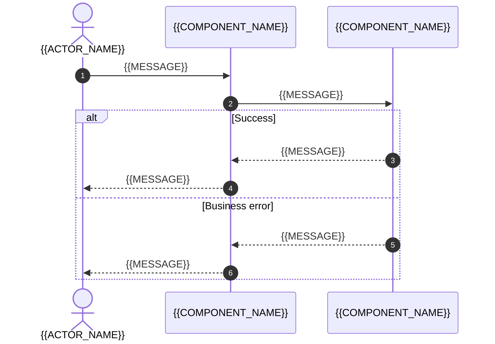
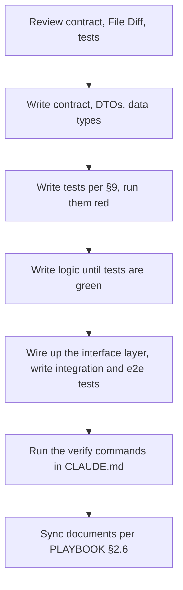

# Technical Specification: {{FEATURE_NAME}}

<!-- fill: Copy to docs/specs/SPEC_<FEATURE_KEY>.md. Add to parent the part of the SRS that holds the feature's FRs (SRS.md or SRS_MODULE_<NAME>.md) and the related ADRs. release is the release label in the Release column of SRS §6.1; every FR in §1.5 has a Release equal to release (CONVENTIONS §3, PLAYBOOK §2.4). The keywords MUST, MUST NOT, SHOULD, MAY follow RFC 2119 and RFC 8174. A section that does not apply keeps its heading and states N/A with a reason; do not delete it. The SPEC is an execution contract: the coding agent does only what is written here. The frontmatter assembled_from records the sources per CONVENTIONS §3. -->

## 1. Goal & Bounded Context

### 1.1. Technical Objective

- SPEC ID: `{{SPEC_ID}}`
- Risk level: <!-- fill: high or normal, with the reason in one sentence; edit the risk key in the frontmatter to match. high when the SPEC touches authentication or authorization, tenant isolation, money or quota, personal data, a schema that already holds data, or an approved public contract (CONVENTIONS §3) -->
- Objective: <!-- fill: what the feature does, for whom, in 2 to 4 sentences; name the main FR. -->

### 1.2. Core Invariants

<!-- fill: What MUST always hold under every condition, including concurrent or interleaved operations. Each invariant has at least one CONC test in §9. -->

| ID | Invariant | Proving test |
| --- | --- | --- |
| INV-01 | <!-- fill: a verifiable statement --> | TC-{{MODULE_CODE}}-CONC-01 |

### 1.3. Out of Scope

<!-- fill: what a reader might assume belongs to this feature but is not done here; one item per line, naming the SPEC or version that will do it, if any. -->

### 1.4. Dependencies

| Type | Dependency | Note |
| --- | --- | --- |
| Internal component | {{COMPONENT_NAME}} | <!-- fill: which interface is used --> |
| External system | {{EXTERNAL_SYSTEM}} | <!-- fill: or "None" --> |
| Data affected | <!-- fill: tables, collections, files per ARCHITECTURE §5 --> | <!-- fill: read or write --> |
| Dependent SPEC | <!-- fill: SPEC ID that must be done first, or "None" --> | <!-- fill --> |

### 1.5. Requirements Satisfied

| FR ID | AC ID | BR ID | NFR ID |
| --- | --- | --- | --- |
| FR-{{MODULE_CODE}}-001 | AC-{{MODULE_CODE}}-01 | <!-- fill: or "None" --> | <!-- fill: or "None" --> |

## 2. File Diff & Impact Tracking

> The coding agent MUST only modify or create files listed in this section. If another file is needed, stop and propose a SPEC change (PLAYBOOK §7). Paths match the directory tree in ARCHITECTURE §4.

### 2.1. Modified Files

| Path | Change |
| --- | --- |
| <!-- fill: path in inline code --> | <!-- fill: function, class or item to add or change --> |

### 2.2. New Files

| Path | Type | Responsibility |
| --- | --- | --- |
| <!-- fill: path in inline code --> | <!-- fill: choose one: source \| test \| migration \| config \| docs --> | <!-- fill --> |

### 2.3. MUST NOT Touch

| Path or scope | Reason |
| --- | --- |
| <!-- fill: files or directories that are easy to change by mistake, for example another module, shared configuration, a migration that has already run --> | <!-- fill --> |

## 3. Contract

The shape of the contract depends on the surface. Every error code used in this section MUST appear in ARCHITECTURE §7.1.

### Endpoint

<!-- fill: One table for each endpoint of the feature. -->

| Item | Value |
| --- | --- |
| Method and path | <!-- fill: choose one: GET \| POST \| PATCH \| PUT \| DELETE --> `/api/v1/{{RESOURCE_PATH}}` |
| Authentication | <!-- fill: Bearer token per ARCHITECTURE §6.1, or "No" for a public endpoint --> |
| Authorization | <!-- fill: roles allowed, matching §6 --> |
| Required headers | `Content-Type: application/json`<!-- fill: add `Idempotency-Key` if the write operation is not naturally idempotent --> |
| Rate limit | <!-- fill: limit per ARCHITECTURE §9.1 --> |
| Success code | <!-- fill: for example 201 on create, 200 when replaying the same Idempotency-Key --> |

### Request & Response DTO

- The request is validated at the boundary with a runtime schema before it enters the service; unknown fields are rejected; a validation error returns `VALIDATION_ERROR` with the list of fields in `error.details`.
- Computed values (price, total, permissions) are not accepted from the request; the service computes them from the source of truth.
- The response contains only declared fields; MUST NOT return internal fields (hashes, unnecessary foreign keys, personal data the client does not need).

<!-- PROFILE-SLOT: spec.contract -->

<!-- fill: Write the real request schema and response type of the endpoint following the pattern above. -->

### Success Response

<!-- fill: One JSON example in the ARCHITECTURE §6.2 envelope, example values matching the DTO. -->

### Error Matrix

| HTTP status | `error.code` | Triggering scenario | `error.details` |
| --- | --- | --- | --- |
| `400` | `VALIDATION_ERROR` | Request does not match the schema | List of `{ field, issue }` |
| `401` | `UNAUTHENTICATED` | Token missing, expired or with a wrong signature | None |
| `403` | `FORBIDDEN` | Authenticated but the role is not allowed | None |
| `429` | `RATE_LIMITED` | Rate limit exceeded | None; `Retry-After` header |
| <!-- fill: status per ARCHITECTURE §7 --> | <!-- fill: business code present in ARCHITECTURE §7.1 --> | <!-- fill --> | <!-- fill --> |

### OpenAPI Fragment

<!-- fill: Replace this line with a line that starts with "Companion file:" per CONVENTIONS §7, pointing to the file next to this SPEC whose name is the SPEC file name without the .md extension plus ".openapi.yaml", with the list of operationIds of the fragment. Create that file from the template specflow/overlays/backend-api/spec-openapi-fragment-template.yaml. The fragment is enough to generate a client and run contract tests: path and method matching the Endpoint table, camelCase operationId, security, requestBody with a real schema, every response in the error matrix, the success response and the error responses carry the schema of the envelope (declared in components), each kind of element of `error.details` has clearly declared properties so a client can generate the type. When implemented, the SPEC merges the fragment into openapi/openapi.yaml, and this file is in the File Diff. -->

## 4. Migration & Data

| Item | Content |
| --- | --- |
| Migration needed | <!-- fill: choose one: Yes \| No; if No, the rows below state N/A --> |
| Migration file | <!-- fill: path, must appear in §2.2 --> |
| Change (forward) | <!-- fill: tables, columns, indexes, constraints added or changed --> |
| Rollback | <!-- fill: how to reverse it, whether data is lost --> |
| Backfill of existing data | <!-- fill: how to fill data for existing records, when it runs, how it stays idempotent --> |
| Compatibility during gradual rollout | <!-- fill: whether old and new code versions can both run against the new schema --> |

## 5. Algorithm & Execution Flow

### 5.1. Sequence Diagram

<!-- fill: Show the main flow and the important error branches; participants are real components from ARCHITECTURE §3 and §4. -->

### 5.2. Processing Steps

<!-- fill: Numbered steps, one verifiable action per step. For a step that can fail, state the condition, the error code and the state of the data after the failure. -->

### 5.3. Transaction Boundary & Concurrency

| Item | Decision |
| --- | --- |
| Transaction boundary | <!-- fill: which steps are in the same transaction; "No transaction" with the reason if so --> |
| Isolation level | <!-- fill: the default level stated in the surface conventions in ARCHITECTURE §7; if another level is used, give the reason --> |
| Concurrency control | <!-- fill: how the §1.2 invariants are kept under parallel operations, for example a conditional atomic update, a row lock, an optimistic lock by version --> |
| Idempotency | <!-- fill: where the idempotency key comes from, where it is stored, the response on a duplicate key; a single mechanism --> |
| Post-commit tasks | <!-- fill: events or tasks that run only after the transaction succeeds --> |

## 6. Authorization Matrix

| Actor | Action | Expected result | Error code when blocked | Test |
| --- | --- | --- | --- | --- |
| `ACT_{{ROLE_CODE}}` | <!-- fill --> | <!-- fill: choose one: Allow \| Deny --> | <!-- fill: code from ARCHITECTURE §7.1, or N/A --> | <!-- fill: TC ID --> |

## 7. Event Contract

| Event | Payload (schema) | Emitted when | Consumer | Delivery guarantee | Version |
| --- | --- | --- | --- | --- | --- |
| `{{EVENT_NAME}}` | <!-- fill: field name, type, required; no sensitive personal data --> | <!-- fill --> | <!-- fill --> | <!-- fill: choose one: at-most-once \| at-least-once with an idempotent consumer --> | <!-- fill: for example v1 --> |

## 8. Observability

| Type | Name | Content | Level or threshold |
| --- | --- | --- | --- |
| Log | <!-- fill: log event name --> | <!-- fill: fields recorded with it, no data that is forbidden to log --> | <!-- fill: log level --> |
| Metric | <!-- fill --> | <!-- fill --> | <!-- fill --> |
| Audit | <!-- fill: action that needs an audit trail, or N/A --> | <!-- fill: who, did what, when, on which data --> | <!-- fill --> |
| Alert | <!-- fill: or N/A --> | <!-- fill --> | <!-- fill --> |

## 9. Tests

> The coding agent MUST write tests per this table before writing logic (TDD). Every AC in §1.5 has at least one TC; every invariant in §1.2 has at least one TC of type `CONC`; every NFR in §1.5 that SRS §8 verifies by Test has a TC that names that NFR in the "AC or INV" column, unless its TC already sits in another SPEC. TCs take the next number from `docs/INDEX.md` §3 (CONVENTIONS §4). The table records the exact file and name of each test; test names describe behavior in English and do not contain the TC ID (CONVENTIONS §4).

### 9.1. Required Tests

| TC ID | AC or INV | Type | Scenario (Given-When-Then) | Test file | Test name |
| --- | --- | --- | --- | --- | --- |
| TC-{{MODULE_CODE}}-UNIT-01 | AC-{{MODULE_CODE}}-01 | Unit | **Given:** <!-- fill --> **When:** <!-- fill --> **Then:** <!-- fill --> | <!-- fill: path, must appear in §2 --> | <!-- fill: test name that describes behavior --> |
| TC-{{MODULE_CODE}}-CONC-01 | INV-01 | Concurrency | **Given:** <!-- fill --> **When:** <!-- fill: concurrent or interleaved operations --> **Then:** <!-- fill: the invariant still holds, measurable --> | <!-- fill --> | <!-- fill --> |

### Surface Test Types

| Type | TYPE in the TC ID | Scope | Data | Required |
| --- | --- | --- | --- | :---: |
| Unit | `UNIT` | Service with the repository and adapters mocked | In memory | Yes |
| Integration | `INT` | Repository and queries on a real database running in isolation | A database created for the run | Yes when the SPEC has a new query |
| E2E | `E2E` | HTTP request through the whole application to the database | A database created for the run | Yes |
| Contract | `CTR` | Real response compared with the OpenAPI fragment in §3 | Same as E2E | Yes when the endpoint is used by another client |
| Concurrency | `CONC` | The invariant in §1.2 under parallel requests | Real database | Yes, one test per invariant in §1.2 |
| Load smoke | `LOAD` | Quick latency measurement against NFR-PERF | Staging environment | When the SPEC touches a hot path of NFR-PERF |

### Concurrency Test Pattern

1. Prepare a state that limits the resource (for example the remaining quantity is smaller than the number of requests).
2. Send N parallel requests (N ≥ 10) to the same resource, wait for all of them to finish.
3. Count the responses by code and query the database to assert the invariant (non-negative, no duplicates, totals match).
4. Do not mock the storage layer; do not use sleep to order the requests.

<!-- PROFILE-SLOT: spec.test-types -->

## 10. Rollout

| Item | Decision |
| --- | --- |
| Feature flag | <!-- fill: flag name per ARCHITECTURE §6.7, or "Not used" with the reason --> |
| Backward compatibility | <!-- fill: how old clients or versions are affected --> |
| Shutoff or rollback plan | <!-- fill: how to turn the feature off on an incident, how the data is handled --> |

## 11. Assumptions & Open Questions

| ID | Type | Content | Reason or impact | BLOCKING | Respondent |
| --- | --- | --- | --- | :---: | --- |
| AQ-01 | <!-- fill: choose one: Assumption \| Question --> | <!-- fill --> | <!-- fill --> | <!-- fill: choose one: Yes \| No --> | <!-- fill --> |

## 12. Execution Workflow & Definition of Done

Definition of Done of the SPEC:

- [ ] Every verify command in `CLAUDE.md` meets the pass condition of the verify command table (PLAYBOOK §11).
- [ ] 100% of the tests in §9 pass, in the exact files and names recorded in the table.
- [ ] Source code changes only in the files in §2; apart from that, only documents and the plan are updated per PLAYBOOK §2.6.
- [ ] No new dependency outside ARCHITECTURE §2 or an `accepted` ADR.
- [ ] Every error is returned in the ARCHITECTURE §6.2 envelope with a code from §7.1 (surfaces that have request/response).
- [ ] The SPEC moves to status `implemented`, the §9 table records the exact test file and test name, and the plan checkboxes are synced.

## 13. Version History

| Version | Date | Editor | Change | Reason and requester | Approver |
| --- | --- | --- | --- | --- | --- |
| 0.1.0 | {{DATE}} | {{AUTHOR}} | Initial version | Created by the pipeline | Not approved |
