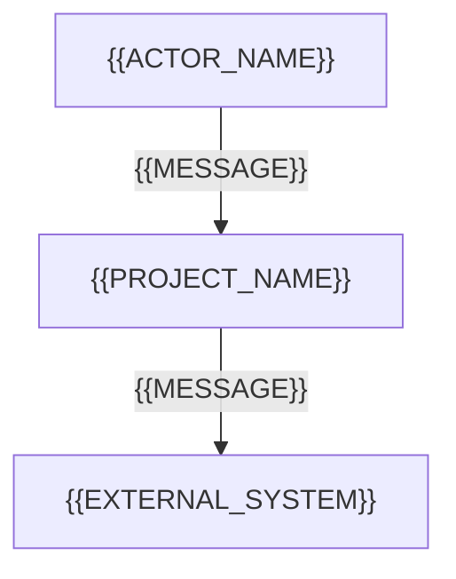
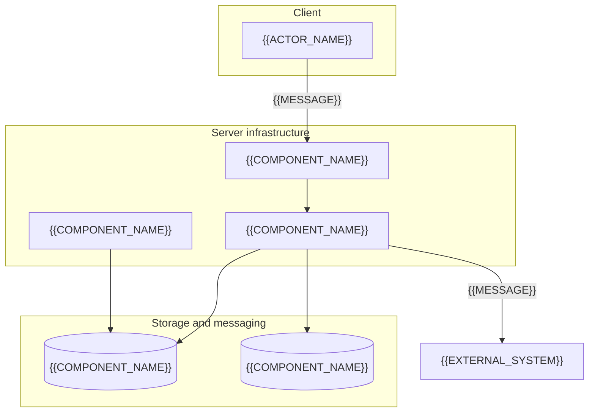
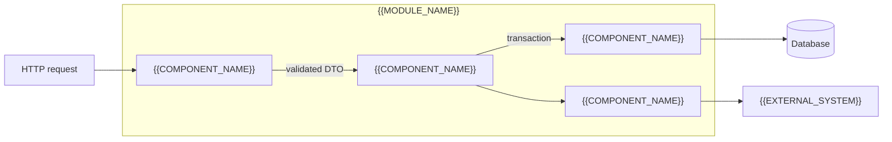
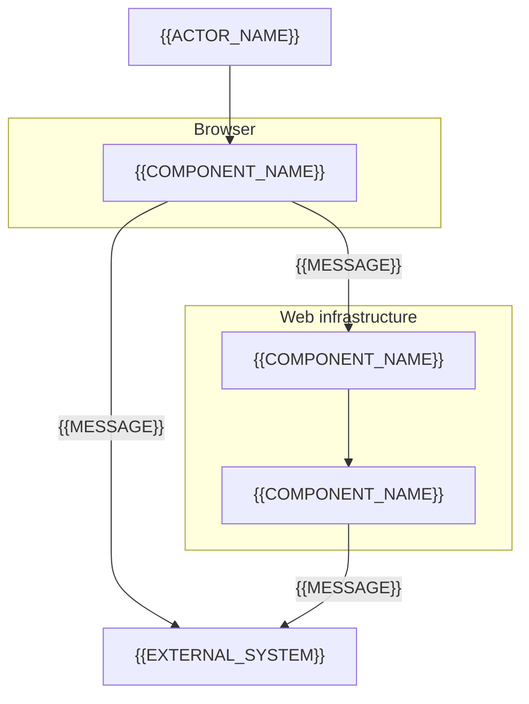
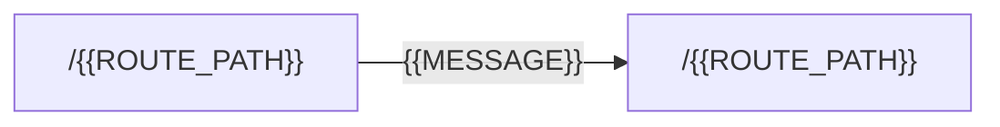
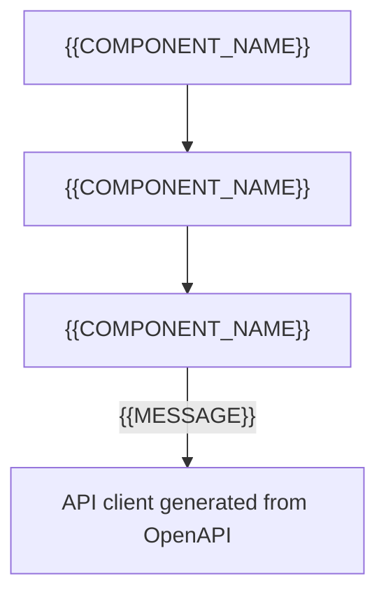

# System Architecture Document: {{PROJECT_NAME}}

<!-- fill: Copy to docs/ARCHITECTURE.md. Add the approved SRS to parent (docs/srs/SRS.md or docs/srs/00_SRS_MASTER.md). Refer to ISO/IEC/IEEE 42010:2022 (the view concept, rationale recorded as ADRs; no conformance claim) and use the C4 model. The document answers WHERE and HOW; every choice in the document is a single value, never "A or B". Key decisions have an ADR per PLAYBOOK §2.3 and are listed in §12; a choice marked "has ADR" MUST be covered by an ADR. The frontmatter assembled_from records the sources per CONVENTIONS §3. -->

## 1. Architectural Goals & Principles

### 1.1. Quality Attributes

| Attribute | Related NFR | How it is achieved (summary, details in §8.1) |
| --- | --- | --- |
| <!-- fill: for example scalability, reliability, security, maintainability --> | <!-- fill: NFR ID in SRS §7 --> | <!-- fill --> |

### 1.2. Golden Rules

1. Layer Isolation. The communication layer (route handler, controller, screen, command handler) only receives input, validates it and maps output; it MUST NOT contain business logic or access storage directly. The business layer (service, use case) handles the business and coordinates transactions. The data access layer (repository, gateway, adapter) encapsulates queries and calls to external systems.
2. No Circular Dependencies. If module A depends on module B, then B MUST NOT depend back on A; they communicate through a public interface or events.
3. Strict Typing. Every payload, entity and function signature has an explicit type; MUST NOT use the language's mechanism for escaping type checking. The language-specific rules are in the rule of the surface in `.claude/rules/`.
4. No hardcoded secrets. Secrets only pass through the mechanism in §6.4 and §9.1.
5. Write logs through the structured logger (§6.3); MUST NOT print directly to stdout or stderr outside the logger.
6. Only the config module reads environment variables; elsewhere, config is received through parameters or dependency injection.
7. Currency uses one single exact representation across the whole system: <!-- fill: choose one: exact decimal type \| integer in the smallest currency unit; write N/A if the system does not handle money -->; MUST NOT use floating-point numbers.
8. Time is stored and transmitted in UTC, in ISO 8601 format; time zone conversion happens only in the display layer.
9. Validate at the boundary (user input, external systems, files, queues); data that has passed the boundary is trusted inside. Values computed by the client (price, amount, permission, status) MUST NOT be trusted: the server recomputes or rechecks them from the source of truth.
10. A migration only changes structure and data and MUST NOT contain business logic; migrations are forward-only and have a rollback plan in the SPEC.
11. <!-- fill: project-specific rules, or delete this line if there are none -->

### 1.3. Architectural Style

| Item | Decision |
| --- | --- |
| Architectural style | <!-- fill: choose one, has ADR: modular monolith \| microservices \| serverless \| another style, named explicitly --> |
| Module boundaries | <!-- fill: how the modules in §4.1 communicate with each other: in-process interface calls, events, network calls --> |
| ADR | <!-- fill: ADR ID --> |

## 2. Fixed Tech Stack

### 2.1. Technology Table

<!-- fill: One group of rows per surface, copied from the section whose heading contains (Tech Stack) in the stack profile chosen in Intake §14. Write exact versions (no ranges or ^). Every deviation from the profile has an ADR. The coding agent MUST only use libraries that are in this table. -->

| Surface | Layer | Technology | Exact version | Role | ADR |
| --- | --- | --- | --- | --- | --- |
| <!-- fill --> | <!-- fill: for example language, runtime, framework, storage, cache, validation, test --> | <!-- fill --> | <!-- fill --> | <!-- fill --> | <!-- fill: ADR ID or "per profile" --> |

### 2.2. Dependency Policy

| Rule | Content |
| --- | --- |
| Adding a new library | An `accepted` ADR is needed before installing; the ADR states the reason, the alternative of not using a library, and the license |
| Allowed licenses | <!-- fill: list of accepted licenses; any other license needs an ADR --> |
| Package source | <!-- fill: official registry or internal registry --> |
| Version upgrades | <!-- fill: patch level may be upgraded after passing the verify gate; minor and major levels need an ADR --> |
| Lockfile | The lockfile is committed; the build uses exactly the versions in the lockfile |
| Vulnerability check | Runs in CI (§11); a high or critical vulnerability blocks the merge unless an ADR accepts the risk |

## 3. C4 Architecture Views

### 3.1. C4 Level 1: System Context

<!-- fill: The actors and external systems match SRS §2.1 and §2.2. Each edge states the purpose and the protocol. -->



### Backend API

#### C4 Level 2: Container

<!-- fill: Each container is an independently running or storage unit. Delete containers that are not used (worker, cache, broker) and record the reason in §13 if you delete one. Edges state the protocol. -->



#### C4 Level 3: Component

<!-- fill: Draw it for the module with the most complex flow; the other modules follow the same layering pattern in §4. -->



#### Deployment View

| Environment | Where it runs | API instances | Database | Data | Who has access |
| --- | --- | --- | --- | --- | --- |
| dev | <!-- fill --> | <!-- fill --> | <!-- fill --> | Fake data | <!-- fill --> |
| staging | <!-- fill --> | <!-- fill --> | <!-- fill --> | <!-- fill: fake or anonymized data; MUST NOT use real personal data --> | <!-- fill --> |
| production | <!-- fill --> | <!-- fill: at least 2 if NFR-RELI requires high availability --> | <!-- fill --> | Real data | <!-- fill --> |

### Frontend Web

#### C4 Level 2: Container

<!-- fill: The browser, the web app (server rendering if any), the backend API and the external services that the browser calls directly. Delete unused containers and record the reason in §13. Edges record the protocol. -->



#### Route Map

<!-- fill: Every route of the app, with the main navigation as edges; routes that need login are marked explicitly. -->



<!-- fill: Route table: one row for each route. With Stage 1W: the SCR ID column records the screen that the route displays; each SCR-* of the wireframe index has at least one row (Gate 2); a route that displays no screen of the index (for example a redirect route, a shared error page) records N/A with a reason. Without Stage 1W: remove the SCR ID column. -->

| Route | SCR ID | Requires login | Notes |
| --- | --- | :---: | --- |
| `/{{ROUTE_PATH}}` | {{SCR_ID}} | <!-- fill: choose one: Yes \| No --> | <!-- fill --> |

#### Component Tree

<!-- fill: Draw it for the most complex screen; record which components render on the server, which run on the client, and where the API is called. -->



#### Deployment View

| Environment | Where it runs | API called | Data | Who has access |
| --- | --- | --- | --- | --- |
| dev | <!-- fill --> | <!-- fill: dev API or a mock API --> | Fake data | <!-- fill --> |
| staging | <!-- fill --> | <!-- fill --> | <!-- fill: fake or anonymized data; MUST NOT use real personal data --> | <!-- fill --> |
| production | <!-- fill --> | <!-- fill --> | Real data | <!-- fill --> |

## 4. Repository Layout

The coding agent MUST put new files in the directory tree below and MUST NOT create directories outside the standard.

### 4.1. Module Mapping

| Module ID | Code | Component (container, component) | Directory | Surface |
| --- | --- | --- | --- | --- |
| {{MODULE_ID}} | `{{MODULE_CODE}}` | {{COMPONENT_NAME}} | <!-- fill: path in inline code --> | <!-- fill --> |

### Backend API

#### Layering Rules

- Each module in §4.1 is a module directory that holds everything: the interface layer (controller or route handler), the business layer (service), the data access layer (repository), DTOs and validation schemas, domain types (entity), the module's tests.
- Shared code that is not business logic lives in the shared directory: constants, errors, error filters, guards, interceptors, pure utilities.
- Infrastructure connections (database, cache, email, storage, clients of external APIs) live in the infrastructure directory and are injected into a repository or adapter.
- A module imports another module only through that module's public interface; MUST NOT import another module's repository or internal files.
- Only the configuration module reads environment variables.

<!-- PROFILE-SLOT: arch.layout -->

### Frontend Web

#### Layering Rules

- The route layer (pages, layouts, loading screens, error screens of each route) only fetches initial data and composes the feature's components; MUST NOT contain display business logic or call the API directly by URL.
- Each module in §4.1 is a feature directory containing: the feature's components, hooks, form schemas, API calls through the shared client, display strings by key, and the feature's tests.
- Shared UI components (button, input field, dialog) live in the design system directory; they contain no business logic and do not call the API.
- The API client generated from the OpenAPI document and the shared utilities live in the lib directory; every API call goes through this client.
- A feature imports another feature only through that feature's public export file; MUST NOT import the internal files of another feature.
- Only the configuration module reads environment variables; variables sent to the browser are public and MUST NOT contain secrets.

<!-- PROFILE-SLOT: arch.layout -->

## 5. Physical Data Schema

The source of truth for the physical data structure. Table names, columns, types and value domains MUST match SRS §4 and SRS §10.1; if they differ, fix them per PLAYBOOK §8.

### Backend API

#### Physical Schema Rules

- Concrete types for every column: UUID, string with a maximum length, decimal with precision and scale, timestamp with time zone; no generic types.
- The primary key is of type `{{ID_FORMAT}}`, generated by the server or the database, not accepted from the client.
- Every foreign key has an explicit delete rule; data with financial or legal constraints uses `Restrict`.
- An index for every foreign key and every column used to filter or sort in common queries; unique constraints (including composite unique) match SRS §4.2.
- Enums match SRS §4.2 and SRS §10.1; adding an enum value is a schema change and needs a migration.
- Every table has `created_at`, a table that allows edits has `updated_at`; a soft-delete table has `deleted_at`.
- Table and column names are `snake_case`, table names plural.
- Check constraints for simple arithmetic rules, for example quantity greater than 0.
- Migrations are generated with the stack's tool, go one way, and contain no business logic.

<!-- PROFILE-SLOT: arch.schema -->

#### Project Schema

<!-- fill: The whole physical schema of the project in one code block in the DSL of the stack profile: every table, column, key, index, enum, relationship. The schema MUST be migratable as is and match SRS §4. -->

### Frontend Web

#### Client Data Types

This surface has no physical storage schema; business data belongs to the API. This section fixes the source of every client-side data type.

- API request and response types are generated automatically from the API's OpenAPI document; MUST NOT hand-write response types. The OpenAPI document used for generation has its source and version recorded in the table below.
- The form validation schema copies the constraints (required, length, value range, format) from the request DTO in the API's SPEC; each constraint has a boundary test. A form adds no field that the API does not accept.
- Server data is held in exactly one place per the stack's convention (server-rendered data or the query cache in the browser); it is not copied into local state.
- Browser storage is used only for the non-sensitive data in the table below; tokens and personal data follow ARCHITECTURE §6.1 and §9.1.

| Item | Decision |
| --- | --- |
| Source OpenAPI document | <!-- fill: path of the copy in the repo or the URL, with the API version --> |
| How to update when the API changes its contract | <!-- fill: who updates the copy, which generation command runs, which SPEC records the change --> |
| Browser storage used | <!-- fill: key, content, lifetime; write No if not used --> |

<!-- PROFILE-SLOT: arch.schema -->

## 6. Cross-cutting Concerns

<!-- fill: A section that does not apply to the project is written as N/A with a reason, not deleted. -->

### 6.1. Authentication & Authorization

Write N/A with a reason if the system has no authentication. If the authentication model does not use tokens (for example a session stored on the server), write N/A in the rows about tokens and describe the actual model in the last row. The ADR column is required for a row marked `has ADR`; other rows write `Not needed`.

| Item | Decision | ADR |
| --- | --- | --- |
| Access token format (has ADR) | {{TOKEN_FORMAT}} | <!-- fill --> |
| Signing algorithm (has ADR) | {{SIGNING_ALG}} | <!-- fill --> |
| Access token lifetime | {{ACCESS_TTL}} | <!-- fill --> |
| Refresh token lifetime | {{REFRESH_TTL}} | <!-- fill --> |
| Refresh token storage (has ADR) | {{REFRESH_STORE}} | <!-- fill --> |
| Refresh token rotation | <!-- fill: choose one: Yes, the old token is revoked as soon as the new token is issued \| No, with a reason --> | <!-- fill --> |
| Revocation on logout | <!-- fill --> | <!-- fill --> |
| Token content (claims) | <!-- fill: identity and role only; MUST NOT contain sensitive personal data --> | <!-- fill --> |
| Authorization model (has ADR) | <!-- fill: choose one: RBAC \| ABAC \| ACL; state where permissions are checked --> | <!-- fill --> |
| Other authentication model | <!-- fill: only when tokens are not used; otherwise write N/A --> | <!-- fill --> |

### 6.2. Error Handling & Response Envelope

- Every error is mapped to a code in the Error Code Registry (§7.1) before it leaves the system; MUST NOT return a stack trace or an internal message to the client.
- Every request/response style response (API, IPC) is wrapped in the envelope below. A surface with no request/response writes N/A.
- The content of `meta` follows the pagination convention in §7; `correlationId` comes from §6.3.

Success response:

```json
{
  "success": true,
  "data": {},
  "meta": {},
  "timestamp": "2026-01-01T00:00:00.000Z"
}
```

Error response:

```json
{
  "success": false,
  "error": {
    "code": "VALIDATION_ERROR",
    "message": "A message for the user that does not reveal internal details.",
    "details": [{ "field": "fieldName", "issue": "Description of the violation" }],
    "correlationId": "request-id",
    "timestamp": "2026-01-01T00:00:00.000Z"
  }
}
```

### 6.3. Logging

| Item | Decision |
| --- | --- |
| Format | <!-- fill: choose one: JSON, one line per record \| key-value --> |
| Log level | <!-- fill: the level used in each environment --> |
| Correlation ID | Generated at the boundary if the request has none, passed through every internal and external call, and written in every log record |
| Data forbidden in logs | Secrets, tokens, passwords, card data, sensitive personal data that is not masked |
| Collection point | <!-- fill --> |
| Retention period | <!-- fill: matches NFR-OBS and NFR-DATA --> |

### 6.4. Config & Environment Variables

<!-- fill: List every variable. The project's environment variable template file holds only variable names and fake values, no real secrets. -->

| Variable name | Type | Required | Default | Description | Secret |
| --- | --- | --- | --- | --- | :---: |
| <!-- fill: UPPER_SNAKE --> | <!-- fill --> | <!-- fill: choose one: Yes \| No --> | <!-- fill: or "None" --> | <!-- fill --> | <!-- fill: choose one: Yes \| No --> |

### 6.5. Observability

| Item | Decision |
| --- | --- |
| Metrics | <!-- fill: the main business and technical metrics, where they are collected --> |
| Trace | <!-- fill: trace scope, sampling rate --> |
| Health check | <!-- fill: liveness and readiness checks, what each one checks --> |
| Alerts | <!-- fill: alert conditions tied to NFR-RELI and NFR-PERF, recipients --> |

### 6.6. Internationalization

<!-- fill: default language, supported languages, where display strings are stored, number, currency and date formats by locale; matches NFR-I18N. -->

### 6.7. Feature Flags

<!-- fill: mechanism (choose one: static configuration per environment | flag service), naming convention, who may switch flags, deadline to remove a flag after it is stable. -->

### 6.8. Background Jobs

<!-- fill: queue or scheduling mechanism, retry and backoff policy, job idempotency, handling of a job that finally fails (dead letter), monitoring. -->

### 6.9. Caching Policy

| Data | Cache location | TTL | How to invalidate | Acceptable staleness |
| --- | --- | --- | --- | --- |
| <!-- fill --> | <!-- fill --> | <!-- fill --> | <!-- fill --> | <!-- fill --> |

## 7. Conventions

### 7.1. Error Code Registry

The only source of error codes. Stage 2 moves every code in SRS §6.3 (including SRS modules) into this table. A SPEC only uses codes that are in the table; a new code is added here before a SPEC uses it. The column "Mapping per surface" records how the error code appears on each surface under the convention of that surface below; a project with many surfaces writes one part per surface in the same cell, starting with the display name of the surface (CONVENTIONS §2) and a colon, the parts separated by semicolons, for example `Backend API: HTTP 409; Frontend Web: string key and display behavior`.

| Error code | Meaning | Owning module | Type | Mapping per surface |
| --- | --- | --- | --- | --- |
| `VALIDATION_ERROR` | Input violates the schema or the validation rule at the boundary | Shared | Client error | <!-- fill: per the convention of each surface below --> |
| `UNAUTHENTICATED` | Authentication information is missing, expired or wrong | Shared | Client error | <!-- fill --> |
| `FORBIDDEN` | Authenticated but without permission | Shared | Client error | <!-- fill --> |
| `RATE_LIMITED` | Rate limit exceeded | Shared | Client error | <!-- fill --> |
| `INTERNAL_ERROR` | Unexpected error; details only in the log | Shared | Server error | <!-- fill --> |
| <!-- fill: business error code in UPPER_SNAKE --> | <!-- fill --> | {{MODULE_ID}} | <!-- fill: choose one: Client error \| Server error --> | <!-- fill --> |

### Backend API

#### HTTP API Conventions

| Item | Convention |
| --- | --- |
| Version | Major version in the path: `/api/v1/...`; a breaking change increases the major |
| Resource naming | Plural `kebab-case` nouns, nested at most one level, for example `/api/v1/{{RESOURCE_PATH}}/{id}` |
| Methods | `GET` reads, `POST` creates or performs an action, `PATCH` edits partially, `PUT` replaces entirely, `DELETE` deletes |
| Envelope | Per §6.2 for every response |
| Date-time format | ISO 8601 UTC, for example `2026-01-01T00:00:00.000Z` |
| Resource ID | `{{ID_FORMAT}}` |
| Pagination | `{{PAGINATION_STYLE}}`. Offset: parameters `page`, `limit`; `meta` has `page`, `limit`, `totalItems`, `totalPages`. Cursor: parameters `cursor`, `limit`; `meta` has `nextCursor`, `limit`, `hasMore`. <!-- fill: keep the sentence of the chosen style, delete the other --> |
| Filtering and sorting | Filter with queries by field name, for example `?status=ACTIVE`; sort with `?sort=-createdAt,name` (a minus sign means descending); accept only fields in the endpoint's allowlist |
| Rate limit | Count per user on an authenticated route, per real client IP (through a trusted proxy, including the servers of another surface that call the API on behalf of users) on a public route; headers `RateLimit-Limit`, `RateLimit-Remaining`, `RateLimit-Reset`; a `429` response has `Retry-After`; the way to configure it per stack is at the end of this section |
| Idempotency | A write operation that is not naturally idempotent accepts the `Idempotency-Key` header (a client-generated string, scoped per user); the storage mechanism and the key retention time are recorded in an ADR |
| Request size | <!-- fill: maximum body limit --> |
| OpenAPI document | One complete OpenAPI 3.1 document at `openapi/openapi.yaml`: it has `info` (title, version, license) and the `servers` of each environment, plus the fragment in SPEC §3 of every implemented SPEC; it is the source for generating clients of other surfaces and for contract tests |
| CORS for browser clients | Only the origins in §9.1; allow the headers `Authorization`, `Content-Type`, `Idempotency-Key`; declare `Access-Control-Expose-Headers` for `Retry-After` and the rate-limit headers so a browser on another origin can read them |

#### Error Code to HTTP Mapping

The Backend API part of the "Mapping by surface" column in §7.1 records the HTTP status per this table.

| Error group | HTTP status | Error code |
| --- | --- | --- |
| Input violating the schema or the validation rules | `400` | `VALIDATION_ERROR` |
| Missing, expired or wrong token | `401` | `UNAUTHENTICATED` |
| Insufficient permission | `403` | `FORBIDDEN` |
| Resource does not exist | `404` | Codes of the form `*_NOT_FOUND` by resource name, present in §7.1 |
| State conflict or business rule violation | `409` | Business codes in §7.1 |
| Rate limit exceeded | `429` | `RATE_LIMITED` |
| Unforeseen error | `500` | `INTERNAL_ERROR` |

#### Transaction

- The transaction boundary sits at the service layer; the controller and the repository do not open a transaction themselves.
- Default isolation level: `{{ISOLATION_LEVEL}}`. The SPEC states it explicitly when a higher level or a row lock is used.
- Invariants under concurrent operations are kept in the database: a conditional atomic update, a unique constraint, or a lock (row lock, advisory lock) taken inside the transaction before the check step. No check-then-write at the application layer without holding that lock.
- Events and calls to external systems are emitted after the transaction commits.

<!-- PROFILE-SLOT: arch.conventions -->

### Frontend Web

#### UI Conventions

| Item | Convention |
| --- | --- |
| Design token | Color, spacing, font size, corner radius come from tokens; no loose values in components. Token source: `docs/design-system/tokens.json`; the mapping file in the source code (CSS variables or the UI library theme) per the stack profile is a mapping from `tokens.json`, hand-written per the profile's mapping table or generated by a tool the project chooses, edited at the same time as `tokens.json`, and is the only place allowed to hold raw color, spacing, radius and font size values; the UI library theme changes only through tokens |
| Component naming | Component names in `PascalCase`, file names in `kebab-case`; one exported component per file |
| Accessibility | WCAG level of NFR-USAB; semantic tags before ARIA; every action can be done with the keyboard; visible focus; full criteria in `specflow/CONVENTIONS.md` §10.2 |
| Display strings | The key is the feature name and the element name joined by a dot, in `camelCase`, for example `{{MODULE_SLUG}}.submit`; do not build display strings by string concatenation |
| Number, currency, time format | Use the platform's locale formatting API; currency is received as a string from the API and not converted to floating point for computation |
| Loading screen and error screen | Each route has a `Loading` state as a skeleton and an error boundary that shows the `Error` state with a way to retry |

#### Five UI States

| State | When | Display requirement |
| --- | --- | --- |
| `Initial` | Before the user acts or before loading | Default content, no error message |
| `Loading` | Loading or submitting | Skeleton or progress indicator; lock the write action in progress |
| `Empty` | Loaded but no data | An explanation and the next action |
| `Success` | Has data or the action succeeded | The result, a message that screen readers announce |
| `Error` | Network error or error from the API | A message per the mapping table below, keep the data the user entered, a way to recover |

#### Error Code to UI Mapping

The Frontend Web part of the "Mapping by surface" column in §7.1 records the display string key and behavior per this table; §7.1 has every code the UI handles.

<!-- fill: An API that belongs to another project: copy the API's codes exactly by name from the API's registry, and the Owning module column starts with API followed by the API's name. An API in the same project: the code is owned by the backend module like every other row. A code that exists only on the web side (network error) records the Owning module as the web module or Shared. The code names and the error structure (error.details, correlationId) in the table below follow the convention of the backend-api overlay; for another API, replace them with that API's names and structure. -->

| Error group | Display behavior |
| --- | --- |
| `VALIDATION_ERROR` | Show errors under each field per `error.details`, focus the first error field |
| `UNAUTHENTICATED` | Go to the login screen, return to the previous screen after login |
| `FORBIDDEN` | A no-permission message, no retry |
| Business code of the API | A dedicated message by the code's string key, keep the entered data |
| `RATE_LIMITED` | A wait message, allow retry after the time in the `Retry-After` header |
| Network error, timeout | Client-side code `NETWORK_ERROR`; a lost-connection message, allow retry with the same `Idempotency-Key` |
| `INTERNAL_ERROR` and unknown codes | A generic message with the `correlationId` for reporting to support |

#### API Calls

- Every call goes through the client generated from OpenAPI; the base URL comes from configuration and is not hard-coded.
- A write action that is not naturally idempotent generates an `Idempotency-Key` once for each content the user submits; one key never goes with different content.
- After a network error, a timeout or `5xx`, the result is unknown: the form locks editing, and the user may only resend exactly that content with the same key until a definitive response arrives. A definitive response is a success, or an error that the API returns only after it has looked up the idempotency key (listed per the API's SPEC). After a definitive response, the form reopens and the next submission uses a new key.
- An error returned when there is no submission with an unknown result (for example a validation error on the first submission) allows immediate editing; the next submission uses a new key.
- Lock the write action while submitting; a second trigger during that time does not create a new request.
- Each call has a maximum timeout of <!-- fill: number of seconds -->; automatic retry only for read requests.
- An API call made on the web's server on behalf of the user (page rendering, route handler) carries an `X-Forwarded-For` of a single address: the client address written by the web's load balancer (the last element of the received header), and does not forward the header the client sent itself. The web server accepts only requests that pass through that load balancer. This way the API rate-limits per real user and the client cannot spoof the address.
- An API on a different origin: the API allows the web's origin and the request headers that the UI sends (`Authorization`, `Content-Type`, `Idempotency-Key`), and declares `Access-Control-Expose-Headers` for the headers the UI reads (for example `Retry-After`); record this dependency in §9.1.

<!-- PROFILE-SLOT: arch.conventions -->

## 8. Deployment & Operations

### 8.1. NFR to Tactic

| NFR ID | Tactic | Component applied | ADR | Verification method |
| --- | --- | --- | --- | --- |
| NFR-PERF-01 | <!-- fill --> | {{COMPONENT_NAME}} | <!-- fill --> | <!-- fill: load test, monitoring --> |
| NFR-RELI-01 | <!-- fill --> | {{COMPONENT_NAME}} | <!-- fill --> | <!-- fill --> |
| NFR-SEC-01 | <!-- fill --> | {{COMPONENT_NAME}} | <!-- fill --> | <!-- fill --> |

### 8.2. Backup & Disaster Recovery

| Item | Decision |
| --- | --- |
| RPO, RTO | <!-- fill: taken from NFR-RELI --> |
| Data that is backed up | <!-- fill --> |
| Frequency and retention of backups | <!-- fill: enough to meet the RPO --> |
| Recovery testing | <!-- fill: frequency, who performs it, pass criteria --> |
| Recovery procedure | <!-- fill: the main steps, the expected time compared with the RTO --> |

### Backend API

#### Packaging & Runtime

| Item | Decision |
| --- | --- |
| Deployment unit | Container image; the process runs as a non-root user |
| Configuration | Environment variables per §6.4; secrets come from a secret manager at startup |
| Health check | `GET /health/live` (process alive) and `GET /health/ready` (can connect to the database and required dependencies) |
| Graceful shutdown | Receive the stop signal, stop accepting new requests, finish in-flight requests within <!-- fill: number of seconds --> |

#### Migrations on Deploy

- The release step runs `{{MIGRATION_DEPLOY_CMD}}` before the new version receives traffic.
- Migrations follow the expand and contract style: the old and new versions can both run on the new schema; dropping a column or table happens in a later release.

#### Release & Rollback

| Item | Decision |
| --- | --- |
| Release strategy | <!-- fill: choose one: rolling update \| blue-green; give the reason per NFR-RELI --> |
| Rollback | Redeploy the image of the previous version; the schema does not need to be reversed thanks to expand and contract |
| Database replica | <!-- fill: read replica or standby, or No with the reason --> |
| Backup | Per §8.2 |

### Frontend Web

#### Packaging & Runtime

| Item | Decision |
| --- | --- |
| Deployment unit | <!-- fill: choose one: container running server rendering \| static files on a CDN; give the reason --> |
| Configuration | Environment variables per §6.4; public variables are embedded at build time, changing a value needs a rebuild; secrets are used only on the server |
| Static assets | Served through a CDN with hashed file names and long-term caching; HTML pages are not cached long-term |
| Security headers | Content-Security-Policy, HSTS, `X-Content-Type-Options: nosniff`, `Referrer-Policy` per §9.1 |
| Health check | <!-- fill: the check path when running a server-rendering server; N/A for static files --> |

#### Release & Rollback

| Item | Decision |
| --- | --- |
| Release order with the API | A UI that uses a new contract is released only after the API supports that contract in the target environment |
| Release strategy | <!-- fill: choose one: rolling update \| blue-green \| version switch on the CDN; give the reason --> |
| Rollback | Redeploy the previous build; the previous build's static assets are kept until old user sessions end |

## 9. Security Architecture

### 9.1. Security Controls

| Control | Applies | Design | NFR |
| --- | --- | --- | --- |
| CORS | <!-- fill: choose one: Yes \| N/A: reason --> | <!-- fill: list of allowed origins, no wildcard in a real environment --> | <!-- fill --> |
| CSRF | <!-- fill: choose one: Yes \| N/A: reason --> | <!-- fill --> | <!-- fill --> |
| Security headers | <!-- fill: choose one: Yes \| N/A: reason --> | <!-- fill: list of headers and values, including HSTS when there is HTTPS --> | <!-- fill --> |
| Secret management | Yes | <!-- fill: where stored, who may read, rotation period --> | <!-- fill --> |
| Encryption in transit | Yes | <!-- fill: minimum TLS version --> | <!-- fill --> |
| Password storage | <!-- fill: choose one: Yes \| N/A: reason --> | <!-- fill: salted one-way hash with a slowing parameter (for example Argon2id with parameters); MUST NOT store in a recoverable form --> | <!-- fill --> |
| Injection prevention | Yes | Parameterized queries, no string concatenation to build a query or command | <!-- fill --> |
| Output encoding | <!-- fill: choose one: Yes \| N/A: reason --> | <!-- fill: context-aware encoding when displaying user data to prevent XSS --> | <!-- fill --> |
| Personal data at rest | <!-- fill: choose one: Yes \| N/A: reason --> | <!-- fill: encryption, masking, table separation, access rights --> | <!-- fill --> |
| Audit log | <!-- fill: choose one: Yes \| N/A: reason --> | <!-- fill: events recorded, immutability, retention period --> | <!-- fill --> |
| Rate limiting | <!-- fill: choose one: Yes \| N/A: reason --> | <!-- fill: limit per function group --> | <!-- fill --> |
| Dependency scanning | Yes | Per §2.2 and §11 | <!-- fill --> |

### 9.2. Threat Model (STRIDE)

| Category | Specific threat | Mitigation | Verification method |
| --- | --- | --- | --- |
| Spoofing | <!-- fill --> | <!-- fill --> | <!-- fill --> |
| Tampering | <!-- fill --> | <!-- fill --> | <!-- fill --> |
| Repudiation | <!-- fill --> | <!-- fill --> | <!-- fill --> |
| Information disclosure | <!-- fill --> | <!-- fill --> | <!-- fill --> |
| Denial of service | <!-- fill --> | <!-- fill --> | <!-- fill --> |
| Elevation of privilege | <!-- fill --> | <!-- fill --> | <!-- fill --> |

## 10. Test Strategy

### 10.1. Test Pyramid

| Test type | Scope | Target ratio | Tool | Runs on |
| --- | --- | --- | --- | --- |
| Unit | <!-- fill --> | <!-- fill --> | <!-- fill: from the stack profile --> | <!-- fill: choose one: local and CI \| CI only --> |
| Integration | <!-- fill --> | <!-- fill --> | <!-- fill --> | <!-- fill --> |
| E2E | <!-- fill --> | <!-- fill --> | <!-- fill --> | <!-- fill --> |
| Concurrency (`CONC`) | The core invariants of each SPEC | At least one test for each invariant in SPEC §1.2 | <!-- fill --> | <!-- fill --> |

### 10.2. Test Data

| Item | Decision |
| --- | --- |
| Storage during tests | <!-- fill: choose one: a real instance run in isolation for each run \| a disposable instance created at test time \| an in-memory fake; state the reason --> |
| Fixtures and factories | <!-- fill: where they live, naming convention --> |
| Data cleanup | <!-- fill: the isolation mechanism between tests --> |
| Personal data | Tests MUST NOT use real personal data |

### 10.3. Coverage & Naming

- The coverage threshold follows NFR-MAINT, measured over <!-- fill: the scope of code measured and what is excluded -->.
- A test name describes the behavior in English and contains no TC ID; SPEC §9 records the file and the test name of each TC (CONVENTIONS §4). The location of test files follows §4.

## 11. CI/CD

| Stage | Content | Pass condition | Blocks merge |
| --- | --- | --- | :---: |
| Lint | Per the verify command in `CLAUDE.md` | 0 errors, 0 warnings | Yes |
| Typecheck | Per the verify command in `CLAUDE.md` | 0 errors | Yes |
| Test | Unit, integration, e2e | 100% pass, coverage meets NFR-MAINT | Yes |
| Build | Produce the deployment artifact | Exit code 0 | Yes |
| Scan | Check dependency vulnerabilities and secrets in the code | No high or critical level without an ADR | Yes |
| Deploy | <!-- fill: environment, trigger condition, approver for the real environment --> | <!-- fill --> | <!-- fill: choose one: Yes \| No --> |

Branch and merge strategy: <!-- fill: main branch, review rules, commits in Conventional Commits in English -->

## 12. ADR Index

| ADR ID | Title | Status | File |
| --- | --- | --- | --- |
| ADR-{{ADR_NUMBER}} | {{ADR_TITLE}} | <!-- fill: choose one: proposed \| accepted \| deprecated \| superseded --> | <!-- fill: path of the ADR file in inline code, in the form docs/adr/NNNN-<slug>.md --> |

## 13. Assumptions & Open Questions

| ID | Type | Content | Reason or impact | BLOCKING | Respondent |
| --- | --- | --- | --- | :---: | --- |
| AQ-01 | <!-- fill: choose one: Assumption \| Question --> | <!-- fill --> | <!-- fill --> | <!-- fill: choose one: Yes \| No --> | <!-- fill --> |

## 14. Agent Execution Directive

When reading this document to execute a task, the agent MUST:

1. Use the exact table names, column names and data types in §5.
2. Put files in the directory tree in §4; MUST NOT create directories outside the standard.
3. Follow the Golden Rules in §1.2, especially layer isolation.
4. Map every error to the envelope in §6.2 with a code in §7.1.
5. Only use libraries in §2.1; if a new library is needed, propose an ADR and stop.
6. When this document conflicts with the SPEC or the existing code: stop and report per PLAYBOOK §7.

## 15. Version History

| Version | Date | Author | Change | Reason and requester | Approver |
| --- | --- | --- | --- | --- | --- |
| 0.1.0 | {{DATE}} | {{AUTHOR}} | Initial version | Created by the pipeline | Not approved |
