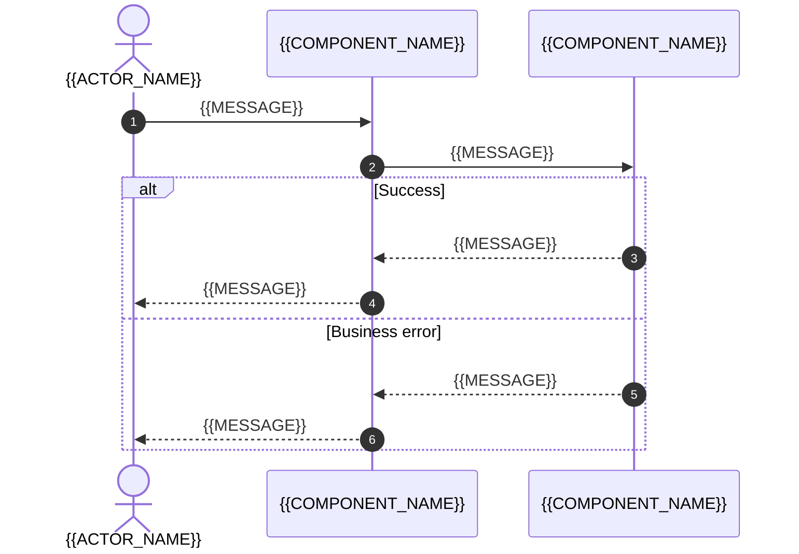
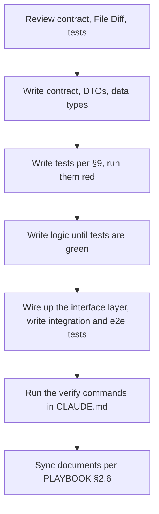

# Technical Specification: {{FEATURE_NAME}}

<!-- fill: Copy to docs/specs/SPEC_<FEATURE_KEY>.md. Add to parent the part of the SRS that holds the feature's FRs (SRS.md or SRS_MODULE_<NAME>.md) and the related ADRs. release is the release label in the Release column of SRS §6.1; every FR in §1.5 has a Release equal to release (CONVENTIONS §3, PLAYBOOK §2.4). The keywords MUST, MUST NOT, SHOULD, MAY follow RFC 2119 and RFC 8174. A section that does not apply keeps its heading and states N/A with a reason; do not delete it. The SPEC is an execution contract: the coding agent does only what is written here. The frontmatter assembled_from records the sources per CONVENTIONS §3. -->

## 1. Goal & Bounded Context

### 1.1. Technical Objective

- SPEC ID: `{{SPEC_ID}}`
- Risk level: <!-- fill: high or normal, with the reason in one sentence; edit the risk key in the frontmatter to match. high when the SPEC touches authentication or authorization, tenant isolation, money or quota, personal data, a schema that already holds data, or an approved public contract (CONVENTIONS §3) -->
- Objective: <!-- fill: what the feature does, for whom, in 2 to 4 sentences; name the main FR. -->

### 1.2. Core Invariants

<!-- fill: What MUST always hold under every condition, including concurrent or interleaved operations. Each invariant has at least one CONC test in §9. -->

| ID | Invariant | Proving test |
| --- | --- | --- |
| INV-01 | <!-- fill: a verifiable statement --> | TC-{{MODULE_CODE}}-CONC-01 |

### 1.3. Out of Scope

<!-- fill: what a reader might assume belongs to this feature but is not done here; one item per line, naming the SPEC or version that will do it, if any. -->

### 1.4. Dependencies

| Type | Dependency | Note |
| --- | --- | --- |
| Internal component | {{COMPONENT_NAME}} | <!-- fill: which interface is used --> |
| External system | {{EXTERNAL_SYSTEM}} | <!-- fill: or "None" --> |
| Data affected | <!-- fill: tables, collections, files per ARCHITECTURE §5 --> | <!-- fill: read or write --> |
| Dependent SPEC | <!-- fill: SPEC ID that must be done first, or "None" --> | <!-- fill --> |

### 1.5. Requirements Satisfied

| FR ID | AC ID | BR ID | NFR ID |
| --- | --- | --- | --- |
| FR-{{MODULE_CODE}}-001 | AC-{{MODULE_CODE}}-01 | <!-- fill: or "None" --> | <!-- fill: or "None" --> |

## 2. File Diff & Impact Tracking

> The coding agent MUST only modify or create files listed in this section. If another file is needed, stop and propose a SPEC change (PLAYBOOK §7). Paths match the directory tree in ARCHITECTURE §4.

### 2.1. Modified Files

| Path | Change |
| --- | --- |
| <!-- fill: path in inline code --> | <!-- fill: function, class or item to add or change --> |

### 2.2. New Files

| Path | Type | Responsibility |
| --- | --- | --- |
| <!-- fill: path in inline code --> | <!-- fill: choose one: source \| test \| migration \| config \| docs --> | <!-- fill --> |

### 2.3. MUST NOT Touch

| Path or scope | Reason |
| --- | --- |
| <!-- fill: files or directories that are easy to change by mistake, for example another module, shared configuration, a migration that has already run --> | <!-- fill --> |

## 3. Contract

The shape of the contract depends on the surface. Every error code used in this section MUST appear in ARCHITECTURE §7.1.

### Screen

<!-- fill: One table for each screen of the feature. With Stage 1W: the SCR ID row cites exactly the ID in the wireframe index and the Wireframe page row cites the screen's page; the SPEC only cites SCR-*, and does not redefine the screen, the layout or the components already on the wireframe page; the five-state table below matches the state table of the page and adds the execution behavior. Without Stage 1W: remove these two rows. -->

| Item | Value |
| --- | --- |
| SCR ID | {{SCR_ID}} |
| Wireframe page | `docs/wireframes/{{SCR_ID}}.md` |
| Route | `/{{ROUTE_PATH}}` |
| Actor and access condition | <!-- fill: roles allowed in; behavior when not logged in or without permission --> |
| Page title | String key <!-- fill --> |
| Navigation in | <!-- fill: from which screen, with which parameters --> |
| Navigation out | <!-- fill: after success, on cancel --> |
| Search indexing | <!-- fill: choose one: allowed \| not allowed (noindex) --> |

### Components & Props

| Component | Runs on | Props (name: type) | Responsibility |
| --- | --- | --- | --- |
| {{COMPONENT_NAME}} | <!-- fill: choose one: server \| client --> | <!-- fill --> | <!-- fill --> |

### UI States

<!-- fill: All five rows for each screen or independent data region; a state that does not apply is written N/A with a reason in the Display column. The AC column points to the acceptance criteria in SRS §8. -->

| State | Entry condition | Display | User action | AC |
| --- | --- | --- | --- | --- |
| `Initial` | <!-- fill --> | <!-- fill --> | <!-- fill --> | AC-{{MODULE_CODE}}-01 |
| `Loading` | <!-- fill --> | <!-- fill --> | <!-- fill --> | AC-{{MODULE_CODE}}-01 |
| `Empty` | <!-- fill --> | <!-- fill --> | <!-- fill --> | AC-{{MODULE_CODE}}-01 |
| `Success` | <!-- fill --> | <!-- fill --> | <!-- fill --> | AC-{{MODULE_CODE}}-01 |
| `Error` | <!-- fill --> | <!-- fill --> | <!-- fill --> | AC-{{MODULE_CODE}}-01 |

### Interaction States

| Element | State | Rule |
| --- | --- | --- |
| Submit button | Submitting | Locked and the label changes; a second click does not create a new request |
| Form | Result unknown (network error, timeout, `5xx`) | Fields are read-only; the only action is to resend the same content with the same key until a definitive response arrives |
| Input field | Has an error | Error border, message tied to the field through an accessibility attribute, focus moves to the first error field on submit (criteria in `specflow/CONVENTIONS.md` §10.2) |
| <!-- fill --> | <!-- fill --> | <!-- fill --> |

### Form & Validation

<!-- fill: One row for each field; copy the constraints from the request DTO in the API's SPEC and record the source SPEC in the last column. -->

| Field | Type | Constraints | String key of the error message | Constraint source |
| --- | --- | --- | --- | --- |
| <!-- fill --> | <!-- fill --> | <!-- fill --> | <!-- fill --> | <!-- fill: SPEC ID of the API, section §3 --> |

<!-- PROFILE-SLOT: spec.contract -->

### API Calls

| When called | Method and path | Source contract | Special headers | Success handling | Error handling |
| --- | --- | --- | --- | --- | --- |
| <!-- fill --> | <!-- fill: choose one: GET \| POST \| PATCH \| PUT \| DELETE; the path exactly as in the source contract --> `/api/v1/{{RESOURCE_PATH}}` | <!-- fill: SPEC ID and operationId in OpenAPI --> | <!-- fill: for example Idempotency-Key generated once for each submission --> | <!-- fill --> | Per the error mapping table below |

### Error to UI Mapping

<!-- fill: Every error code that the calls above can return (per the error matrix of the source SPEC) and the client-side codes; the codes are in ARCHITECTURE §7.1. -->

| `error.code` | UI state | String key of the message | Behavior |
| --- | --- | --- | --- |
| `VALIDATION_ERROR` | `Error` | <!-- fill --> | Errors under each field per `error.details` |
| `UNAUTHENTICATED` | `Error` | <!-- fill --> | Go to login, then return |
| `NETWORK_ERROR` | `Error` | <!-- fill --> | Allow retry with the same `Idempotency-Key` |
| <!-- fill: business code of the API --> | `Error` | <!-- fill --> | <!-- fill --> |

### i18n Keys

| Key | Content in the default locale |
| --- | --- |
| <!-- fill: in the form feature.element --> | <!-- fill --> |

## 4. Migration & Data

| Item | Content |
| --- | --- |
| Migration needed | <!-- fill: choose one: Yes \| No; if No, the rows below state N/A --> |
| Migration file | <!-- fill: path, must appear in §2.2 --> |
| Change (forward) | <!-- fill: tables, columns, indexes, constraints added or changed --> |
| Rollback | <!-- fill: how to reverse it, whether data is lost --> |
| Backfill of existing data | <!-- fill: how to fill data for existing records, when it runs, how it stays idempotent --> |
| Compatibility during gradual rollout | <!-- fill: whether old and new code versions can both run against the new schema --> |

## 5. Algorithm & Execution Flow

### 5.1. Sequence Diagram

<!-- fill: Show the main flow and the important error branches; participants are real components from ARCHITECTURE §3 and §4. -->

### 5.2. Processing Steps

<!-- fill: Numbered steps, one verifiable action per step. For a step that can fail, state the condition, the error code and the state of the data after the failure. -->

### 5.3. Transaction Boundary & Concurrency

| Item | Decision |
| --- | --- |
| Transaction boundary | <!-- fill: which steps are in the same transaction; "No transaction" with the reason if so --> |
| Isolation level | <!-- fill: the default level stated in the surface conventions in ARCHITECTURE §7; if another level is used, give the reason --> |
| Concurrency control | <!-- fill: how the §1.2 invariants are kept under parallel operations, for example a conditional atomic update, a row lock, an optimistic lock by version --> |
| Idempotency | <!-- fill: where the idempotency key comes from, where it is stored, the response on a duplicate key; a single mechanism --> |
| Post-commit tasks | <!-- fill: events or tasks that run only after the transaction succeeds --> |

## 6. Authorization Matrix

| Actor | Action | Expected result | Error code when blocked | Test |
| --- | --- | --- | --- | --- |
| `ACT_{{ROLE_CODE}}` | <!-- fill --> | <!-- fill: choose one: Allow \| Deny --> | <!-- fill: code from ARCHITECTURE §7.1, or N/A --> | <!-- fill: TC ID --> |

## 7. Event Contract

| Event | Payload (schema) | Emitted when | Consumer | Delivery guarantee | Version |
| --- | --- | --- | --- | --- | --- |
| `{{EVENT_NAME}}` | <!-- fill: field name, type, required; no sensitive personal data --> | <!-- fill --> | <!-- fill --> | <!-- fill: choose one: at-most-once \| at-least-once with an idempotent consumer --> | <!-- fill: for example v1 --> |

## 8. Observability

| Type | Name | Content | Level or threshold |
| --- | --- | --- | --- |
| Log | <!-- fill: log event name --> | <!-- fill: fields recorded with it, no data that is forbidden to log --> | <!-- fill: log level --> |
| Metric | <!-- fill --> | <!-- fill --> | <!-- fill --> |
| Audit | <!-- fill: action that needs an audit trail, or N/A --> | <!-- fill: who, did what, when, on which data --> | <!-- fill --> |
| Alert | <!-- fill: or N/A --> | <!-- fill --> | <!-- fill --> |

## 9. Tests

> The coding agent MUST write tests per this table before writing logic (TDD). Every AC in §1.5 has at least one TC; every invariant in §1.2 has at least one TC of type `CONC`; every NFR in §1.5 that SRS §8 verifies by Test has a TC that names that NFR in the "AC or INV" column, unless its TC already sits in another SPEC. TCs take the next number from `docs/INDEX.md` §3 (CONVENTIONS §4). The table records the exact file and name of each test; test names describe behavior in English and do not contain the TC ID (CONVENTIONS §4).

### 9.1. Required Tests

| TC ID | AC or INV | Type | Scenario (Given-When-Then) | Test file | Test name |
| --- | --- | --- | --- | --- | --- |
| TC-{{MODULE_CODE}}-UNIT-01 | AC-{{MODULE_CODE}}-01 | Unit | **Given:** <!-- fill --> **When:** <!-- fill --> **Then:** <!-- fill --> | <!-- fill: path, must appear in §2 --> | <!-- fill: test name that describes behavior --> |
| TC-{{MODULE_CODE}}-CONC-01 | INV-01 | Concurrency | **Given:** <!-- fill --> **When:** <!-- fill: concurrent or interleaved operations --> **Then:** <!-- fill: the invariant still holds, measurable --> | <!-- fill --> | <!-- fill --> |

### Surface Test Types

| Type | TYPE in the TC ID | Scope | Data | Required |
| --- | --- | --- | --- | :---: |
| Unit | `UNIT` | Form schema, formatting functions, hooks, components rendered in isolation | In memory | Yes |
| Integration | `INT` | The feature's components together with the real API client, with the API mocked at the network layer per the contract | Mock response that matches OpenAPI | Yes when the feature calls the API |
| E2E | `E2E` | User flows on the built app, in a real browser | API mocked at the network layer, or the staging environment API | Yes |
| Accessibility | `A11Y` | Automated scan at the WCAG level of NFR-USAB on every screen and main state | Same as E2E | Yes, for each screen |
| Visual regression | `VIS` | Screenshot compared with the approved baseline | Same as E2E, fixed data | Yes, for each screen in the `Success` state |
| Concurrency | `CONC` | The invariants in §1.2 when a write action is triggered repeatedly | Same as E2E | Yes, one test for each invariant in §1.2 |

### Concurrency Test Pattern

1. Open the screen on the built app; intercept the write call with a mock route that has enough delay for the second trigger to happen while the first request has not finished.
2. Trigger the write action repeatedly within one submission: double click, press Enter then click, or resend after a network error (the form must be locked for editing). The mock route that returns a network error must also have a delay, so that the second click lands while the first request has not ended.
3. Count the write requests sent and their `Idempotency-Key`; assert the invariant (one request for one submission, the same key on retry) and that the UI shows only one result.
4. Do not use sleep to order events; wait on the displayed state.

<!-- PROFILE-SLOT: spec.test-types -->

## 10. Rollout

| Item | Decision |
| --- | --- |
| Feature flag | <!-- fill: flag name per ARCHITECTURE §6.7, or "Not used" with the reason --> |
| Backward compatibility | <!-- fill: how old clients or versions are affected --> |
| Shutoff or rollback plan | <!-- fill: how to turn the feature off on an incident, how the data is handled --> |

## 11. Assumptions & Open Questions

| ID | Type | Content | Reason or impact | BLOCKING | Respondent |
| --- | --- | --- | --- | :---: | --- |
| AQ-01 | <!-- fill: choose one: Assumption \| Question --> | <!-- fill --> | <!-- fill --> | <!-- fill: choose one: Yes \| No --> | <!-- fill --> |

## 12. Execution Workflow & Definition of Done

Definition of Done of the SPEC:

- [ ] Every verify command in `CLAUDE.md` meets the pass condition of the verify command table (PLAYBOOK §11).
- [ ] 100% of the tests in §9 pass, in the exact files and names recorded in the table.
- [ ] Source code changes only in the files in §2; apart from that, only documents and the plan are updated per PLAYBOOK §2.6.
- [ ] No new dependency outside ARCHITECTURE §2 or an `accepted` ADR.
- [ ] Every error is returned in the ARCHITECTURE §6.2 envelope with a code from §7.1 (surfaces that have request/response).
- [ ] The SPEC moves to status `implemented`, the §9 table records the exact test file and test name, and the plan checkboxes are synced.

## 13. Version History

| Version | Date | Editor | Change | Reason and requester | Approver |
| --- | --- | --- | --- | --- | --- |
| 0.1.0 | {{DATE}} | {{AUTHOR}} | Initial version | Created by the pipeline | Not approved |
