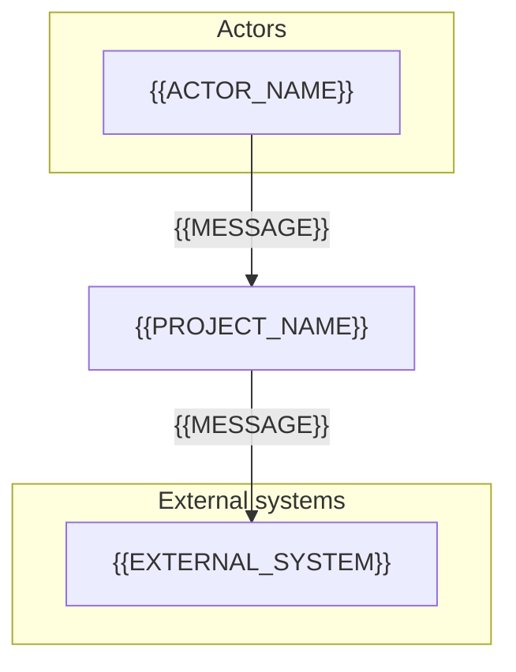
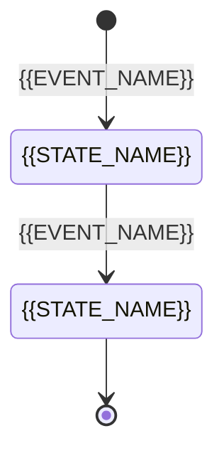

# Software Requirements Specification: {{PROJECT_NAME}}

<!-- fill: Copy to docs/srs/SRS.md (docs_mode monolithic) or docs/srs/00_SRS_MASTER.md (modular). Modular mode: the master keeps §1 to §5, §7, §9, §10 and the shared data model; each module gets one file docs/srs/SRS_MODULE_<NAME>.md that keeps §6 and §8 of that module, plus its own §9 and §10.2, frontmatter doc_type srs-module, parent pointing to the master. The frontmatter assembled_from records the sources per CONVENTIONS §3. Reference standards: ISO/IEC/IEEE 29148:2018 for the layout and the way requirements are written (mapped in §10.3), ISO/IEC 25010:2023 for the NFR groups; the rules for writing requirements are in CONVENTIONS §8. The SRS answers WHAT and does not choose technology; technology choices belong to ARCHITECTURE. -->

## 1. Introduction

### 1.1. Purpose

This document defines all functional requirements (FR), non-functional requirements (NFR), the logical data model, external interfaces and constraints of {{PROJECT_NAME}}. It is the Single Source of Truth for ARCHITECTURE, SPEC, the Implementation Plan, the source code and the test suite.

### 1.2. Scope

- Core goal: <!-- fill: 2 to 3 sentences on the problem and the value, consistent with Intake §2 -->
- In-scope modules:

| Module ID | Module code | Module name | Main capability | Surface |
| --- | --- | --- | --- | --- |
| {{MODULE_ID}} | `{{MODULE_CODE}}` | {{MODULE_NAME}} | <!-- fill --> | <!-- fill: overlay that serves the module --> |

- Out-of-scope for this version: <!-- fill: one line per capability or integration not built, with a short reason -->

### 1.3. Definitions & Abbreviations

| Term | Full name | Explanation in the project context |
| --- | --- | --- |
| `PII` | Personally Identifiable Information | Personal data under the law that applies per Intake §7 |
| `SLA` | Service Level Agreement | Commitment on the quality of the operated service (uptime, processing time) |
| `RPO`, `RTO` | Recovery Point Objective, Recovery Time Objective | The maximum amount of data that may be lost and the maximum time to recover after an incident |
| <!-- fill: business or technical terms that are easy to misunderstand; delete the generic rows above if unused --> | <!-- fill --> | <!-- fill --> |

### 1.4. References

1. ISO/IEC/IEEE 29148:2018, Systems and software engineering, Life cycle processes, Requirements engineering.
2. ISO/IEC 25010:2023, Systems and software engineering, Systems and software Quality Requirements and Evaluation (SQuaRE), Product quality model.
3. `docs/intake/PROJECT_INTAKE.md`.
4. <!-- fill: the standards in §2.7, business documents, legal regulations, related contracts; give the path or URL -->

### 1.5. Stakeholders

| Role | Main concern | Approval authority |
| --- | --- | --- |
| <!-- fill --> | <!-- fill --> | <!-- fill: which gate, taken from Intake §9; "No" if the role does not approve --> |

## 2. Overall Description

### 2.1. System Perspective

<!-- fill: standalone system or part of a larger system; the system boundary. The diagram shows every actor in §2.2 and every external system in Intake §8, and does not draw the components inside the system. -->



### 2.2. User Classes & Characteristics

| Actor ID | Role name | Skill level | Frequency of use | Business permissions |
| --- | --- | --- | --- | --- |
| `ACT_{{ROLE_CODE}}` | {{ACTOR_NAME}} | <!-- fill --> | <!-- fill --> | <!-- fill: what the actor may do and may not do --> |

### 2.3. Operating Environment

<!-- fill: where and with what users access the system, where the system runs, network conditions, time zone and user language. The technical details of each surface are in §2.5. -->

### 2.4. Business, Legal & Operational Constraints

| Type | Constraint | Source |
| --- | --- | --- |
| Business | <!-- fill: process, pricing policy, operating hours --> | <!-- fill --> |
| Legal | <!-- fill: from Intake §7 --> | <!-- fill --> |
| Operations | <!-- fill: normal operating mode, maintenance, degradation when a dependency fails; who does backup and recovery and when; maintenance window, operations team --> | <!-- fill --> |
| Memory Constraints | <!-- fill: limits on memory and storage capacity on the user device or the server; N/A with a reason if there is no significant limit --> | <!-- fill --> |
| Site Adaptation | <!-- fill: configuration that differs by environment, customer, data region or language; N/A with a reason if there is only one deployment site --> | <!-- fill --> |

### 2.5. Technical Constraints

Technical constraints per surface. Specific technologies and versions do not belong in the SRS; they are fixed in ARCHITECTURE.

#### Backend API

| Constraint | Content |
| --- | --- |
| Stack | Per the stack profile `{{STACK_PROFILE}}` chosen at Intake §14; specific versions in ARCHITECTURE §2 |
| Strict typing | A language with static type checking, strict mode on; specific rules in ARCHITECTURE and `.claude/rules/` |
| Transaction integrity | Every business operation that changes the state of two or more related records runs in one database transaction; the default isolation level is fixed in ARCHITECTURE §7; the SPEC states it explicitly when a higher level or a row lock is needed |
| Protocol | The API is served over HTTPS only; <!-- fill: minimum TLS version, for example TLS 1.2 --> |
| Time | Stored and transmitted in UTC, ISO 8601 format |
| Currency | <!-- fill: currency unit and exact representation; write N/A if the system does not handle money --> |

#### Frontend Web

| Constraint | Content |
| --- | --- |
| Stack | Per the stack profile `{{STACK_PROFILE}}` chosen at Intake §14; exact versions in ARCHITECTURE §2 |
| Strict typing | A language with static type checking, strict mode enabled; specific rules in ARCHITECTURE and `.claude/rules/` |
| Supported browsers | <!-- fill: list of browsers and minimum versions, for example the two latest versions of Chrome, Edge, Firefox, Safari; Safari on iOS from a specific version --> |
| Devices and breakpoints | <!-- fill: the smallest screen width that must be usable (for example 360 px) and the breakpoints where the layout changes --> |
| Accessibility | Comply with WCAG 2.2 level {{WCAG_LEVEL}} per NFR-USAB |
| Perceived performance | <!-- fill: Core Web Vitals thresholds at the 75th percentile, for example LCP ≤ 2.5 s, INP ≤ 200 ms, CLS ≤ 0.1; the device and network used to measure --> |
| Protocol | Pages and API calls over HTTPS only |
| Source of truth | Prices, amounts, permissions and business status are displayed from the data the API returns; the UI does not compute these values and then send them up |
| Browser-side storage | Do not store tokens, secrets or personal data in `localStorage` or `sessionStorage` |
| Time and currency | Received from the API in UTC and ISO 8601; display format follows the user's locale |

### 2.6. Dependencies

| Dependency | Type | Required commitment (SLA) | Impact when unavailable |
| --- | --- | --- | --- |
| {{EXTERNAL_SYSTEM}} | <!-- fill: choose one: external service \| internal system \| data \| people --> | <!-- fill --> | <!-- fill --> |

### 2.7. Standards Compliance

<!-- fill: Technical standards, industry standards or contract standards that the product MUST meet, for example OWASP ASVS 5.0 (level L1, L2 or L3) for security, WCAG 2.2 (level A, AA or AAA) for accessibility, PCI DSS when processing payment cards. Laws and legal regulations go in §2.4 and NFR-LEGAL. The matching NFR in §7 points back to the row here. Write one N/A row with a reason if there is no standard. -->

| Standard | Scope of application | Level or version | Verification method | Related NFR |
| --- | --- | --- | --- | --- |
| <!-- fill --> | <!-- fill: module or surface --> | <!-- fill --> | <!-- fill: choose one: Test \| Inspection \| Demo \| Analysis --> | <!-- fill: NFR ID --> |

## 3. External Interface Requirements

The external interface types follow ISO/IEC/IEEE 29148 §9.6.4. A type that does not apply is written as N/A with a reason; a type that applies has a detail section right below the table.

| Interface type | Applies | Summary |
| --- | --- | --- |
| System Interfaces | <!-- fill: choose one: Yes \| N/A: reason. Yes when the product is part of a larger system; name that system and the share of work of each side --> | <!-- fill --> |
| User Interfaces | <!-- fill: choose one: Yes \| N/A: reason --> | <!-- fill --> |
| Hardware Interfaces | <!-- fill: choose one: Yes \| N/A: reason --> | <!-- fill --> |
| Software Interfaces | <!-- fill: choose one: Yes \| N/A: reason --> | <!-- fill --> |
| Communications Interfaces | <!-- fill: choose one: Yes \| N/A: reason --> | <!-- fill --> |
| Interfaces with Services | <!-- fill: choose one: Yes \| N/A: reason. Shared services that the product relies on, for example identity, notification, payment, file storage --> | <!-- fill --> |

### Backend API

#### Software Interfaces

<!-- fill: Keep the rows that apply, write "No" in the Applies column of the remaining rows instead of deleting them. -->

| System | Purpose | Protocol and format | Authentication and safety | Applies |
| --- | --- | --- | --- | :---: |
| API client (web app, mobile app, other system) | Calls the business functions of the system | REST, JSON, HTTPS | Bearer token per ARCHITECTURE §6.1 | <!-- fill: choose one: Yes \| No --> |
| Third-party API (other than the email, SMS and identity in the rows below) | <!-- fill: which service, doing what --> | <!-- fill --> | <!-- fill: API key, OAuth client credentials --> | <!-- fill: choose one: Yes \| No --> |
| Incoming webhook | <!-- fill: sender, event --> | HTTPS POST, JSON | Signature verification (for example HMAC-SHA256 over the raw body), replay protection by timestamp, idempotent handling by the sender's event ID | <!-- fill: choose one: Yes \| No --> |
| Object storage | <!-- fill: which files are stored --> | S3-compatible API, pre-signed URL with an expiry | Private bucket, signed URL with a short expiry | <!-- fill: choose one: Yes \| No --> |
| Email or SMS | <!-- fill: which notifications --> | Provider API | API key in a secret manager | <!-- fill: choose one: Yes \| No --> |
| Identity provider | Federated sign-in | OpenID Connect over OAuth 2.0, Authorization Code with PKCE | Check `state`, `nonce`, audience | <!-- fill: choose one: Yes \| No --> |

#### Communications Interfaces

| Channel | Convention | Applies |
| --- | --- | :---: |
| REST API | JSON UTF-8, lowercase `kebab-case` URIs, major version in the path; details in ARCHITECTURE §7 | Yes |
| Real time | WebSocket over TLS (WSS) with heartbeat ping/pong and client auto-reconnect with exponential backoff | <!-- fill: choose one: Yes \| No --> |
| Queue or event bus | <!-- fill: used for internal events or for integration; write No if not used --> | <!-- fill: choose one: Yes \| No --> |

User Interfaces and Hardware Interfaces: N/A for the `backend-api` surface; user interfaces belong to the overlay of the client surface if the project has one.

### Frontend Web

#### User Interfaces

<!-- fill: One row for each screen; this table is the only source of the screen list. The SCR ID as SCR-<MOD>-NN is assigned here (CONVENTIONS §4), MOD is the code of the module that owns the main FR of the screen, NN is unique per MOD across the whole project; Stage 1W elaborates each SCR ID into one wireframe page, without assigning more IDs. Brownfield project: a screen that does not change per the Gap Analysis records Unchanged in the SCR ID cell. Route is the page path; FR is the requirement that the screen implements. -->

| Screen | SCR ID | Route | Actor | Purpose | FR |
| --- | --- | --- | --- | --- | --- |
| <!-- fill --> | {{SCR_ID}} | `/{{ROUTE_PATH}}` | `ACT_{{ROLE_CODE}}` | <!-- fill --> | FR-{{MODULE_CODE}}-001 |

General requirements for every screen:

- The five UI states: each screen and each independent data region on a screen has all of `Initial` (before the user acts or before loading), `Loading` (waiting for data or submitting), `Empty` (loaded but no data), `Success` (has data or the action succeeded), `Error` (an error, with a way to recover). A state that does not apply is written N/A with a reason; with Stage 1W, write it on the screen's wireframe page (§4) and the SPEC takes it over; without Stage 1W, write it directly in the SPEC.
- Responsive per the breakpoints in §2.5; no horizontal scroll at the smallest width.
- Accessibility per §2.5: each screen meets the WCAG 2.2 criteria at the level of NFR-USAB; the criteria are examined per screen when drawing the wireframe per `specflow/CONVENTIONS.md` §10.2.
- Every display string comes from the string bundle by locale; default locale <!-- fill: for example en-US -->.

#### Software Interfaces

<!-- fill: Keep the rows that apply, write "No" in the Applies column of the other rows instead of deleting them. -->

| System | Purpose | Protocol and format | Authentication and safety | Applies |
| --- | --- | --- | --- | :---: |
| Backend API | <!-- fill: name of the API and the contract document (SPEC, OpenAPI) that the UI calls --> | REST, JSON, HTTPS | <!-- fill: login session mechanism, decided in ARCHITECTURE §6.1 --> | <!-- fill: choose one: Yes \| No --> |
| Identity provider | Federated login | OpenID Connect on OAuth 2.0, Authorization Code with PKCE | Check `state`, `nonce`, audience | <!-- fill: choose one: Yes \| No --> |
| Analytics | <!-- fill: which events are sent --> | <!-- fill --> | Send only after the user consents; do not send personal data | <!-- fill: choose one: Yes \| No --> |
| Browser-side error tracking | <!-- fill: the service that receives JavaScript errors --> | <!-- fill --> | Mask personal data before sending | <!-- fill: choose one: Yes \| No --> |

#### Communications Interfaces

| Channel | Convention | Applies |
| --- | --- | :---: |
| HTTPS to the API | JSON UTF-8; errors per the API's envelope; timeout and retry per ARCHITECTURE §7 | Yes |
| Real time | <!-- fill: choose one: WebSocket over TLS (WSS) \| Server-Sent Events; if not used, replace the whole cell with Not needed --> with automatic reconnect using exponential backoff | <!-- fill: choose one: Yes \| No --> |

Hardware Interfaces: N/A for the `frontend-web` surface; the browser is the intermediary layer to the device.

## 4. Data Requirements

### 4.1. Logical Data Model

#### Backend API

##### Logical ERD

<!-- fill: Every business entity and relationship, Crow's foot notation; entity names UPPER_SNAKE singular, attributes snake_case. Record only the core attributes, the logical type (uuid, string, decimal, int, timestamp, enum) and the key role (PK, FK, UK). Enum names and value sets MUST match §4.2 and §10.1. -->

```mermaid
erDiagram
    {{ENTITY_NAME}} ||--o{ {{ENTITY_NAME}} : "{{MESSAGE}}"
    {{ENTITY_NAME}} {
        uuid id PK "Primary key"
        timestamp created_at "Creation time, UTC"
        timestamp updated_at "Last update time, UTC"
    }
```

<!-- fill: When filling §4.2 and §4.3, consider each point fully and record the decision in the right section: history, financial and audit-log tables are append-only; an entity whose child data carries financial or legal constraints is soft-deleted with a deleted_at column, hard delete is forbidden, and the default query behavior for soft-deleted records is stated; time-dependent values (price, rate, configuration) are captured into the transaction record; arithmetic rules are written in inline code, matching the column names; natural unique keys and composite unique keys; finite value domains are listed in full, an entity with a lifecycle has a state machine in §10.1. -->

#### Frontend Web

##### View Model

<!-- fill: This surface owns no persistent data; business entities, the ERD and integrity rules belong to the SRS of the API it calls. Each view model takes its fields from the response of one endpoint, keeping the field names exactly as in the response (including in §4.2, without converting to snake_case); do not add fields that the API does not return. Display data that must be kept after its source is deleted (for example the product name of an order just placed when the cart has been cleared) records the snapshot source explicitly. §4.2 lists view models and client-side state as entities; §4.3 records the display and client-side storage rules. -->

| View model | Source (endpoint and FR of the API) | Displayed fields | Display format |
| --- | --- | --- | --- |
| {{ENTITY_NAME}} | <!-- fill --> | <!-- fill --> | <!-- fill: for example currency per locale, time in the user's time zone --> |

##### Client State

| State | Type | Lifecycle | Where it is held | Contains personal data |
| --- | --- | --- | --- | :---: |
| <!-- fill --> | <!-- fill: choose one: server data \| form state \| URL state \| UI state --> | <!-- fill: when created, when cleared --> | <!-- fill: memory, URL, cookie; do not use localStorage for sensitive data --> | <!-- fill: choose one: Yes \| No --> |

### 4.2. Data Dictionary

| Entity | Business description | Core attributes | Constraints and integrity | Data classification |
| --- | --- | --- | --- | --- |
| <!-- fill: entity name, matching the model in §4.1 --> | <!-- fill --> | <!-- fill: attribute names in English snake_case --> | <!-- fill: keys, uniqueness, value domain, deletion rule --> | <!-- fill: choose one: public \| internal \| personal data \| sensitive personal data \| financial --> |

### 4.3. Data Integrity Rules

<!-- fill: one numbered line per rule, with a name and verifiable content. Consider at least: data that is immutable once written (history, financial, audit log); the deletion policy (soft delete or hard delete, child data when parent data is deleted); arithmetic rules written in inline code, for example `total = Σ line_amount`; business uniqueness; time zone and time format. -->

## 5. Business Rules

| BR ID | Rule | Source | Related FR | Verification method |
| --- | --- | --- | --- | --- |
| BR-001 | <!-- fill: state one rule, measurable, unambiguous --> | <!-- fill: the person, document or law that sets the rule --> | FR-{{MODULE_CODE}}-001 | <!-- fill: choose one: Test \| Inspection \| Demo \| Analysis --> |

## 6. Functional Requirements

### 6.1. Functional Requirements Catalog

<!-- fill: The catalog table holds the requirement statement; the attribute table right below holds the attributes per ISO/IEC/IEEE 29148 §5.2.8, in the same FR ID order. Each statement follows one EARS pattern in CONVENTIONS §8: the subject is the system or the module, exactly one MUST or MUST NOT, one verifiable behavior, no vague term from CONVENTIONS §8. Secondary behavior goes into the use case §6.2 or a Business Rule §5. The release apportions requirements per 29148 §9.6.9. -->

| FR ID | Module | Function name | Requirement statement | Primary actor | Priority (MoSCoW) | Release | Verification method |
| --- | --- | --- | --- | --- | --- | --- | --- |
| FR-{{MODULE_CODE}}-001 | {{MODULE_ID}} | <!-- fill: short name --> | <!-- fill: one sentence following an EARS pattern --> | `ACT_{{ROLE_CODE}}` | <!-- fill: choose one: Must \| Should \| Could \| Won't --> | <!-- fill: release label, for example R1 --> | <!-- fill: choose one: Test \| Inspection \| Demo \| Analysis --> |

| FR ID | Prerequisite | Rationale | Source | Risk |
| --- | --- | --- | --- | --- |
| FR-{{MODULE_CODE}}-001 | <!-- fill: another FR ID or None --> | <!-- fill: why it is needed --> | <!-- fill: the GOAL-NN of the Intake that the FR serves; the stakeholder or document when the FR does not directly serve any goal --> | <!-- fill: choose one: High \| Medium \| Low --> |

### 6.2. Use Case Specification

<!-- fill: Each FR with priority Must has one use case following the template below; other FRs may have only the line in §6.1. Copy the template for each use case and keep all 7 items. -->

#### Use case FR-{{MODULE_CODE}}-001: {{FEATURE_NAME}}

- Primary actor: `ACT_{{ROLE_CODE}}`
- Business goal: <!-- fill -->
- Business rules that apply: <!-- fill: BR ID -->

1. Pre-conditions: <!-- fill: the system state and the actor's permissions before the start -->
2. Main Flow: <!-- fill: numbered steps; each step is one action of the actor or one response of the system; do not describe technology -->
3. Alternative Flows: <!-- fill: numbered by the branching step, for example "3a"; write N/A if none -->
4. Exception Flows: <!-- fill: each exception has the step where it arises, the condition, the system response, an error code in the form {{HTTP_OR_DOMAIN_ERROR}}, and the data state after the error. Use the shared codes VALIDATION_ERROR, UNAUTHENTICATED, FORBIDDEN, RATE_LIMITED, INTERNAL_ERROR when they fit; name a new business code in UPPER_SNAKE and record it in §6.3. Stage 2 moves every error code of the SRS into the Error Code Registry in ARCHITECTURE §7.1 -->
5. Post-conditions: <!-- fill: the data and system state on success -->
6. Related non-functional requirements: <!-- fill: NFR ID -->
7. Acceptance criteria: see §8.

### 6.3. Error Codes Used

<!-- fill: List every error code that appears in the use cases in §6.2. Stage 2 moves this whole table into the Error Code Registry in ARCHITECTURE §7.1. -->

| Error code | Meaning | Use case |
| --- | --- | --- |
| <!-- fill: UPPER_SNAKE --> | <!-- fill --> | FR-{{MODULE_CODE}}-001 |

## 7. Non-Functional Requirements

<!-- fill: Each group has at least one NFR or one N/A row: the Requirement cell starts with "N/A:" followed by a reason, and the measurement cells are N/A. The Requirement cell is a short label; each applicable NFR has a metric, a way to measure and a numeric threshold, uses no vague term from CONVENTIONS §8, and has one row in the NFR table of §8. The groups map to ISO/IEC 25010:2023 per CONVENTIONS §8; add an NFR in a group with the next number. The Source column points to a GOAL-NN when the NFR serves a goal of the Intake. -->

| NFR ID | Group | Requirement | Metric | Measurement method | Threshold | Verification method | Priority | Source |
| --- | --- | --- | --- | --- | --- | --- | --- | --- |
| NFR-PERF-01 | Performance | <!-- fill: latency, throughput, resource usage --> | <!-- fill --> | <!-- fill --> | <!-- fill: for example p95 ≤ a number + unit --> | <!-- fill: choose one: Test \| Inspection \| Demo \| Analysis --> | <!-- fill: choose one: Must \| Should \| Could --> | <!-- fill --> |
| NFR-PERF-02 | Performance | Capacity <!-- fill: concurrent users, data volume, taken from Intake §5; the Source column points to a GOAL-NN if there is a load goal --> | <!-- fill --> | <!-- fill --> | <!-- fill --> | <!-- fill: choose one: Test \| Inspection \| Demo \| Analysis --> | <!-- fill: choose one: Must \| Should \| Could --> | Intake §5 |
| NFR-SEC-01 | Security | <!-- fill: credential protection, authorization, rate limiting, injection prevention; point to the standard level in §2.7 if any. Specific algorithms and parameters belong to ARCHITECTURE --> | <!-- fill --> | <!-- fill --> | <!-- fill --> | <!-- fill: choose one: Test \| Inspection \| Demo \| Analysis --> | <!-- fill: choose one: Must \| Should \| Could --> | <!-- fill --> |
| NFR-RELI-01 | Reliability | <!-- fill: uptime, RPO, RTO --> | <!-- fill --> | <!-- fill --> | <!-- fill --> | <!-- fill: choose one: Test \| Inspection \| Demo \| Analysis --> | <!-- fill: choose one: Must \| Should \| Could --> | <!-- fill --> |
| NFR-MAINT-01 | Maintainability | Test coverage of the business logic | Percentage of lines covered by tests | Coverage report in CI | ≥ {{COVERAGE_THRESHOLD}}% | <!-- fill: choose one: Test \| Inspection \| Demo \| Analysis --> | <!-- fill: choose one: Must \| Should \| Could --> | <!-- fill --> |
| NFR-USAB-01 | Interaction Capability and accessibility | Conformance with WCAG 2.2 level {{WCAG_LEVEL}} <!-- fill: write N/A with a reason if there is no user interface --> | <!-- fill --> | <!-- fill --> | <!-- fill --> | <!-- fill: choose one: Test \| Inspection \| Demo \| Analysis --> | <!-- fill: choose one: Must \| Should \| Could --> | <!-- fill --> |
| NFR-FLEX-01 | Flexibility | <!-- fill: scaling with load, installation and reconfiguration in another environment, replacing components; N/A with a reason if there is no requirement --> | <!-- fill --> | <!-- fill --> | <!-- fill --> | <!-- fill: choose one: Test \| Inspection \| Demo \| Analysis --> | <!-- fill: choose one: Must \| Should \| Could --> | <!-- fill --> |
| NFR-SAFE-01 | Safety | <!-- fill: fail-safe behavior, hazard warnings, limits on operations that can harm people or data; N/A with a reason if there is no hazard --> | <!-- fill --> | <!-- fill --> | <!-- fill --> | <!-- fill: choose one: Test \| Inspection \| Demo \| Analysis --> | <!-- fill: choose one: Must \| Should \| Could --> | <!-- fill --> |
| NFR-I18N-01 | Internationalization | <!-- fill: languages, number, currency and date formats --> | <!-- fill --> | <!-- fill --> | <!-- fill --> | <!-- fill: choose one: Test \| Inspection \| Demo \| Analysis --> | <!-- fill: choose one: Must \| Should \| Could --> | <!-- fill --> |
| NFR-LEGAL-01 | Legal | <!-- fill: from Intake §7 --> | <!-- fill --> | <!-- fill --> | <!-- fill --> | <!-- fill: choose one: Test \| Inspection \| Demo \| Analysis --> | <!-- fill: choose one: Must \| Should \| Could --> | <!-- fill --> |
| NFR-OBS-01 | Observability and audit | <!-- fill: logs, audit trail, retention period --> | <!-- fill --> | <!-- fill --> | <!-- fill --> | <!-- fill: choose one: Test \| Inspection \| Demo \| Analysis --> | <!-- fill: choose one: Must \| Should \| Could --> | <!-- fill --> |
| NFR-DATA-01 | Data | <!-- fill: retention period, deletion on request, backup --> | <!-- fill --> | <!-- fill --> | <!-- fill --> | <!-- fill: choose one: Test \| Inspection \| Demo \| Analysis --> | <!-- fill: choose one: Must \| Should \| Could --> | <!-- fill --> |
| NFR-COMPAT-01 | Compatibility | <!-- fill: client versions, old API, platforms --> | <!-- fill --> | <!-- fill --> | <!-- fill --> | <!-- fill: choose one: Test \| Inspection \| Demo \| Analysis --> | <!-- fill: choose one: Must \| Should \| Could --> | <!-- fill --> |
| NFR-COST-01 | Operating cost | <!-- fill: infrastructure budget or cost per use; N/A if unconstrained --> | <!-- fill --> | <!-- fill --> | <!-- fill --> | <!-- fill: choose one: Test \| Inspection \| Demo \| Analysis --> | <!-- fill: choose one: Must \| Should \| Could --> | <!-- fill --> |

## 8. Traceability & Acceptance Matrix

<!-- fill: First table: each FR has at least one AC. The TC is not written here: the TC is in SPEC §9, and the AC-to-TC lookup table is in docs/INDEX.md §5 (CONVENTIONS §4). An important exception of a use case needs its own AC. Second table: each NFR that applies in §7 has one row; the last column records the evidence and where it is kept when verified by Inspection, Demo, Analysis, and records `Test in SPEC §9` when verified by Test. -->

| FR ID | AC ID | Acceptance scenario (Given-When-Then) |
| --- | --- | --- |
| FR-{{MODULE_CODE}}-001 | AC-{{MODULE_CODE}}-01 | **Given:** <!-- fill --><br>**When:** <!-- fill --><br>**Then:** <!-- fill: measurable result, including the data state --> |

| NFR ID | Verification method | Evidence |
| --- | --- | --- |
| NFR-PERF-01 | <!-- fill: matches the Verification method column in §7 --> | <!-- fill: evidence and where it is kept, or `Test in SPEC §9` --> |

## 9. Assumptions & Open Questions

<!-- fill: At the approval of Gate 1, the requirement set is complete per ISO/IEC/IEEE 29148 §5.2.6: no BLOCKING question remains, no TBD remains in an FR, NFR or BR; the remaining assumptions state the impact if they are wrong. -->

| ID | Type | Content | Reason or impact | BLOCKING | Respondent |
| --- | --- | --- | --- | :---: | --- |
| AQ-01 | <!-- fill: choose one: Assumption \| Question --> | <!-- fill --> | <!-- fill --> | <!-- fill: choose one: Yes \| No --> | <!-- fill --> |

## 10. Appendices

### 10.1. State Machine

<!-- fill: One diagram for each entity that has a lifecycle; the set of states MUST match the value domain in §4.2 and the schema in ARCHITECTURE §5. Write N/A if no entity has a lifecycle. -->



### 10.2. Version History

| Version | Date | Author | Change | Reason and requester | Approver |
| --- | --- | --- | --- | --- | --- |
| 0.1.0 | {{DATE}} | {{AUTHOR}} | Initial version | Created by the pipeline | Not approved |

### 10.3. Standards Mapping

The table maps the sections of ISO/IEC/IEEE 29148:2018 §9.6 to this document. A section that the project does not apply is written as N/A with a reason at the matching section of the document; do not delete the row here.

| 29148:2018 | Content | Section in the SRS |
| --- | --- | --- |
| 9.6.2, 9.6.3 | Purpose, Scope | §1.1, §1.2 |
| 9.6.4 | Product perspective | §2.1 |
| 9.6.4.1 to 9.6.4.5, 9.6.4.9 | System, User, Hardware, Software, Communications Interfaces, Interfaces with Services | §3 |
| 9.6.4.6 | Memory constraints | §2.4 |
| 9.6.4.7 | Operations | §2.4 |
| 9.6.4.8 | Site adaptation requirements | §2.4 |
| 9.6.5 | Product functions | §1.2, §6.1 |
| 9.6.6 | User characteristics | §2.2 |
| 9.6.7 | Limitations | §2.4, §2.5 |
| 9.6.8 | Assumptions and dependencies | §2.6, §9 |
| 9.6.9 | Apportioning of requirements | §6.1, Release column |
| 9.6.10 | Specified requirements: requirements have a unique ID, are cross-referenceable, and meet the characteristics of 29148 §5.2 | §4 to §7; writing per CONVENTIONS §8 |
| 9.6.11 | External interfaces | §3 |
| 9.6.12 | Functions | §5, §6 |
| 9.6.13 | Usability requirements | §7, NFR-USAB |
| 9.6.14 | Performance requirements | §7, NFR-PERF |
| 9.6.15 | Logical database requirements | §4 |
| 9.6.16 | Design constraints | §2.5 |
| 9.6.17 | Standards compliance | §2.7 |
| 9.6.18 | Software system attributes | §7, groups RELI, SEC, MAINT, FLEX, SAFE, COMPAT |
| 9.6.19 | Verification | Verification method column in §5, §6.1, §7; §8 |
| 9.6.20 | Supporting information | §10 |
